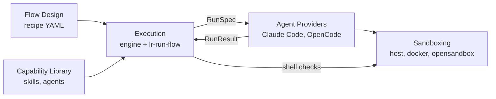

<div align="center">

<picture>
  <source media="(prefers-color-scheme: dark)" srcset="docs/branding/lamproom/lamproom-tower-animated-on-dark.svg">
  
</picture>

# Lamproom

**A local-first control room for the AI coding agents you already run.**

[](https://nodejs.org)
[](https://nextjs.org)
[](#status)

[Features](#features) • [Getting started](#getting-started) • [How it works](#how-it-works) • [Sandboxing](#sandboxing) • [Docs](#docs)

</div>

Lamproom turns running coding agents from *babysitting a terminal* into *operating a board*. You write a **flow**, a
recipe of steps such as research, plan, build, and review. Lamproom runs each step as a headless agent session or a
shell check, routes on the result, loops failed work back for rework, and stops for you when a decision is yours. It
runs on your machine, over your repositories, for one developer.

## Features

- **Flows as recipes.** A flow is a YAML graph of agent steps and shell checks, wired by routes that fire `always`,
  `on_pass`, or `on_fail`. Steps fan out, join, and loop back for rework, up to a safe `max_attempts`.
- **A visual flow designer.** Draw and edit flows at `/flows` with live validation. Saving changes only the lines whose
  meaning changed, so hand-written comments survive.
- **You stay in charge.** Approval gates, questions from agents, spent rework loops, and failed runs all stop at a gate
  for you. Nothing fails a task except you.
- **Cost you can see.** A `budget_usd` ceiling on every flow, a monthly cap per project, and a *wasted spend* figure for
  runs that rework or failures threw away.
- **Provider-agnostic.** Every model call goes through an agent CLI behind one seam: Claude Code (your own `claude`
  login) and OpenCode (OpenRouter or local Ollama models) today.
- **Sandboxed by default.** A project's trust level sets the floor: Trusted runs on your machine with approvals, Normal
  runs each step in a Docker container, and Untrusted adds gVisor.
- **Projects and workspaces.** Clone a repo from GitHub, let an analyst agent study it, and run each task in its own git
  worktree on branch `lr/task-<id>`.
- **Desktop app.** The same app in an Electron window.

## Getting started

### Prerequisites

- [Node.js](https://nodejs.org) 24 and [pnpm](https://pnpm.io) 10
- [git](https://git-scm.com), and the [GitHub CLI](https://cli.github.com) to clone projects
- [Claude Code](https://docs.anthropic.com/en/docs/claude-code), signed in with `claude` (Lamproom uses your login, not
  an API key)
- [Docker](https://www.docker.com), for Normal and Untrusted projects

### Install and run

```bash
git clone git@github.com:ClearCloudSoftware/flowboard.git lamproom
cd lamproom/code/lamproom
pnpm install
pnpm dev
```

Open [http://localhost:3000](http://localhost:3000). To use the desktop app instead, run `pnpm electron:dev`.

> [!NOTE]
> The flows API answers only on `localhost`, `127.0.0.1`, or `[::1]`. Lamproom is single-user and has no accounts.

### Run a flow from the terminal

Check a recipe, then run it on a folder with a task file:

```bash
pnpm lr-run-flow --check flows/review-loop.yaml
pnpm lr-run-flow --folder <repo> --task <task.md> flows/review-loop.yaml
```

A valid flow prints `-- flow ok: 2 steps, starting at implement`. Each run writes its state, logs, and a pinned copy of
the flow to `runs/<stamp>-<name>/`, and `pnpm lr-run-flow --resume <run folder>` picks it up again. You can also start
runs from the **New run** sheet at `/runs`.

## How it works

A **task** moves through a **flow**. Each step runs with a fresh context, so steps hand off through declared files: a
step that `produces: [plan]` writes it, and a later step that `requires: [plan]` reads it first.

```yaml
# flows/review-loop.yaml: a reviewer sends the work back until the review passes.
budget_usd: 6
entry: implement
defaults: { adapter: claude-code, model: sonnet, limits: { max_turns: 30 } }
steps:
  implement: { prompt: prompts/implement.md, produces: [notes], max_attempts: 3 }
  review:
    prompt: prompts/review.md
    requires: [notes]
    produces: [review_notes]
    guards: { deny_paths: ["src/**", "tests/**"] }   # it reports issues; it doesn't fix them
edges:
  - { from: implement, to: review }
  - { from: review, to: implement, condition: on_fail }
```



Three rules hold everywhere:

1. **Only a work outcome picks the next route.** A rate limit or a crash is never a `fail`.
2. **A missing outcome is never a pass.** A step that reports nothing waits at a gate.
3. **A spent or stuck rework loop escalates to you.** It never fails the task on its own.

## Sandboxing

Each project has a trust level, and a flow's `sandbox:` key can only keep it or make it stricter.

| Trust     | Where a step runs                                              |
| --------- | -------------------------------------------------------------- |
| Trusted   | On your machine, with approvals                                |
| Normal    | A throwaway Docker container per step (`lamproom-cli` image)   |
| Untrusted | The same under gVisor (`runsc`), with only the agents' keys     |

Build the images before the first Normal or Untrusted run; see [`code/lamproom/docker/README.md`](code/lamproom/docker/README.md).

> [!WARNING]
> Docker containers have no egress proxy yet, so an AI step can reach the network and its keys are inside the box. For
> an egress allowlist and a credential vault, use `runtime: opensandbox`.

> [!IMPORTANT]
> gVisor isn't available on macOS, so Untrusted projects are refused there.

## Development

Run these from `code/lamproom`:

| Command                   | What it does                                  |
| ------------------------- | --------------------------------------------- |
| `pnpm dev`                | The web app on `next dev`                     |
| `pnpm electron:dev`       | The desktop app on `next dev`                 |
| `pnpm test:app`           | The app's unit tests                          |
| `pnpm test:packages`      | The packages' tests, with no live runs        |
| `pnpm typecheck:packages` | Typechecks the packages                       |
| `pnpm lint`               | ESLint                                        |
| `pnpm build`              | The production build, which also typechecks the app |

> [!CAUTION]
> `pnpm test:live` runs real agents and costs money.

The code lives in [`code/lamproom`](code/lamproom): the flow engine, agent providers, and CLI commands in `packages/`,
and the Next.js app in `app/`.

## Status

Early and moving fast. Much of Lamproom is designed further than it's built; each component's notes mark what is built
and when. The project was called FlowBoard until 2026-11-16; [`code/lamproom/README.md`](code/lamproom/README.md#renamed-from-flowboard)
lists how to move an existing setup.

## Docs

- **[Running agent work](docs/Lamproom/Running%20Agent%20Work.md)**: flows, execution, providers, capabilities, and
  sandboxing on one page. The app also renders it at `/docs`.
- **[Component notes](docs/Lamproom/)**: an Obsidian vault with a folder per component.
- **[Feature map](docs/feature-map.md)**: a plain-English tour of every component.
- **[Mockups](docs/mockups/)**: clickable screens built ahead of the code.
