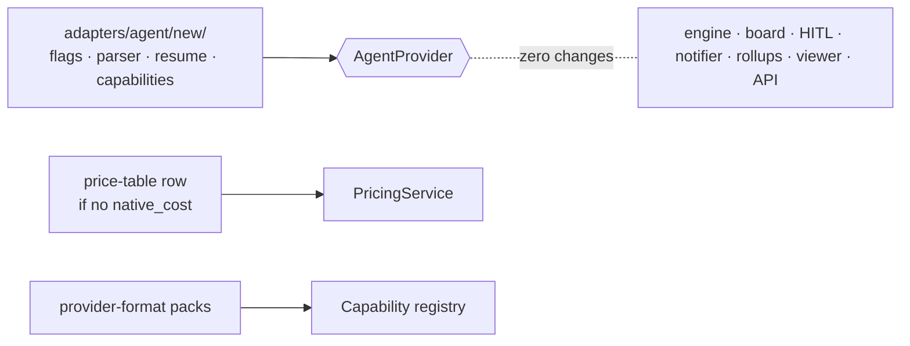

# Adding A Provider

`06` calls this *"The acceptance test for the whole genericization program."*

## The checklist

> *"Adding **Codex** should require only:*
> *1. `adapters/agent/codex/` — implement `AgentProvider`: flag mapping, stream parser → `NormalizedEvent`, session/resume, `capabilities` set (likely without `native_cost`, maybe without `plugins`).*
> *2. A `(codex, model) → rates` row in the price table (12), because `native_cost` is absent.*
> *3. Codex-format `CapabilityPack`s for any skills used by flows targeting it (13).*
> *4. Zero changes to: engine, board projection, HITL protocol, notifier, cost rollups, viewer, API.*
>
> *If step 4 isn't true, the abstraction leaked — trace it back to a port and push the provider knowledge down."* — `06`, *Where a new provider actually touches the codebase*

## What else a provider needs (from other sources)

| Item | Source |
|---|---|
| A composition-root change: *"Swapping Claude for Codex means constructing a different `provider` in the composition root and nothing here changes."* | `07` |
| A captured native stream to write the parser against, kept as raw lines | PRD §0; `01-ports.md` |
| A logical → native model table for `resolveModel` | `01-ports.md` |
| An egress allowlist entry and credential injection (drawio: *"api.openai.com (later)"*) | drawio *Harness architecture* |
| The CLI in the sandbox image (*"claude CLI · codex CLI"*) | drawio *Harness architecture* |
| Before any of it: check whether ACP covers it | `01-ports.md`; [[Agent Client Protocol Option]] |

Items 4–5 are not on `06`'s list. Nothing says how a flow or step chooses the new provider: [[Agent Providers Open Questions]] #14.

## Other providers named

- Codex is the planned second real provider ([[Codex Adapter]]).
- *"Gemini CLI"* appears once, in the architecture README's five-ports table (*"Unlocks: Codex, Gemini CLI, `ReplayProvider` (tests)"*). No other source mentions it.

## Related

- [[Provider Boundary Rules]]
- [[Codex Adapter]]
- [[Pricing Service]]
- [[Provider Coverage And Portability]]
- [[Agent Providers Roadmap]]
