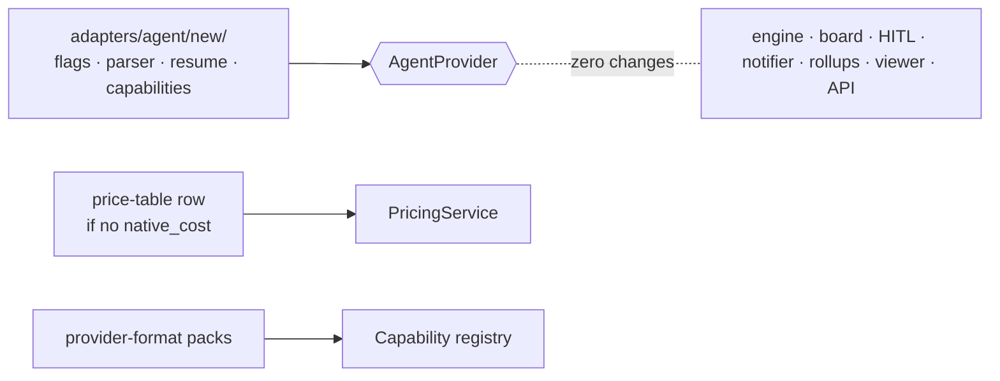

# Adding A Provider

`06` calls this *"The acceptance test for the whole genericization program."*

## The checklist

> *"Adding **Codex** should require only:*
> *1. `adapters/agent/codex/` — implement `AgentProvider`: flag mapping, stream parser → `NormalizedEvent`, session/resume, `capabilities` set (likely without `native_cost`, maybe without `plugins`).*
> *2. A `(codex, model) → rates` row in the price table (12), because `native_cost` is absent.*
> *3. Codex-format `CapabilityPack`s for any skills used by flows targeting it (13).*
> *4. Zero changes to: engine, board projection, HITL protocol, notifier, cost rollups, viewer, API.*
>
> *If step 4 isn't true, the abstraction leaked — trace it back to a port and push the provider knowledge down."* — `06`, *Where a new provider actually touches the codebase*

> [!info] Written for Codex; OpenCode is the provider that was added
> `06` wrote the checklist for Codex, the planned second real provider ([[Codex Adapter]], designed, not built). The build overtook that plan: on 2026-10-18 [[OpenCode Adapter]] was added as the second real provider, after [[Provider SDK Fit Analysis]] recommended it as *"the real test of the abstraction"*. Whether OpenCode is in v1, and whether Codex is still next, is not decided: [[Agent Providers Open Questions]]. Step 4 could not be tested, because the engine, board, notifier, rollups, viewer and API are not built yet; neither are the price table and the capability registry of steps 2 and 3. What OpenCode needed instead is under [[#What OpenCode needed]].

## What else a provider needs (from other sources)

| Item | Source | For OpenCode (2026-10-18) |
|---|---|---|
| A composition-root change: *"Swapping Claude for Codex means constructing a different `provider` in the composition root and nothing here changes."* | `07` | `run-agent` is the only composition root: `defaultProvider` in `cli/src/run.ts` |
| A captured native stream to write the parser against, kept as raw lines | PRD §0; `01-ports.md` | `adapters/test/fixtures/capture-opencode.ts` recorded `opencode-read.jsonl`, which the normalizer tests read |
| A logical → native model table for `resolveModel` | `01-ports.md` | A `models` constructor option. Ids containing `/` pass through, and `run-agent` passes an empty table |
| An egress allowlist entry and credential injection (drawio: *"api.openai.com (later)"*) | drawio *Harness architecture* | Not built: there is no sandbox, and OpenCode reads its own `auth.json` on the host |
| The CLI in the sandbox image (*"claude CLI · codex CLI"*) | drawio *Harness architecture* | Not built: runs use the installed `opencode` 1.19.3 |
| Before any of it: check whether ACP covers it | `01-ports.md`; [[Agent Client Protocol Option]] | [[Provider SDK Fit Analysis]] checked the two SDKs instead, and the port stayed hand-written |

None of these items is on `06`'s four-step list; each comes from the source in its row. Nothing says how a flow or step chooses the new provider: [[Agent Providers Open Questions]] #14. In `run-agent`, the YAML's `adapter:` field chooses it ([[Run Config Reference]]).

## What OpenCode needed

Beyond `06`'s list, the OpenCode adapter (`adapters/src/agent/opencode/`) needed five things:

1. **Permission rules, plus answers to permission requests.** OpenCode has no headless permission mode. The adapter turns `toolPolicy` and `permissionMode` into ordered session rules, writes the same rules into config for subagents, and answers every `permission.asked`, because an unanswered one hangs the run (`permissions.ts`).
2. **A guard plugin with tool-name translation.** The guards run inside OpenCode as a plugin file (`guard-plugin.ts`) that maps `write`, `edit`, `apply_patch` and `bash` onto the Claude tool names that core's guard checks, and passes bash's `workdir` as the folder the shell is in. The adapter fails the run when the plugin did not load.
3. **Server start and stop through ExecHost.** One `opencode serve` per run, spawned through `RunSpec.exec`, with a readiness line, a 30 s start timeout, and SIGTERM then SIGKILL at the end (`server.ts`, the shared `adapters/src/exec/terminate.ts`).
4. **Config isolation.** A fresh `XDG_CONFIG_HOME`, project config off, no inherited `OPENCODE_*` setting except the credentials, and the run's whole config in `OPENCODE_CONFIG_CONTENT` (`options.ts`).
5. **A captured stream, a fake server and live tests.** The recorded `opencode-read.jsonl` for the normalizer; `fake-opencode.mjs`, a scripted stand-in for the server's HTTP and event-stream surface, for the provider; and `opencode-live.test.ts` against the real CLI.

It also emulates what OpenCode lacks: a budget cap (the adapter sums the cost and aborts the session), a failing turn limit, and Claude's plugin namespace (it mounts `<dir>/skills` and rewrites `/<plugin>:<slug>` as `Use the "<slug>" skill.`). Outside its folder, it touched `run-agent`'s loader (`cli/src/config.ts`: the adapter name, the `providerID/modelID` check, the shell opt-in) and the shared tool summary (`adapters/src/agent/summarize.ts`). Details: [[OpenCode Adapter]].

> [!warning] The neutral vocabulary is Claude Code's
> `toolPolicy` entries are Claude tool names (`Read`, `Bash(git *)`, `mcp__server__tool`), and `PermissionMode` is Claude's set of modes. Core's guard (`checkToolCall` in `core/src/guard.ts`) checks only `Write`, `Edit`, `MultiEdit`, `NotebookEdit` and `Bash`, and allows every other tool name. An adapter must translate its provider's tool names and inputs before calling it; OpenCode does so in its guard plugin and in `TOOL_NAMES` (`adapters/src/agent/opencode/permissions.ts`). A new adapter that forgets gets a guard that silently allows everything. It must also pass the folder the shell is in (`checkToolCall`'s `shellCwd`: Claude's hook `cwd`, OpenCode's bash `workdir`), or a recursive `rm` is checked against the run's folder instead. Tool events go the other way: `tool_use` and `tool_result` keep the provider's own names and shapes (`core/src/ports/events.ts`).

## No conformance suite

No shared test suite checks that a provider keeps the port's promises. Each adapter has its own tests in `adapters/test/`, and a new one has to repeat by hand what both real adapters do today:

- a stop before the result settles with exit 130 and `error: 'stopped'`, and a stop after it changes nothing;
- a binary that cannot be spawned gives 127, and `pid` resolves to -1 when nothing spawned;
- `sessionId` rejects when no id arrives;
- a failure sets `RunResult.error`, normally to the first `error` event's message, and a set `error` means failed even at exit 0;
- a stopped or failed run reports the last running usage;
- `result` settles whether or not anyone reads `events` (Replay does not: C8 in [[Provider Implementation Decisions]]);
- every injected tool server is pre-approved, and an explicit deny still wins.

## Other providers named

- Claude Code and OpenCode are built, and [[Replay Provider]] is a test double. Codex was the planned second real provider; it is designed, not built ([[Codex Adapter]]).
- *"Gemini CLI"* appears once, in the architecture README's five-ports table, whose *Unlocks* cell reads *"Codex, Gemini CLI, `ReplayProvider` (tests)"*. No other design source mentions it.

## Related

- [[Provider Boundary Rules]]
- [[OpenCode Adapter]]
- [[Codex Adapter]]
- [[Provider SDK Fit Analysis]]
- [[Pricing Service]]
- [[Provider Coverage And Portability]]
- [[Agent Providers Roadmap]]
