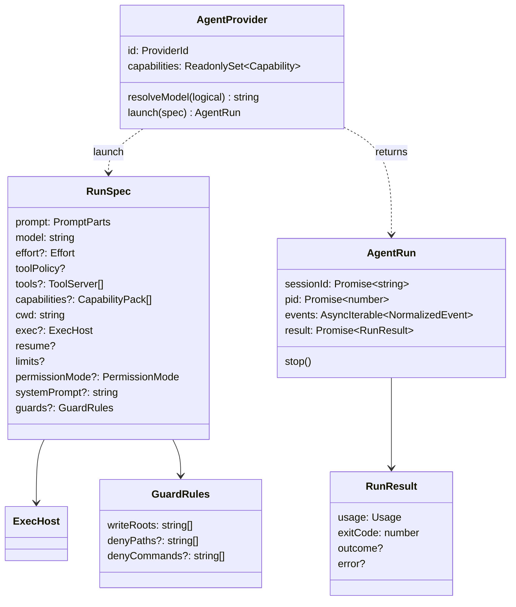

# Agent Providers Data Model

The port's types live in code, in `core/src/ports/`; the database stores what the runner records about each run. Providers have no table of their own.

## Types

> [!check] Implemented 2026-10-18
> All but `SpecTransform` and `PricingService`, which are design. Paths are under `code/flowboard/packages/`.

| Type | File | Note |
|---|---|---|
| `AgentProvider`, `ProviderId`, `Capability`, `Effort`, `PermissionMode` | `core/src/ports/agent-provider.ts` | [[AgentProvider Port]], [[Provider Capabilities]] |
| `RunSpec`, `PromptParts`, `ArtifactRef`, `ToolServer`, `CapabilityPack`, `GuardRules` | `core/src/ports/agent-provider.ts` | [[Run Spec]] |
| `AgentRun`, `RunResult` | `core/src/ports/agent-provider.ts` | [[Agent Run Handle And Result]] |
| `NormalizedEvent`, `Usage` | `core/src/ports/events.ts` | [[Normalized Event Envelope]] |
| `ExecHost`, `SandboxProfile`, `IsolationTier` | `core/src/ports/exec-host.ts` | [[Providers And Sandboxing]] |
| `Question`, `Answers`, `AskRequest`, `AskReply` | `core/src/hitl/question.ts` | [[Ask User MCP Server]] |
| `ReplayScript` | `adapters/src/agent/replay/replay-provider.ts` | [[Replay Provider]] |
| `SpecTransform` | design: `06` §15 | [[Draft Mode And Spec Transforms]] |
| `PricingService` | design: `06` §12 | [[Pricing Service]] |

`PermissionMode` is Claude Code's six modes; other adapters map them. `GuardRules` holds `writeRoots`, `denyPaths` and `denyCommands`. `NormalizedEvent` has eight kinds: the eighth, `usage`, carries the run's running totals mid-run, and every kind may carry `raw`, the native message it came from. `ExecHost.spawn` returns Node's `ChildProcessWithoutNullStreams`; the reference port's `ChildHandle` is gone.

`Usage` holds `input`, `output`, `cacheRead`, `cacheWrite`, `numTurns` and an optional `costUsd`:

- `numTurns` counts the main agent's turns (model calls). Subagents' tokens and cost count; their turns do not.
- `costUsd` is USD as the provider reports it. Claude reports it only on its result, so its live `usage` events have none. OpenCode reports it on every event, with 0 for a model it has no price for. Absent means "price it from tokens".
- `RunResult.usage` is the result's totals. A run that ends before its result, stopped or failed, keeps the last running totals instead; on Claude those carry tokens but no cost.

> [!check] Changed 2026-10-22
> The `numTurns` and stopped-run rules are decisions taken 2026-10-22, open to Alex's review. Before, Claude's live `numTurns` was always 0, OpenCode's counted subagent steps too, and a stopped or failed run reported zero usage.

## Database columns the port feeds

> [!info] Design, not built
> No database exists on `dev` as of 2026-10-22: no table in this section or the next, and no runner to fill one. `run-agent` keeps each run in a JSONL log instead ([[Agent Providers Storage]]) and builds its `RunSpec` from one YAML file ([[Run Config Reference]]).

Columns from PRD §5 unless noted. The *Filled from* column is inferred from the type and column names; no source maps port fields to columns ([[Agent Providers Open Questions]] #35).

| Table.column | Filled from | Note |
|---|---|---|
| `runs.claude_session_id` | `AgentRun.sessionId`, which the provider reports (#5) | `02` §1: rename to `agent_session_id` |
| `runs.pid` | `AgentRun.pid`, once it resolves: `-1` if nothing spawned; on OpenCode, the server's pid | restart re-attach |
| `runs.exit_code` | `RunResult.exitCode` | |
| `runs.error` | `RunResult.error` | the provider's own error report or the stderr tail; `stopped` after a stop. A set `error` means failed, even at exit 0 (#33) |
| `runs.cost_usd` | `Usage.costUsd`, or PricingService when it is absent | |
| `runs.input_tokens`, `output_tokens`, `cache_read_tokens`, `cache_write_tokens`, `num_turns` | `Usage` | `num_turns`: the main agent's turns |
| `runs.provider` | `AgentProvider.id` | proposed by `02` §1; not in PRD §5 |
| `runs.model`, `runs.effort` | the resolved model and effort | backlog Story 1.1 (*"the three columns that proved necessary"*); `02` §1; PRD §11.1 and `08` prose; not in PRD §5's SQL |
| `runs.sandbox` | `exec.id` | PRD §11.1 prose (*"records the tier that actually ran"*); `08`; backlog 1.1, 3.5; drawio *SQLite* node; not in PRD §5's SQL |
| `run_events.seq`, `type`, `v`, `raw`, `summary` | each `NormalizedEvent` | `v` defaults to 1. `events.ts` has no `v` (C10 in [[Provider Implementation Decisions]]) and no `seq`; `summary` is on `tool_use` only; `raw` is absent on an error the adapter raises with no native message behind it (a thrown exception, a limit it enforces) |

## Columns the runner reads to build `RunSpec`

Inferred from PRD §5's columns, PRD §7's command and hooks, and the `RunSpec` fields; no source tabulates it.

| Column | `RunSpec` field |
|---|---|
| `step_defs.model` (default `'sonnet'`), `agents.default_model` | `model` |
| `step_defs.effort` (default `'medium'`), `agents.default_effort` | `effort` |
| `step_defs.allowed_tools`, `agents.allowed_tools`, `skills.allowed_tools` | `toolPolicy` (agent ∩ skill ∩ step, PRD §7) |
| `step_defs.max_turns`, `max_budget_usd` | `limits` |
| `step_defs.permission_mode` (default `'bypassPermissions'`) | `permissionMode` ([[Agent Providers Open Questions]] #4) |
| `agents.system_prompt` | `systemPrompt` (#4) |
| `tasks.capability_pins`, `step_defs.extra_plugin_ids` | `capabilities` |
| `tasks.worktree_path` | `cwd`, and `guards.writeRoots` |
| `tasks.non_goals`, the lines written as a path or glob (PRD §7) | `guards.denyPaths` |
| `settings` `sandbox_profile` (PRD §11.1, *"overridable per step"*), `step_defs.sandbox_profile` (backlog 1.1) | `exec` (via `workspace.execHost(task)`) |
| `settings` draft mode | applied as a `SpecTransform` |

> [!note] No provider column anywhere
> No table stores which provider a step, flow, project or run uses. PRD §5 is Claude-only by construction; [[Capability Library Decisions]] D1/D23 keep it so in v1. [[Agent Providers Open Questions]] #14 and #16; the missing run columns are also [[Cost And Control Open Questions]] #14 and [[Settings And Plumbing Open Questions]] #22.
>
> The build overtook that plan: OpenCode was built on 2026-10-18 as a second provider, and `run-agent` picks one per run with its `adapter:` field. Whether OpenCode is in v1 is open: [[Agent Providers Open Questions]].

## Related

- [[Execution Data Model]]
- [[Cost Data Model]]
- [[Capability Data Model]]
- [[Agent Providers Storage]]
