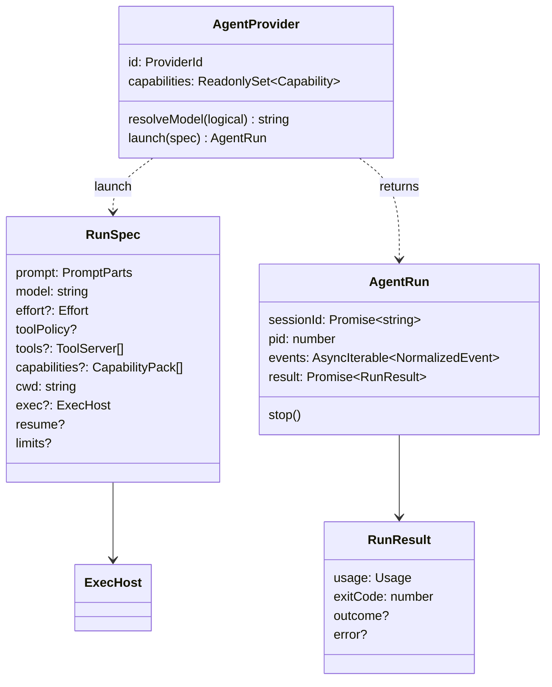

# Agent Providers Data Model

The port's types live in code (`core/ports/`); the database stores what the runner records about each run. Providers have no table of their own.

## Types

| Type | File | Note |
|---|---|---|
| `AgentProvider`, `ProviderId`, `Capability`, `Effort` | `agent-provider.ts` | [[AgentProvider Port]], [[Provider Capabilities]] |
| `RunSpec`, `PromptParts`, `ArtifactRef`, `ToolServer`, `CapabilityPack` | `agent-provider.ts` | [[Run Spec]] |
| `AgentRun`, `RunResult` | `agent-provider.ts` | [[Agent Run Handle And Result]] |
| `NormalizedEvent`, `Usage` | `events.ts` | [[Normalized Event Envelope]] |
| `ExecHost`, `SandboxProfile`, `ChildHandle`, `IsolationTier` | `exec-host.ts` | [[Providers And Sandboxing]] |
| `ReplayScript` | `replay-provider.ts` | [[Replay Provider]] |
| `SpecTransform` | `06` §15 | [[Draft Mode And Spec Transforms]] |
| `PricingService` | `06` §12 | [[Pricing Service]] |

## Database columns the port feeds

Columns from PRD §5 unless noted. The *Filled from* column is inferred from the type and column names; no source maps port fields to columns ([[Agent Providers Open Questions]] #35).

| Table.column | Filled from | Note |
|---|---|---|
| `runs.claude_session_id` | `AgentRun.sessionId` / `--session-id` | `02` §1: rename to `agent_session_id` |
| `runs.pid` | `AgentRun.pid` | restart re-attach |
| `runs.exit_code` | `RunResult.exitCode` | |
| `runs.error` | `RunResult.error` | stderr tail |
| `runs.cost_usd` | `Usage.costUsd` (or PricingService) | |
| `runs.input_tokens`, `output_tokens`, `cache_read_tokens`, `cache_write_tokens`, `num_turns` | `Usage` | |
| `runs.provider` | — | proposed by `02` §1; not in PRD §5 |
| `runs.model`, `runs.effort` | the resolved model and effort | backlog Story 1.1 (*"the three columns that proved necessary"*); `02` §1; PRD §11.1 and `08` prose; not in PRD §5's SQL |
| `runs.sandbox` | `exec.id` | PRD §11.1 prose (*"records the tier that actually ran"*); `08`; backlog 1.1, 3.5; drawio *SQLite* node; not in PRD §5's SQL |
| `run_events.seq`, `type`, `v`, `raw`, `summary` | each `NormalizedEvent` | `v` defaults to 1 |

## Columns the runner reads to build `RunSpec`

Inferred from PRD §5's columns, PRD §7's command and the `RunSpec` fields; no source tabulates it.

| Column | `RunSpec` field |
|---|---|
| `step_defs.model` (default `'sonnet'`), `agents.default_model` | `model` |
| `step_defs.effort` (default `'medium'`), `agents.default_effort` | `effort` |
| `step_defs.allowed_tools`, `agents.allowed_tools`, `skills.allowed_tools` | `toolPolicy` (agent ∩ skill ∩ step, PRD §7) |
| `step_defs.max_turns`, `max_budget_usd` | `limits` |
| `step_defs.permission_mode` (default `'bypassPermissions'`) | none ([[Agent Providers Open Questions]] #4) |
| `agents.system_prompt` | none (`--append-system-prompt`) |
| `tasks.capability_pins`, `step_defs.extra_plugin_ids` | `capabilities` |
| `tasks.worktree_path` | `cwd` |
| `settings` `sandbox_profile`, `step_defs.sandbox_profile` (PRD §11.1; backlog 1.1) | `exec` (via `workspace.execHost(task)`) |
| `settings` draft mode | applied as a `SpecTransform` |

> [!note] No provider column anywhere
> No table stores which provider a step, flow, project or run uses. PRD §5 is Claude-only by construction; [[Capability Library Decisions]] D1/D23 keep it so in v1. [[Agent Providers Open Questions]] #14 and #16; the missing run columns are also [[Cost And Control Open Questions]] #14 and [[Settings And Plumbing Open Questions]] #22.

## Related

- [[Execution Data Model]]
- [[Cost Data Model]]
- [[Capability Data Model]]
- [[Agent Providers Storage]]
