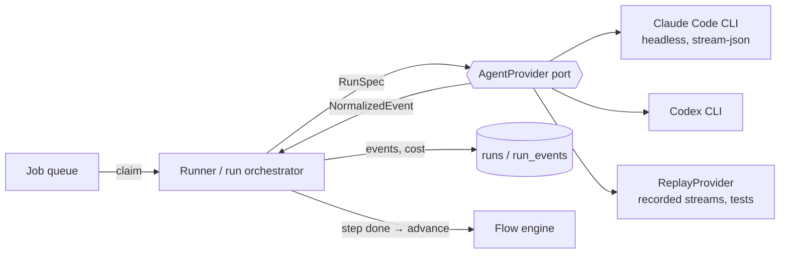

# Agent Providers Overview

## Purpose

FlowBoard runs every AI step as a headless coding-agent CLI session. Agent Providers is the layer that makes the CLI swappable. The architecture calls the port *"The centerpiece. Turns "run an agent" into a normalized contract so Claude Code, Codex, and a test `ReplayProvider` are interchangeable."* (`01-ports.md`, *AgentProvider*).

In plain words, from feature map §6:

| Feature | Feature map wording |
|---|---|
| Swap the underlying AI | *"A step doesn't care which vendor's tool runs it; FlowBoard translates its request into whatever that tool understands, so you're never locked to one vendor."* |
| Know each tool's abilities | *"Tools differ in what they support (thinking effort, resuming a session, reporting cost). FlowBoard checks what each can do and adapts, hiding options a tool can't handle."* |
| One shared format for results | *"Whatever tool runs, its output (messages, tool calls, results, cost) is translated into one common format the rest of the app understands."* |
| A test stand-in | *"A fake provider that replays a recorded session, so the whole system can be tested without spending real money."* |
| ❓ open | *"Try FlowBoard against a second real tool (Codex) early, to be sure the "swap the AI" design actually holds — and check first whether an open standard for driving coding tools (the Agent Client Protocol) could do the translating for us."* |

## Place in the system

It is architecture component **#5, *AgentProvider abstraction ⭐*** (architecture README, component index), one of *"The five ports that carry the whole program"*:

| Port | Today (only adapter) | Unlocks |
|---|---|---|
| **AgentProvider** | Claude Code CLI | Codex, Gemini CLI, `ReplayProvider` (tests) |

(architecture README)

The README states the goal up front: the general version is *"the one where **Claude Code and Codex are interchangeable adapters**, not the substrate"*. It counts the normalized events as something the spec already got right (*"`run_events.type` normalizes to 7 event kinds → *already the provider seam*"*) and makes the flow graph provider-agnostic: *"the graph references *logical* models and capabilities, so the same agentic graph runs on Claude Code, Codex, or a replay adapter unchanged."* The drawio *FlowBoard ideation* page labels its architecture group *"Claude Code and Codex as interchangeable adapters."*

Drawn from the drawio *Logical components* page: edges *Run orchestrator → AgentProvider*, *AgentProvider → Claude Code CLI*, *→ Codex CLI*, *→ ReplayProvider*, and *Run orchestrator → Task & run state* (*"events, cost"*).

Consumers of the port's outputs (`03` §5, *Composes with*): *"the runner (6) is the generic half that consumes this port; HITL (4), cost (6), and the viewer (8) all consume its normalized outputs."* The engine *"Depends only on the AgentProvider port's `RunResult`, never on how the"* run happened (`02` §3).

## Design principles

1. **Two mappings, nothing else.** *"An adapter's job is exactly two mappings"* (`agent-provider.ts`). See [[AgentProvider Port]].
2. **Core never imports an adapter.** *"`core/` and `runner/` must never import from `adapters/` — only from `core/ports/`. Enforce with a lint rule."* (architecture README). See [[Provider Boundary Rules]].
3. **Zero provider strings downstream.** *"Components 6–8 contain **zero provider strings** once 5 is extracted — that is the test of the abstraction."* (`03` intro).
4. **Degrade, don't fail.** Capability negotiation is *"The key trick that makes graceful degradation cheap"* (`01-ports.md`). See [[Capability Negotiation]].
5. **Logical, not native, models.** *"A flow authored for Claude runs on Codex unchanged; only the resolution table differs."* (`01-ports.md`). See [[Logical Model Ids]].
6. **One envelope, versioned.** *"This is the most-read contract in the system, so it carries a schema version"* (`01-ports.md`). See [[Normalized Event Envelope]].
7. **Sandboxing is orthogonal.** *"any provider × any tier, for free (2×N, not N×M)"* (`01-ports.md`; `exec-host.ts` says *"any provider × any isolation tier"*). See [[Providers And Sandboxing]].
8. **Prove it with a second implementation.** *"The interface is only as good as its second implementation."* (`01-ports.md`). See [[Codex Adapter]] and [[Replay Provider]].
9. **The CLI, never the API.** *"Do not build … anything that talks to the Anthropic API directly. Every model call goes through the `claude` CLI."* (PRD §17).

> [!quote] Why it matters to the pitch
> *"It is also **provider-agnostic by design** (Claude *and* Codex behind one seam), so we are not betting the workflow on one vendor."* (`pitch.md`, objection 3)
>
> The competitive analysis puts FlowBoard's provider story at *"One seam, Claude Code first, Codex intended"* against Multica's *"26 agent CLIs today"* (`competitor-multica.md`), and lists *"provider-agnosticism"* among what *"Multica already ships"*, so the seam is table stakes rather than a differentiator.

## Related

- [[Agent Providers Index]]
- [[AgentProvider Port]]
- [[Agent Providers Glossary]]
- [[Execution Overview]]
- [[Agent Launch Contract]]
