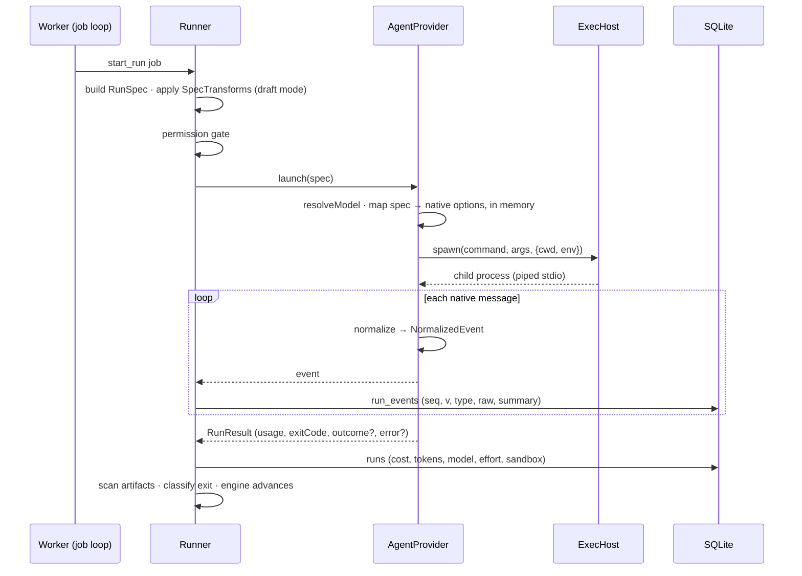

# Agent Providers Runtime

Where providers live and how one launch flows through the system.

> [!info] Design, not built
> Everything after *What runs today* is the PRD's design, except `AgentRun.stop()`. On `dev` as of 2026-10-22 there is no web app beyond the Next.js starter page, and no worker, sandbox, runner or memory store. What runs today is under [[#What runs today]].

## What runs today

> [!check] Implemented 2026-10-18
> A run is started by hand from a terminal, and every process runs on the host.

| Process | Role | Code |
|---|---|---|
| `pnpm run-agent <task.yaml>` | One Node process. Loads the YAML, runs the question broker, builds the `RunSpec`, calls `launch()`, prints each event and appends it to the run log | `cli/src/main.ts`, `cli/src/run.ts` |
| The provider's child | Claude: the `claude` CLI, which the Agent SDK's `query()` spawns through the host ExecHost. OpenCode: one `opencode serve` per run on `127.0.0.1`, which the adapter drives over HTTP and the server's event stream | `adapters/src/agent/claude/`, `adapters/src/agent/opencode/` |
| The ask-user shim | A stdio MCP server that the `claude` CLI or the OpenCode server spawns. It forwards each `ask_user` or `ask_user_batch` call to `run-agent`'s broker over a Unix socket and returns the reply | `ask-user/src/main.ts`; the broker is `cli/src/ask/broker.ts` |

One run, in order (`cli/src/run.ts`):

1. Load and check the YAML. A bad file exits with code 2 before anything starts.
2. Open the log, `runs/<stamp>-<adapter>.jsonl` ([[Agent Providers Storage]]).
3. Make a temp folder `/tmp/fb-*`, start the broker on `ask.sock` inside it, and copy any `skills:` folders into a `local` plugin there.
4. Add the shim to `RunSpec.tools`, with the socket in `FLOWBOARD_ASK_SOCKET`. On Claude, also deny `AskUserQuestion`.
5. Call `launch()`. The adapter builds its provider's config in memory; no `settings.json` or `mcp.json` is written. Guards run in a `PreToolUse` hook callback inside `run-agent` (Claude) or in a plugin inside the OpenCode server.
6. Print and log each event. Ask each question batch in the terminal, one batch at a time; without a terminal, the agent gets an error saying no one can answer.
7. Close the broker, which withdraws any open question, log the result and delete the temp folder. Exit 0, 1, or 130 after a stop.

Ctrl+C, SIGTERM and SIGHUP call `AgentRun.stop()`. See [[Run Config Reference]] and [[Ask User MCP Server]].

## Processes

The PRD's processes:

| Process | Role with providers | Source |
|---|---|---|
| `apps/web` (Next.js) | Never spawns: *"Next.js route handlers must never spawn a long-lived child process; they enqueue jobs and the worker picks them up"* | PRD §2 |
| `apps/worker` | Leases `start_run`, builds the `RunSpec`, calls `launch()`, tees events | PRD §3; drawio *Harness architecture* |
| The agent sandbox | Runs the CLI (*"claude CLI · codex CLI"* in the image) | drawio *Harness architecture* |
| `apps/mcp-shim` | Launched by the CLI as an MCP server for `ask_user` | PRD §9 |

## One launch

The runner sketch in `07` (*Composing them — the runner*):

```ts
const run = deps.provider.launch({                       // AgentProvider port
  prompt: buildPrompt(step, task, deps.store),
  model: step.model, effort: step.effort,
  cwd: deps.workspace.cwd(task),                         // Workspace port
  resume: step.resume,
});
for await (const ev of run.events) {                     // normalized — provider-blind
  persistEvent(run, ev);                                 //   → run_events + SSE
  if (ev.type === 'result') updateLiveCost(task, ev.usage);
}
const result = await run.result;
```

`07` labels it *"illustrative"*. The sketch passes only `prompt`, `model`, `effort`, `cwd` and `resume`: no `exec`, `tools`, `capabilities`, `toolPolicy`, `limits`, `permissionMode`, `systemPrompt` or `guards`, which `03` §6 and PRD §7 require. It also updates live cost only on the `result` event; the shipped port's `usage` event carries running totals for that.



Built from `03` §6, `07`, PRD §7 and the drawio *Life of one step* (letters C, E, F, G, I), with the shipped port's changes: the runner writes no config files ([[Agent Providers Open Questions]] #4), and `spawn` returns a Node child process. The sequence is this note's synthesis. The diagram follows the port and puts parsing in the adapter, as the code does; the drawio draws the *Stream parser* as a separate worker node ([[Agent Providers Open Questions]] #34). The drawio letters:

- **C** *"The worker leases the job. The engine picks the step; the runner builds the RunSpec and the prompt"*
- **E** *"The permission gate checks the tier; the runner writes mcp.json and the hook settings; the ExecHost starts a sandbox with the worktree at /work."*
- **F** *"claude runs inside, holding only a dummy key."*
- **G** *"stream-json on stdout → parser → run_events + live cost → SSE → run viewer and board."*
- **I** *"On exit: scan artifacts, read the outcome."*

The drawio *Runner* node: *"builds the RunSpec · draft-mode transform · writes per-run mcp.json + settings.json (hooks) · records model, effort, tier"*.

> [!warning] The shipped code differs
> - No runner writes `mcp.json` or hook settings: each adapter builds its provider's config in memory ([[Agent Providers Open Questions]] #4).
> - There is no sandbox, permission gate or dummy key: the CLI runs on the host with the owner's own login ([[Providers And Sandboxing]]).
> - No adapter reads stdout lines: the Claude adapter iterates the Agent SDK's typed messages, and the OpenCode adapter reads the server's event stream ([[Stream Parsing And Normalization]]).

## Memory around launch

When memory is on, *"the runner brackets `launch()` with the MemoryStore port"* — recall before, write after a success, both host-side (`03` §6). The provider never sees the store. See [[Memory Carried Into A Task]].

## Restart and stop

- *"Restart recovery: re-attach by pid before failing. A `starting`/`running` row whose pid is alive → keep tailing"* (`03` §7). The port has no re-attach method: a restarted worker has no `AgentRun`, only a pid. How it re-reads the live process's stream is not said ([[Agent Providers Open Questions]] #30, same as [[Execution Open Questions]] #31).
- *"Stop = SIGTERM by pid from the route (same machine), finalize as `cancelled`."* (`03` §8). The port's stop is `AgentRun.stop()`, which is built. The Claude adapter aborts the Agent SDK query; the OpenCode adapter aborts the session, then stops its server. The child gets SIGTERM, then SIGKILL if it outlives a grace period (C12 in [[Provider Implementation Decisions]]). `result` settles as `{ exitCode: 130, error: 'stopped' }` unless the result came first, and keeps the last running usage. A SIGTERM by pid from outside is not a stop: both adapters report it as a failure, with exit 1. The route holds no `AgentRun`, so the two paths differ ([[Monitor Open Questions]] #36).

## Related

- [[Runner Pipeline]]
- [[Life Of One Step]]
- [[Worker Lifecycle]]
- [[Execution Runtime]]
- [[Run Agent CLI Decisions]]
- [[Agent Providers Data Model]]
