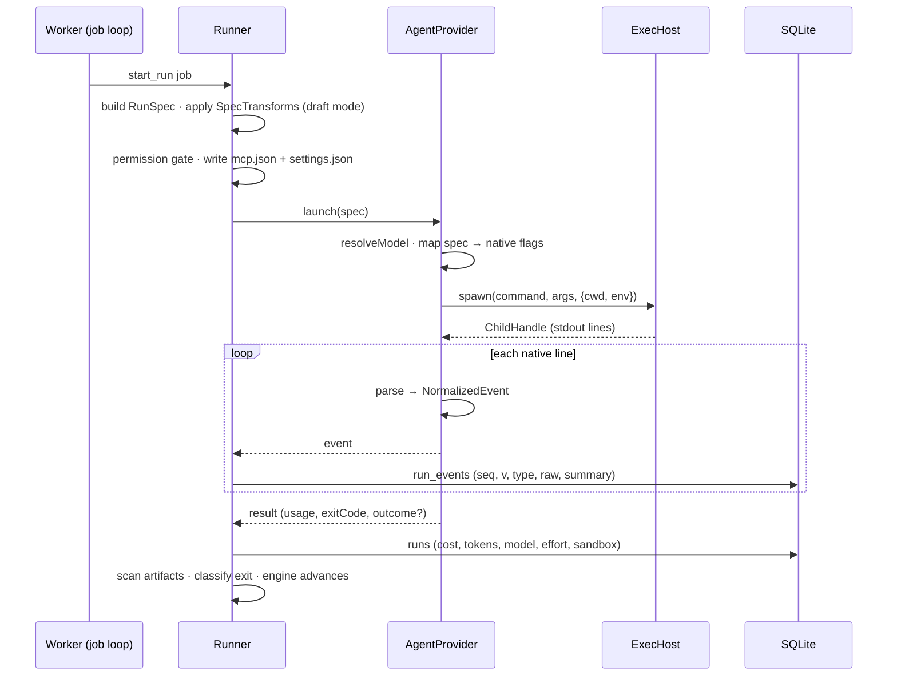

# Agent Providers Runtime

Where providers live and how one launch flows through the system.

## Processes

| Process | Role with providers | Source |
|---|---|---|
| `apps/web` (Next.js) | Never spawns: *"Next.js route handlers must never spawn a long-lived child process; they enqueue jobs and the worker picks them up"* | PRD §2 |
| `apps/worker` | Leases `start_run`, builds the `RunSpec`, calls `launch()`, tees events | PRD §3; drawio *Harness architecture* |
| The agent sandbox | Runs the CLI (*"claude CLI · codex CLI"* in the image) | drawio *Harness architecture* |
| `apps/mcp-shim` | Launched by the CLI as an MCP server for `ask_user` | PRD §9 |

## One launch

The runner sketch in `07` (*Composing them — the runner*):

```ts
const run = deps.provider.launch({                       // AgentProvider port
  prompt: buildPrompt(step, task, deps.store),
  model: step.model, effort: step.effort,
  cwd: deps.workspace.cwd(task),                         // Workspace port
  resume: step.resume,
});
for await (const ev of run.events) {                     // normalized — provider-blind
  persistEvent(run, ev);                                 //   → run_events + SSE
  if (ev.type === 'result') updateLiveCost(task, ev.usage);
}
const result = await run.result;
```



Built from `03` §6, `07`, PRD §7 and the drawio *Life of one step* (letters C, E, F, G, I). The drawio letters:

- **C** *"The worker leases the job. The engine picks the step; the runner builds the RunSpec and the prompt"*
- **E** *"The permission gate checks the tier; the runner writes mcp.json and the hook settings; the ExecHost starts a sandbox with the worktree at /work."*
- **F** *"claude runs inside, holding only a dummy key."*
- **G** *"stream-json on stdout → parser → run_events + live cost → SSE → run viewer and board."*
- **I** *"On exit: scan artifacts, read the outcome."*

The drawio *Runner* node: *"builds the RunSpec · draft-mode transform · writes per-run mcp.json + settings.json (hooks) · records model, effort, tier"*.

## Memory around launch

When memory is on, *"the runner brackets `launch()` with the MemoryStore port"* — recall before, write after a success, both host-side (`03` §6). The provider never sees the store. See [[Memory Carried Into A Task]].

## Restart and stop

- *"Restart recovery: re-attach by pid before failing. A `starting`/`running` row whose pid is alive → keep tailing"* (`03` §7). The port has no re-attach method: a restarted worker has no `AgentRun`, only a pid. How it re-reads the live process's stream is not said ([[Agent Providers Open Questions]] #30).
- *"Stop = SIGTERM by pid from the route (same machine), finalize as `cancelled`."* (`03` §8). `AgentRun.stop()` is *"SIGTERM the child"*.

## Related

- [[Runner Pipeline]]
- [[Life Of One Step]]
- [[Worker Lifecycle]]
- [[Execution Runtime]]
- [[Agent Providers Data Model]]
