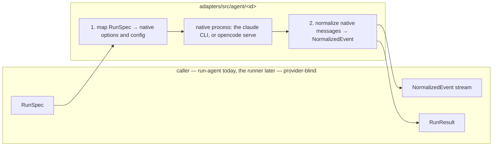

# AgentProvider Port

The shipped file opens: *"AgentProvider — the port that makes coding-agent CLIs interchangeable. This is the seam of the whole system. `core/` and the runner (not built yet; `run-agent` stands in) program against this interface; `adapters/src/agent/<claude|opencode|replay>/` implement it. No file under `core/` or the runner may import a provider adapter — only this port."* (`core/src/ports/agent-provider.ts`)

> [!check] Implemented 2026-10-18
> The port is `code/flowboard/packages/core/src/ports/agent-provider.ts`, with `events.ts` and `exec-host.ts` beside it. It replaced the reference port in `docs/old/reference/core/ports/agent-provider.ts`, which named `runner/` and `adapters/agent/<claude|codex|replay>/`. Two real providers implement it, the [[Claude Code Adapter]] and the [[OpenCode Adapter]], plus the [[Replay Provider]], a test double. The [[Codex Adapter]] is designed, not built. The plan named Codex as the second provider; whether OpenCode is in v1 and Codex still next is open ([[Agent Providers Open Questions]] #38).

## The interface

```ts
export interface AgentProvider {
  readonly id: ProviderId;
  /** What this provider supports; drives capability negotiation. */
  readonly capabilities: ReadonlySet<Capability>;
  /** Map a logical model id to this provider's native id, e.g. 'reasoning-high' -> 'opus' | 'o3'. */
  resolveModel(logical: string): string;
  /** Launch one attempt. Non-blocking: returns a handle whose promises settle as the run proceeds. */
  launch(spec: RunSpec): AgentRun;
}
```

(`core/src/ports/agent-provider.ts`, *The port*)

| Member | What it is | Detail |
|---|---|---|
| `id` | `ProviderId` — `'claude-code' \| 'codex' \| 'opencode' \| 'replay' \| (string & {})` | The open union *"keeps autocomplete without closing the set"*. The built providers use `claude-code`, `opencode` and `replay`; `codex` has no adapter. `01-ports.md` sketches a closed union instead. See [[Agent Providers Open Questions]] #15. |
| `capabilities` | `ReadonlySet<Capability>` | [[Provider Capabilities]]. Claude and OpenCode declare all eleven flags; Replay declares `sessions`, `partial_stream` and `native_cost`. Nothing reads the set yet: [[Capability Negotiation]] is design. |
| `resolveModel` | logical id → native id | Claude and Replay return the id as is. OpenCode looks it up in the table given to the provider, passes a `providerID/modelID` id through, and throws for anything else, which fails the run. See [[Logical Model Ids]]. |
| `launch` | `RunSpec` → `AgentRun`, non-blocking | [[Run Spec]], [[Agent Run Handle And Result]] |

## An adapter's two jobs

> *"An adapter's job is exactly two mappings:*
> *1. RunSpec -> the provider's native CLI flags / config.*
> *2. the provider's native event stream -> NormalizedEvent (./events.ts).*
> *Everything else — the flow engine, board projection, cost ledger, HITL protocol, live viewer — consumes only the normalized outputs and never learns which provider ran."* — `core/src/ports/agent-provider.ts`

`03` §5 says the same as a seam: *"the adapter maps `RunSpec` → native flags and parses the native stream → `NormalizedEvent`."*

How the built adapters do the two jobs (all under `adapters/src/agent/`):

| Adapter | 1. `RunSpec` → native | 2. native stream → `NormalizedEvent` |
|---|---|---|
| Claude Code | Agent SDK `query()` options; the SDK runs the installed `claude` CLI (`claude/options.ts`) | the SDK's typed messages (`claude/normalize.ts`) |
| OpenCode | a per-run `opencode serve`: its env, with the whole config in `OPENCODE_CONFIG_CONTENT`, plus session permission rules and the prompt (`opencode/options.ts`, `opencode/permissions.ts`) | the server's SSE events (`opencode/normalize.ts`) |
| Replay | none: it ignores the spec | none: it streams scripted `NormalizedEvent`s |

Tool events are the one place provider shapes leak through: see [[Normalized Event Envelope]].



## Where the port sits

> [!info] Design, not built
> Nothing in this section exists on `dev` as of 2026-10-22 except the port itself. There is no runner, no worker and no `apps/` folder. Of the other ports only `ExecHost` exists, with a host-tier implementation (`adapters/src/exec/host.ts`). The one caller today is `run-agent` (`cli/src/run.ts`), a terminal command that builds one `RunSpec` from a YAML file and launches one provider ([[Run Config Reference]]). It lives in `packages/cli`, not `runner/`, because the runner may not import adapters and `run-agent` has to ([[Run Agent CLI Decisions]] R6).

- **In the code layout**: `core/ports/` holds *"AgentProvider, Notifier, Workspace, ArtifactStore, TaskSource, MemoryStore"* (architecture README, *Suggested module layout*); PRD §3 lists `packages/core/ports/` with *"AgentProvider, ExecHost, MemoryStore, Notifier, TaskSource interfaces"*.
- **In the process model**: the drawio *Harness architecture* puts *"AgentProvider port / Claude CLI adapter (claude -p, stream-json) · Codex (later) · ReplayProvider at $0 · spike first: could this port be ACP?"* inside *Process 2 · apps/worker*. As built, the Claude adapter drives the CLI through the Agent SDK, and OpenCode, not Codex, is the second provider. The ACP question is in [[Agent Client Protocol Option]].
- **Who calls it**: only the runner. *"The runner touches three ports and no adapter."* (`07`, *Composing them*). The `StepExecutor` sketch: *"The 'agent'/'skill' executor delegates to an AgentProvider (01); others don't touch it at all."* (`02` §3). Shell steps use no provider: *"No `AgentProvider` is involved, and the run costs nothing."* (`03` §6).

## The sketches and the shipped port

`01-ports.md` calls its code *"TypeScript-shaped pseudocode; the point is the *shape of the seam*, not the exact fields."* Where it, the reference file and the shipped port differ:

| Point | `01-ports.md` | Reference file | Shipped port |
|---|---|---|---|
| `id` | closed union `'claude-code' \| 'codex' \| 'replay'` | adds `(string & {})` | also adds `'opencode'` |
| `capabilities` | mutable `Set` | `ReadonlySet` | `ReadonlySet` |
| `tool_hooks` | a capability | missing | a capability: the provider enforces `RunSpec.guards` inside the agent. Both real providers declare and enforce it ([[Agent Providers Open Questions]] #1, decided 2026-10-18) |
| `RunSpec.exec` | missing ([[Agent Providers Open Questions]] #3) | present | present |
| `permissionMode`, `systemPrompt`, `guards` | missing | missing | present ([[Agent Providers Open Questions]] #4); see [[Run Spec]] |
| `AgentRun.pid` | `number` | `number` | `Promise<number>` ([[Agent Providers Open Questions]] #37); see [[Agent Run Handle And Result]] |
| Event kinds | seven | seven | eight, adding `usage`; any event may carry `raw` ([[Agent Providers Open Questions]] #9); see [[Normalized Event Envelope]] |

`07` says *"A real `ClaudeCodeProvider` implements the *same* three members — `id`, `capabilities`, `resolveModel`, `launch`"* and then lists four ([[Agent Providers Open Questions]] #27).

## Related

- [[Run Spec]]
- [[Agent Run Handle And Result]]
- [[Normalized Event Envelope]]
- [[Claude Code Adapter]]
- [[OpenCode Adapter]]
- [[Replay Provider]]
- [[Provider Boundary Rules]]
- [[Agent Launch Contract]]
- [[Agent Providers Index]]
