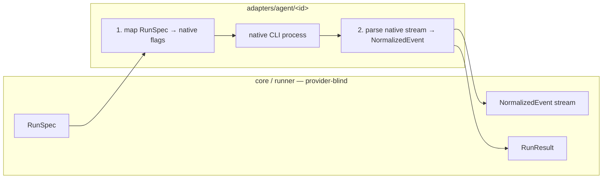

# AgentProvider Port

The reference file opens: *"AgentProvider — the port that makes coding-agent CLIs interchangeable. This is the seam of the whole system. `core/` and `runner/` program against this interface; `adapters/agent/<claude|codex|replay>/` implement it. No file under `core/` or `runner/` may import a provider adapter — only this port."* (`docs/old/reference/core/ports/agent-provider.ts`).

## The interface

```ts
export interface AgentProvider {
  readonly id: ProviderId;
  /** What this provider supports; drives capability negotiation. */
  readonly capabilities: ReadonlySet<Capability>;
  /** Map a logical model id to this provider's native id, e.g. 'reasoning-high' -> 'opus' | 'o3'. */
  resolveModel(logical: string): string;
  /** Spawn one attempt. Non-blocking: returns a handle whose promises settle as the run proceeds. */
  launch(spec: RunSpec): AgentRun;
}
```

(`agent-provider.ts`, *The port*)

| Member | What it is | Detail |
|---|---|---|
| `id` | `ProviderId` — `'claude-code' \| 'codex' \| 'replay' \| (string & {})` | The open union *"keeps autocomplete without closing the set"*. `01-ports.md` sketches a closed union instead. See [[Agent Providers Open Questions]] #15. |
| `capabilities` | `ReadonlySet<Capability>` | [[Provider Capabilities]], used by [[Capability Negotiation]] |
| `resolveModel` | logical id → native id | [[Logical Model Ids]] |
| `launch` | `RunSpec` → `AgentRun`, non-blocking | [[Run Spec]], [[Agent Run Handle And Result]] |

## An adapter's two jobs

> *"An adapter's job is exactly two mappings:*
> *1. RunSpec -> the provider's native CLI flags / config.*
> *2. the provider's native event stream -> NormalizedEvent (./events.ts).*
> *Everything else — the flow engine, board projection, cost ledger, HITL protocol, live viewer — consumes only the normalized outputs and never learns which provider ran."* — `agent-provider.ts`

`03` §5 says the same as a seam: *"the adapter maps `RunSpec` → native flags and parses the native stream → `NormalizedEvent`."*



## Where the port sits

- **In the code layout**: `core/ports/` holds *"AgentProvider, Notifier, Workspace, ArtifactStore, TaskSource, MemoryStore"* (architecture README, *Suggested module layout*); PRD §3 lists `packages/core/ports/` with *"AgentProvider, ExecHost, MemoryStore, Notifier, TaskSource interfaces"*.
- **In the process model**: the drawio *Harness architecture* puts *"AgentProvider port / Claude CLI adapter (claude -p, stream-json) · Codex (later) · ReplayProvider at $0 · spike first: could this port be ACP?"* inside *Process 2 · apps/worker*.
- **Who calls it**: only the runner. *"The runner touches three ports and no adapter."* (`07`, *Composing them*). The `StepExecutor` sketch: *"The 'agent'/'skill' executor delegates to an AgentProvider (01); others don't touch it at all."* (`02` §3). Shell steps use no provider: *"No `AgentProvider` is involved, and the run costs nothing."* (`03` §6).

## Two sketches of the same port

> [!warning] `01-ports.md` and `agent-provider.ts` differ
> `01-ports.md` calls its code *"TypeScript-shaped pseudocode; the point is the *shape of the seam*, not the exact fields."* Differences against the reference file:
> - `id` is a closed union `'claude-code' | 'codex' | 'replay'`; the reference adds `(string & {})`.
> - `capabilities` is a mutable `Set`, not a `ReadonlySet`.
> - `Capability` includes `tool_hooks`; the reference does not ([[Agent Providers Open Questions]] #1).
> - `RunSpec` has no `exec` field ([[Agent Providers Open Questions]] #3).
>
> `07` says *"A real `ClaudeCodeProvider` implements the *same* three members — `id`, `capabilities`, `resolveModel`, `launch`"* and then lists four ([[Agent Providers Open Questions]] #27).

## Related

- [[Run Spec]]
- [[Agent Run Handle And Result]]
- [[Normalized Event Envelope]]
- [[Provider Boundary Rules]]
- [[Agent Launch Contract]]
- [[Agent Providers Index]]
