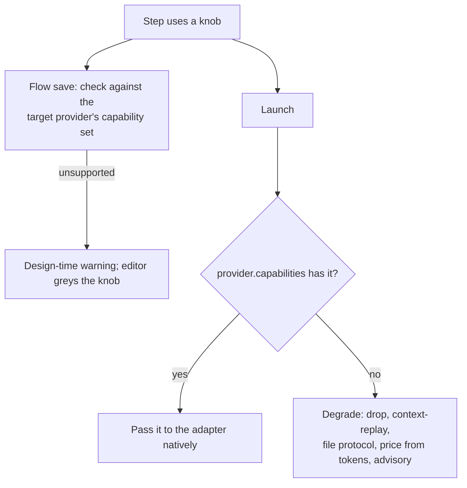

# Capability Negotiation

*"The key trick that makes graceful degradation cheap. The engine and flow editor query `capabilities` before using a knob"* (`01-ports.md`, *Capability negotiation*). Feature map §6 in plain words: *"FlowBoard checks what each can do and adapts, hiding options a tool can't handle."*

## Run-time: degrade, don't fail

The five rules in `01-ports.md`, plus one from PRD §7. The *Who degrades* column is sourced only for `effort` (*"adapter … editor"*), `mcp_tools` (`04` §9: *"the engine watches the `produces:questions` path"*) and `tool_hooks` (*"the flow editor"*); the rest is inferred ([[Agent Providers Open Questions]] #35).

| Missing | Degradation | Who degrades |
|---|---|---|
| `effort` | *"adapter drops it; editor greys the field."* | adapter + flow editor |
| `resume_fork` | *"park/resume falls back to **context-replay** (re-inject requires/produces + answers into a fresh prompt — which the spec already does anyway)."* | runner |
| `mcp_tools` | *"HITL uses the artifact-file fallback"* | runner / engine |
| `native_cost` | *"PricingService computes cost from tokens."* | cost ledger |
| `allowed_tools` | *"tool policy becomes advisory / prompt-level."* | runner (prompt) |
| `tool_hooks` | *"a provider without them relies on the sandbox alone, and the flow editor says so."* (PRD §7) | flow editor |

Both checks apply to the same knob: `effort` has a run-time fallback (drop it) *and* is a design-time warning (*"step uses effort but its provider lacks it"*, `01-ports.md`). The diagram is a reading of `01-ports.md` and `02` §2, not a source drawing.

### HITL, the biggest fallback

`04` §9: *"two integration strategies behind one interface, chosen by provider capability"*:

1. *"**MCP tool injection** where `mcp_tools` is present (Claude *and* Codex speak MCP) — synchronous feel, `ask_user_batch` preferred"*.
2. *"**Artifact-file fallback** for any provider without it — the engine watches the `produces:questions` path; when the agent writes it and exits, that *is* the batch."*

*"So HITL genericizes to **"MCP where available, file protocol universal."**"* (`04` §9). PRD §9 keeps it: *"The artifact-file exchange … remains the fallback for a provider without MCP."* See [[Ask Park And Resume]].

## Design-time: the capability contract

*"Validation (component 2) checks steps against the *target provider's* capability set, so "step uses effort but its provider lacks it" is a design-time warning, same machinery as the artifact contract."* (`01-ports.md`)

`02` §2: *"validation stays provider-independent *if* it validates against **capability descriptors** … rather than hardcoded knobs. Two design-time checks share one engine: 1. **Artifact contract** … 2. **Capability contract**: every knob a step uses is supported by its target provider."* The editor *"greys invalid edges *and* unsupported knobs"*.

A related check sits with packs: *"validation checks the pack's provider matches the step's provider"* (`05` §13). The capability-library mockup says a missing pack is refused, not warned: *"the flow editor refuses to save that combination, because a pack's provider has to match the step's."* See [[Provider Coverage And Portability]].

| Check | Severity in the sources |
|---|---|
| Knob unsupported by provider (e.g. effort) | *"design-time warning"* (`01-ports.md`) |
| Hooks unsupported | *"the flow editor says so"* (PRD §7) |
| Pack provider ≠ step provider | refuses to save (capability-library mockup) |

> [!warning] Gaps
> - The *target provider* of a step is never stored: `step_defs` has no provider column (PRD §5). [[Agent Providers Open Questions]] #14.
> - Validation runs on save in `apps/web` (drawio *Flow validation on save*), while providers are adapters the core may not import. How the web process gets a provider's capability set is not said. [[Agent Providers Open Questions]] #26.
> - In v1 (Claude-only) the capability contract has one provider to check against; [[Capability Library Decisions]] D1 drops the provider-match check.

## Related

- [[Provider Capabilities]]
- [[Flow Validation]]
- [[Session Resume And Context Replay]]
- [[Models And Effort]]
- [[Agent Providers Index]]
