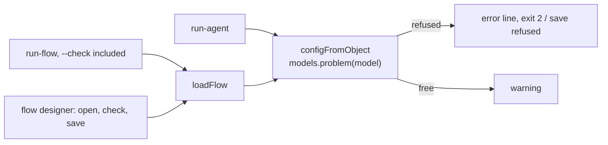

# OpenRouter Models And Key

OpenCode reaches most of its models through OpenRouter. FlowBoard controls two things about those runs: **which models a step may use**, and **which OpenRouter key pays for them**. Both are app-wide settings, for every project. FlowBoard has no OpenRouter adapter: the runs still go through [[OpenCode Adapter|OpenCode]], and these settings only decide what OpenCode is allowed to run on.

> [!check] Built 2026-11-13
> On `feature/opencode-models`, merged into `dev` as `0839946`. Code: `packages/cli/src/openrouter.ts` (the key, the model list, the rules), `packages/cli/src/settings.ts` (`ApprovedModel`, `modelProblem`, `isFree`), the check in `packages/cli/src/config.ts`, the pages in `app/settings/openrouter.tsx`, the routes under `app/api/openrouter/`. Tests: `packages/cli/test/openrouter.test.ts`.

## The rule

An OpenCode step runs only on an **approved** model. Free and paid models both need approving; nothing is allowed by default.

| The step's model | What happens |
|---|---|
| Approved, priced as when it was approved | Runs |
| Approved, and free | Runs, with a privacy warning |
| Not approved | Refused: `<model> is not an approved model; approve it in Settings → Agents → OpenCode models` |
| Approved, but OpenRouter no longer lists it | Refused: `<model> is no longer listed by OpenRouter; pick another model` |
| Approved, but now dearer, input or output | Refused until approved again: `<model> costs more than when you approved it (output $0.4 → $0.6 per million tokens); approve it again in …` |

A model that got cheaper still runs. Without a saved model list (before the first fetch), only the approval is checked.

**The privacy warning.** A free model costs no money, but its provider may keep the prompts and train on them, and the prompts include the project's code. FlowBoard says so when you approve a free model, under the model field wherever you pick one, in a flow's check (`steps.<name>.model: <model> is a free model: …`) and at the start of a `run-agent` run. It warns; it never blocks. If OpenRouter refuses a free model over your data policy, allow such providers in your OpenRouter privacy settings.

## Where you set it

| Page | What it does |
|---|---|
| **Settings → Connections → OpenRouter** (`/settings/connections/openrouter`) | Save, replace or remove the key. Shows which key runs would use, by its last four characters, never the key. **Test** asks OpenRouter for the key's name, credit limit, spend and what is left |
| **Settings → Agents → OpenCode models** (`/settings/agents/models`) | OpenRouter's models with their prices per million input and output tokens and context size, filtered by text or by *all / free / approved*. A checkbox approves a model; a free one asks first, with the privacy warning. A banner lists each approved model that is refused now, with **Approve again** or **Remove**. **Fetch again** reloads the list from OpenRouter |

The model is then **picked, never typed**, from the approved models:

- in the flow designer, on an OpenCode step and in the flow's defaults when their adapter is OpenCode;
- on **Internal steps**, when a step runs on OpenCode (switching to OpenCode empties the model; **Save** stays off until one is picked);
- on **Agents**, as OpenCode's default model, with *none: each step names one*.

Each list marks free models (`· free`). A model the file or setting already names that is not approved stays shown, marked *(not approved)*, until it is changed.

## Where it is enforced

The check sits in `configFromObject` (`config.ts`), which every OpenCode run passes through:



- `run-agent` and `run-flow` get FlowBoard's data folder from `defaultDataDir()`: `FLOWBOARD_DATA_DIR`, else `data/` in the app's folder, as the app has it. A run started from the runs page is handed the app's own data folder.
- The flow designer's routes (`/api/flows`, `/api/flows/<name>`, `/api/flows/<name>/check`) pass the same rules, so a flow with a refused model shows the error and **cannot be saved**, as with any other check error.
- Saving OpenCode's default model or an internal step's OpenCode model refuses one that is not approved (`updateAppSettings`). Withdrawing an approval later is allowed; runs then refuse the model.
- A resumed run (`run-flow --resume`) keeps the models it was checked with when it started.
- Without a data folder, as in the package tests, no model is checked (`ModelRules` is optional on the loaders).

## The key

| | |
|---|---|
| Stored in | `secrets.json` in FlowBoard's data folder, `{ "openrouter": "sk-or-…" }`, written owner-only (mode `0600`). Windows ignores the mode: there, whoever can read the data folder can read the key |
| Never in | `settings.json`, which `/api/settings` sends to the pages |
| Accepted | `sk-or-` and 8 to 300 more characters, no spaces; OpenRouter's **Test** says whether it works |
| Overridden by | `OPENROUTER_API_KEY` in FlowBoard's environment, which wins over the saved key |
| How a run gets it | `run-agent` and `run-flow` put the saved key in `OPENROUTER_API_KEY` at start, unless one is set. OpenCode's server inherits it; the Docker sandbox passes it when `sandbox.env` names it; OpenSandbox injects it at the egress proxy as before. Shell steps never get it: their environment drops every `*_KEY` |
| Without one | Runs use OpenCode's own credentials (`opencode auth login`), as before |

Not the OS keychain: FlowBoard may run on Windows too, and a file works on every OS (Alex, 2026-11-13). `@napi-rs/keyring` would move it into the macOS Keychain, Windows Credential Manager or Linux Secret Service if a plain file is ever not enough.

For a hard ceiling outside FlowBoard, give the key a credit limit on openrouter.ai.

## The model list

| | |
|---|---|
| Source | `GET https://openrouter.ai/api/v1/models`, public, no key sent |
| Saved as | `openrouter-models.json` in the data folder: `{ fetchedAt, models: [{ id, name, free, price: { in, out }, context }] }` |
| Prices | OpenRouter's per-token prices × 1,000,000, so dollars per million tokens |
| Ids | OpenRouter's id with `openrouter/` in front, as an OpenCode step names it |
| Free | input and output price both `0` |
| Left out | models with a negative or missing price (OpenRouter's own routers, such as `openrouter/auto`) |
| Fetched again | when over an hour old: by the settings pages, and by `run-agent` and `run-flow` at start when any model is approved; **Fetch again** forces it. A failed fetch keeps the saved list and says so (`-- warning: could not fetch OpenRouter's models: …`) |

The designer's check never fetches: it uses the saved list.

## The approved list

`AppSettings.opencodeModels`, in `settings.json`:

```json
[{ "id": "openrouter/deepseek/deepseek-v4.1-flash", "free": false, "price": { "in": 0.3, "out": 1.2 }, "approvedAt": "2026-11-13T18:00:00.000Z" }]
```

`price` is what OpenRouter listed when the model was approved; a later rise is compared against it. Ids must start with `openrouter/` and appear once. The default is `[]`.

## Routes

| Route | Does |
|---|---|
| `GET /api/openrouter` (`?refresh=1` to fetch now) | `{ key: { source: 'env' \| 'saved' \| null, last4 }, catalogue, error?, approved: [{ …, free, problem }] }` |
| `PUT /api/openrouter/key` `{ key }` | Saves the key; answers with `key` as above |
| `DELETE /api/openrouter/key` | Removes the saved key |
| `POST /api/openrouter/key` | Tests the key runs would use against OpenRouter's `/key` |
| `PATCH /api/settings` `{ opencodeModels }` | Approves or withdraws models (the page sends the whole list) |

Like every FlowBoard route, they answer only on localhost, and refuse a change from another site.

## Limits

- **OpenRouter models only.** An OpenCode step on another provider (`opencode/…`, `ollama/…`, `anthropic/…`) cannot be approved, so it is refused. Ollama and approving other providers' models are not built.
- **Which key wins inside OpenCode** when its own `auth.json` also holds an OpenRouter key is OpenCode's rule; not checked.
- **A price rise is seen only once the list is fetched again**, within the hour, or at the next run.
- **No direct model calls.** FlowBoard calls OpenRouter only for the model list and the key test; every model call is OpenCode's. A model-provider service of FlowBoard's own (for tool-less steps such as the backlog importer) was analysed and left out of scope (Alex, 2026-11-13).
- **Not used for cost.** The run's cost still comes from OpenCode's `usage`; the list's prices are not read by `budget_usd` or a pricing service. See [[Pricing Service]].

## Related

- [[OpenCode Adapter]] — how the runs themselves work
- [[Providers And Sandboxing]] — credentials per tier
- [[Run Config Reference]] — the `model` field
- [[Run Flow Reference]] — checks, warnings and the run's output
- [[Settings Catalogue]] — every app setting
- [[Agent Providers Index]]
