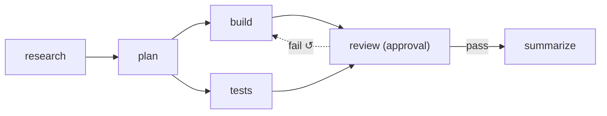

# Run Flow Monitor Readiness

Is the flow orchestration behind `pnpm run-flow` ready for what the [[Monitor Index|Monitor]] describes? This note answers for the code on branch `feature/flow-orchestration`, as of 2026-10-20, brought up to date for the fixes of 2026-10-23 that followed the [[Flow Orchestration Conformance Audit]], and for Alex's three calls of that day: a flow file is a reusable recipe, a flow has a budget ceiling, and what a dead host left running is stopped. No code was changed to write it.

> [!summary] Short answer
> Not yet, though half of it is ready. The engine already follows the rules the Monitor shows, and it runs the Monitor's own flow. What doesn't exist yet is everything the Monitor reads its data from. `run-flow` runs one flow in one terminal and writes files. The Monitor expects many tasks, a database it can read and live updates in a browser. That missing part is the worker and job queue, which [[Run Flow Reference]] leaves for later.

## The Monitor's flow as a run-flow file

The mockup's six steps and models ([[Monitor Sample Data]]), with `review` the only gate and its send-back going to `build`:

```yaml
budget_usd: 10   # the most the whole flow may spend; 0 for no ceiling
defaults: { adapter: claude-code, model: sonnet, limits: { max_turns: 30 } }
steps:
  research: { prompt: p.md, model: haiku, produces: [brief] }
  plan: { prompt: p.md, model: opus, requires: [brief], produces: [plan] }
  build: { prompt: p.md, model: opus, requires: [plan], produces: [changes] }
  tests: { prompt: p.md, requires: [plan], produces: [test_report] }
  review: { prompt: p.md, requires: [changes, test_report], produces: [review], gate: approval }
  summarize: { prompt: p.md, model: haiku, requires: [review], produces: [summary] }
edges:
  - { from: research, to: plan }
  - { from: plan, to: build }
  - { from: plan, to: tests }
  - { from: build, to: review }
  - { from: tests, to: review }
  - { from: review, to: summarize, condition: on_pass }
  - { from: review, to: build, condition: on_fail }
```

The file is a reusable recipe, so a run gives it a folder and a task: `pnpm run-flow --folder proj --task task.md monitor.yaml`. `--check` prints `-- flow ok: 6 steps, starting at research` and exits 0, on the recipe alone or with the same `--folder` and `--task`. `p.md`, beside the flow file, stands in for real prompts, and `task.md` and the folder `proj` for a task and a project; `--check` only needs them to exist and the files not to be empty (an empty one is an error, such as `--task: file is empty`). `--mermaid` draws the send-back as the dotted line:



## What already matches

- **The four hand-off rules** of [[Hand-Off Rules]] work as the guide describes them:
  - the next step starts when one finishes;
  - one step can start several, which run in parallel;
  - a step that several feed waits for all of them;
  - a send-back reruns `build` and the steps after it, but not `tests`. The guide says the same: *"Tests are not re-run — they already passed, and that result still stands."*
- **The person's decision wins.** Approve passes the step whatever the agent said, and Reject fails it. The note typed at Reject goes into the prompt of `build`'s next run, as the guide's *Send back* hands over its reason ([[Monitor Actions And Costs]]). If `build` has used its attempts, the note waits on the escalation gate, and Retry there passes it on unless a new one is typed. A note typed at Approve goes to `summarize`'s run (Claude's call, 2026-10-23, open to Alex's review; see [[Run Flow Reference#Rules this command settles]]).
- **No outcome is never a pass.** A step with a conditional edge that reports no outcome stops at a `no outcome reported` gate. An agent that leaves a declared output unwritten stops at `did not write: <types>`.
- **Escalate instead of failing**, as backlog decision D3 says ([[Failures And Retries]]). When a loop runs out of attempts, the flow stops at `build has used 3 of 3 attempts` and offers Retry or Fail the flow. Retry doesn't reset the count. A check that fails the same way twice stops early. Only a person fails a flow.
- **Wasted spend is a flag on each run, and the cost stays on the run.** Spent is the sum of every run's cost, and wasted is the part on flagged runs. So neither mockup bug in [[Monitor Open Questions]] #17 can happen: a rejected review's cost dropping out of *today*, or a stopped run counted twice. A run whose provider reported no price, such as a Claude run stopped before its result, keeps `costUsd: null`: the totals leave it out, and the summary adds `cost unknown for N runs`. The flow's ceiling is in `flow.json` as `config.budgetUsd`, `0` for none (Alex's call, 2026-10-23), so a reader can show what is spent against it.
- **Every gate says why it stopped.** It records its kind (`verdict`, `escalation` or `run_failed`), a reason and the files to read. That covers the three reasons PRD §8 gives for a gate, which #33 says each need their own wording: an approval step (`approval needed`), no outcome (`no outcome reported`), and a spent or stuck loop, which lists the failing step's outputs. Every reason is listed under *Gates and their choices* in [[Run Flow Reference]].
- **The board can be computed from saved state.** The engine is a pure function. `state.json` holds its whole state after each transition, and `flow.jsonl` logs each transition with its time. That's the shape [[Board Projection]] and [[Monitor Data Model]] ask for: *"The monitor writes nothing of its own."* No flow-level status is stored: paused (a step at a gate, nothing live) and stopped (a step running with no live run) are read from the steps and runs (Claude's call, 2026-10-23). A flow paused because its budget is spent is stored as one of the two; a reader tells it by its spend reaching the ceiling in `flow.json` (pausing there is Claude's call, open to Alex's review).
- **Queued versus running.** A run is `queued: true` in `state.json` from the engine's run command until the host feeds it a `launched` event, which `flow.jsonl` logs as its own line. So the Monitor's `queued` (#7) is in the saved state, and a run cut off while still queued behind `--max-runs` is recorded `not launched`, not wasted. The host feeds `launched` as soon as it starts the run.
- **Events already have one shape.** Each agent run's log holds the provider's events as normalized events, with the raw line kept ([[Normalized Event Envelope]]). Both providers also report running token totals mid-run, and OpenCode's include dollars. A shell run's log has no events: a `start` line, then a `pid` line, then, when the shell exits, a `result` line whose `output` holds the last 20,000 characters it printed. A run's log has a `pid` line once its process starts: the agent CLI's pid, or the check's process group id, with `started`, the process's start time as `ps` prints it. With both, a reader can tell whether the run's process still runs, even once its pid has gone to another process.

## Monitor open questions the engine answers

Numbers are those of [[Monitor Open Questions]] unless marked.

| # | Question | `run-flow`'s answer |
|---|---|---|
| 7, 41 | Do later steps become `skipped` after a send-back, and does a skipped one still count as furthest? | There is no `skipped`. A send-back removes the records of the steps after the target, and they get new ones when the work reaches them again. So the furthest step is the one running again |
| 8, 42 | Does an asking run free its worker, and is waiting free? | Not in `run-flow`. An asking agent stays alive and counts toward `--max-runs`, but spends no tokens while it waits, and its `timeout_minutes` clock stops |
| 11 | Is an infra failure an attempt? | Never. It stops at a `run failed: <error>` gate, and Retry keeps the attempt number. A check that cannot run its command (exit 126 or 127) or dies by a signal counts as one. `run-flow` has no sandbox, so no egress denials yet |
| 12 | Retry with a note, and Fail task | Retry carries the note typed at its gate into the next run. With none typed, Retry at a *run failed* or verdict gate keeps the note the attempt started with, and at an escalation the note typed at the Reject. *Fail the flow* stops every run |
| 17 | What counts as wasted? | Failed runs, runs cut off by Ctrl+C or by a spent budget, runs replaced by Retry, and on a send-back every run so far of `build` and the steps after it, the rejected review included. That's the guide's broad definition, not PRD §5's narrower one, except that runs stopped by *Fail the flow* are not wasted, by the plan's choice. Nor is a run cut off before it launched, which spent nothing |
| 35 | Does a stopped run get retried automatically? | No. Nothing retries by itself. A run cut off by Ctrl+C runs again only when you `--resume`, at the same attempt; one cut off by a spent budget, only when you `--resume` with a larger `--budget-usd` |
| 38 | Live cost has no source path | Partly answered. A `usage` event now carries running totals mid-run, and `run-flow` writes each one to the run's log as it comes. OpenCode's include dollars ($0 for a model it has no price for), so a reader of the run logs can show an OpenCode run's live cost today. Claude's are tokens only, and no price table turns them into dollars. `state.json` gets a run's cost only when it ends: a Claude run stopped before its result is recorded as `costUsd: null`, cost unknown |
| 47 | Read review.md shows no review | An approval gate lists the step's own outputs as files to read, so a gated review shows its `review.md` |
| Flow Design #11 | Do capped retries fail the task? | No. They escalate to a gate (D3) |

## What's missing

### Data the engine doesn't keep yet

Each is small: the host stamps the event, and the engine stores it.

- **Times.** When a run started and ended, and when a gate opened. The Monitor needs them for *waited 12m* and oldest-first order in the [[Needs You Band]], the ESCALATED tag ([[Waiting And Escalation]]), the [[Timeline View]] and the *longest running* sort ([[Pulse View]]). Today they exist only as the `at` of lines in `flow.jsonl` and the run logs, not in `state.json`. A gate's start time is #22.
- **Asking.** There's no asking state. A question exists only in the terminal and the run log.
- **The model, tokens and turns of each run.** The run record keeps only the cost. The model is in the run log's `start` line, and the tokens in its `result`, where `run-flow` keeps them: `state.json` holds only the engine's fields (Claude's call, 2026-10-23).
- **Live cost.** As #38 above: OpenCode's running dollars are in its runs' logs, but there's no price table for Claude, and `state.json` gets a run's cost only at its end. So a Claude run has nothing yet for a row's live cost or for burn ([[Burn Today And Wasted]], #15). What the budget counts as spent lags the same way: it sums the runs that have ended.
- **A check's live output.** A shell run's output reaches its log only when the shell exits, in the `result` line, and the terminal shows only its last line. A running check has nothing for the [[Live Run Viewer]] or a row's log. Logging the output as it arrives is host work, and small too.

### Controls from outside the terminal

- **Approve, Send back, Retry and Fail** work only in the terminal running the flow. With no terminal attached, gates pause the flow. The engine already takes these decisions as `decide` events. What's missing is a way for a web page to deliver them to the running flow ([[Monitor Controls]]).
- **Answering a question** also works only in the terminal, and with no terminal attached questions are refused. An answer is not a `decide` event: each agent run's broker calls the host's answerer, the terminal or a refusal. A page that answers needs an answerer it can reach, such as the worker broker's park path ([[Ask Park And Resume]]); parking is on the plan's *Left out* list.
- **Stopping one run.** Today only Ctrl+C exists, and it stops the whole flow. The engine already handles a run that ends with an error the way the guide wants a stop handled (*"recorded as failed, with "stopped by you" as the reason"*): a `run failed: stopped by you` gate, with the run marked wasted. So this is work in `run-flow`'s run loop only, not in the engine (#14, #36).
- **Allow host & retry.** `run-flow` has no sandbox, so there's no egress allowlist to edit (#13).

### The runtime the Monitor assumes

- **Many tasks at once.** `run-flow` runs one flow per process, with one lock per folder. There are no task records, no backlog and nothing to promote or start (#24), and no pool of worker slots shared across tasks ([[Worker Slots]], #20).
- **The tables the Monitor reads** ([[Monitor Data Model]]): `tasks`, `step_instances`, `runs`, `run_events`, `questions`, `artifacts`, `jobs` and `settings`. `state.json` maps closely onto `step_instances` and `runs`, and the run logs onto `run_events`. But the log lines have no `seq`, so a client that reconnects can't resume where it left off ([[Event Stream And SSE]]).
- **A live feed.** No API and no SSE ([[Monitor API And Routes]], #30). Nothing outside the terminal can watch a run except by reading its files.
- **Pushing a long wait to another channel.** No escalation timers, and no gate times to base them on ([[Waiting And Escalation]]).
- **Automatic retries of passing failures**, such as rate limits (PRD §7). `run-flow` has none, so every rate limit would land in Needs You (#37).
- **Safe to leave running.** What a crashed or killed host left running is stopped only when a `run-flow` next starts in its folder, or resumes its run: it stops each run whose log has a `pid` line and no `result`, while the process's start time still matches the log (Alex's call, 2026-10-23; the start-time check is Claude's, open to Alex's review). Until then those agents and checks keep running, and an agent's CLI is stopped without what it started ([[Run Flow Deferred Issues]]). Resuming takes a manual `--resume`, and every run works in the one folder, with no workspace per task.
- **Flow versions.** Each run pins its own copy of the flow in `flow.json`, but there's no version number for the topbar's `v4` (#3). Now that a flow file is a reusable recipe, a hash of it would name its version; none is recorded until the flow library or the Monitor reads one (Claude's call, 2026-10-23, open to Alex's review).

### Where `run-flow` breaks the Monitor's design

- The Monitor assumes every step has a model. `run-flow` allows shell steps with none, which the tooltip's `Label · model`, the slot's model column and the per-model burn don't fit (#28).
- The Monitor assumes every row runs the same flow. Every `run-flow` run can use a different one (#3).

## Order to build it in

1. **The data additions:** times, asking, and the model and tokens of each run, plus a check's output logged as it arrives. Still small, and pure engine code but for the output, which the host logs.
2. **Stopping one run, and a price table for Claude**, so live dollars and burn exist for Claude runs too, and a Claude run stopped before its result counts against the budget. Small.
3. **A read-only Monitor over the run folders**, reading `flow.json` and watching `state.json`, `flow.jsonl` and the run logs for changes. It would show the task rows, flow bars, spend against each flow's budget, wasted spend, the Needs You band and each run's live log, with decisions still made in the terminal. Medium, and it doesn't need the worker.
4. **The worker:**
   - many flows sharing one pool of slots, with a saved queue;
   - decisions through the database, answers through an answerer the page can reach, and cleanup when the worker restarts after a crash, as `run-flow` already does from the run logs' `pid` lines;
   - then the tables, the API and the live feed.

   This is what the full Monitor needs. Large.

## Related

- [[Run Flow Reference]]
- [[Run Flow Deferred Issues]]
- [[Monitor Index]]
- [[Monitor Open Questions]]
- [[Agent Providers Index]]
