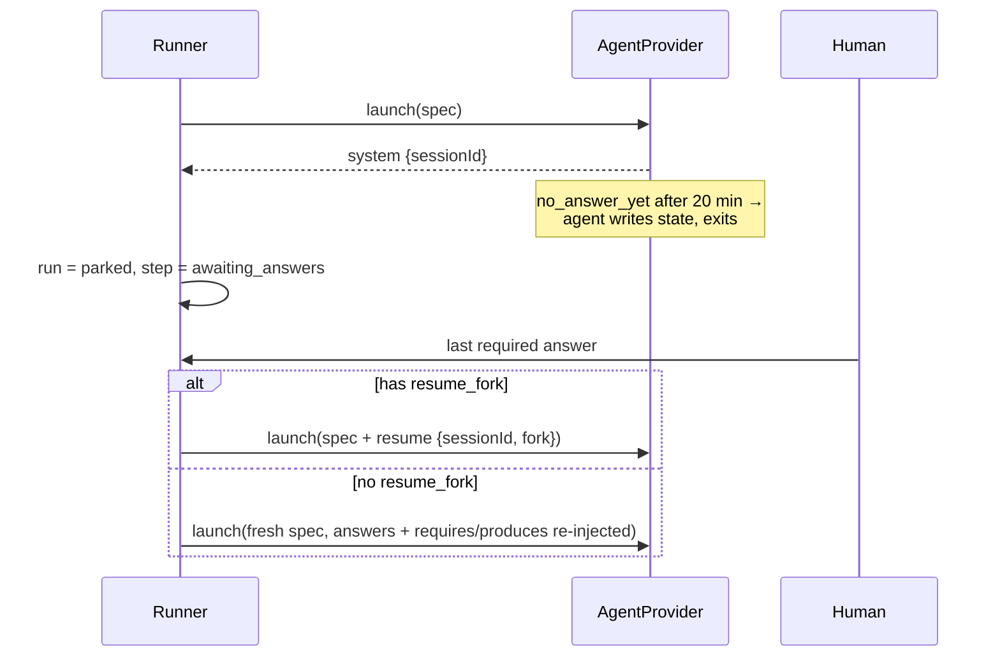

# Session Resume And Context Replay

How a parked run continues, and how that depends on the provider.

## The durable primitive

`04` §9: *"the fundamental protocol is not MCP. It is: agent emits a `questions` artifact → engine **parks** the run → human answers → engine **resumes** with an `answers` artifact in context."* Underneath, *"park (write state, exit) + resume (`--resume --fork-session`, or context-replay) is the durable primitive"*. The architecture README calls it *"a provider-agnostic HITL primitive hiding under the MCP sugar"*.

## Two ways to resume

| Path | When | How |
|---|---|---|
| **Fork the session** | provider has `resume_fork` | `RunSpec.resume = { sessionId, fork: true }`; Claude: *"resumes with `--resume <claude_session_id> --fork-session` and a prompt containing the answers"* (PRD §9) |
| **Context-replay** | provider lacks `resume_fork` | *"re-inject requires/produces + answers into a fresh prompt — which the spec already does anyway"* (`01-ports.md`) |

> [!important] The resume prompt repeats the paths
> *"Resume prompt must repeat the requires/produces paths, not only the answers."* (backlog Story 3.2, **BUG**; `03` §6). This is also what makes context-replay *"what the spec already does anyway"*.

PRD §9 on why parking beats waiting: *"This is more robust than trying to hold a session alive for hours."*

## Session ids

- `AgentRun.sessionId` *"Resolves once the provider emits its session id (from system/init)"* (`agent-provider.ts`).
- PRD §7 passes `--session-id <generated uuid, stored as runs.claude_session_id>`: the runner chooses the id up front. The two descriptions disagree on who creates it: [[Agent Providers Open Questions]] #5.
- `02` §1 renames the column: *"Rename `runs.claude_session_id → agent_session_id`; add `runs.provider`."* PRD §5 keeps `claude_session_id`: [[Agent Providers Open Questions]] #16.
- `sessions` capability: *"a stable session id is reported"*.

## The resume race

*"answer arrives while the process is still exiting → `maybeResume` sees `running` and skips, then completion marks the step done without the agent ever seeing the answers. Make completion re‑check "answers arrived after last poll" and resume instead."* (backlog Story 4.2, **BUG**). Provider-neutral; it lives in the runner. See [[Ask Park And Resume]].

## Codex

Spike risk point (a): *"session/resume semantics vs Claude's `--resume --fork-session`"* (`01-ports.md`). Unresolved: [[Agent Providers Open Questions]] #19.

## Related

- [[Ask Park And Resume]]
- [[Capability Negotiation]]
- [[Prompt Assembly]]
- [[Claude Code Adapter]]
- [[Codex Adapter]]
