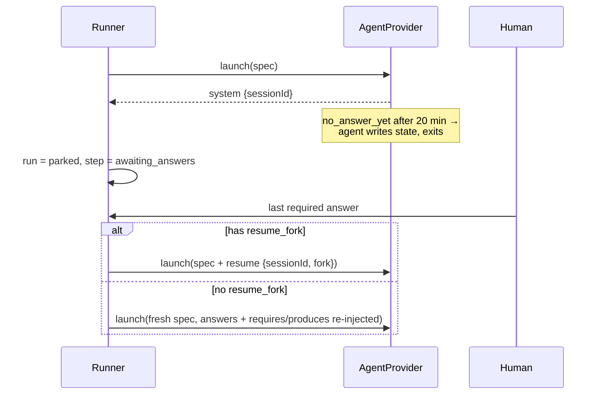

# Session Resume And Context Replay

How a parked run continues, and how that depends on the provider.

> [!info] Design, not built
> Parking is not on `dev` as of 2026-10-22. No runner exists, so nothing parks a run or replays context, and the resume-race fix below is not built. The `no_answer_yet` reply exists only as a type (`AskReply` in `core/src/hitl/question.ts`) that the ask-user shim would relay; nothing sends it. Instead, both adapters lift their MCP time limits, so a question waits for its answer indefinitely ([[Run Agent CLI Decisions]] R20). What is built: provider-reported session ids, and resume with or without a fork in both adapters (below).

## The durable primitive

`04` §9: *"the fundamental protocol is not MCP. It is: agent emits a `questions` artifact → engine **parks** the run → human answers → engine **resumes** with an `answers` artifact in context."* Underneath, *"park (write state, exit) + resume (`--resume --fork-session`, or context-replay) is the durable primitive"*. The architecture README calls it *"a provider-agnostic HITL primitive hiding under the MCP sugar"*.

## Ways to resume

The design names two ways. The port also allows a third, a resume without `fork` (`fork` is optional); no source says when to use it.

| Path | When | How | As built |
|---|---|---|---|
| **Fork the session** | provider has `resume_fork` | `RunSpec.resume = { sessionId, fork: true }`; Claude: *"resumes with `--resume <claude_session_id> --fork-session` and a prompt containing the answers"* (PRD §9) | Both adapters. Claude: the SDK's `resume` and `forkSession`. OpenCode: `session.fork`, then the run's permission rules are re-applied, because a fork drops them |
| **Continue in place** | not stated | `RunSpec.resume = { sessionId }`, without `fork` | Both adapters. Claude: `resume` without `forkSession`. OpenCode: prompts the same session again, after re-applying the run's permission rules, because the session keeps the old run's |
| **Context-replay** | provider lacks `resume_fork` | *"re-inject requires/produces + answers into a fresh prompt — which the spec already does anyway"* (`01-ports.md`) | Not built |

No caller passes `resume` yet: `run-agent` has no resume setting. Tests cover the Claude option mapping (with a fork) and OpenCode's fork against a fake server. No test covers OpenCode's plain resume.

> [!important] The resume prompt repeats the paths
> *"Resume prompt must repeat the requires/produces paths, not only the answers."* (backlog Story 3.2, **BUG**; `03` §6). This is also why `01-ports.md` can say context-replay is something *"which the spec already does anyway"*.

PRD §9 on why parking beats waiting: *"This is more robust than trying to hold a session alive for hours."* The build waits for now: the session stays alive until the question is answered (R20).

## Session ids

- `AgentRun.sessionId` *"Resolves once the provider emits its session id (from system/init)"* (`agent-provider.ts`). The shipped port adds that it *"rejects if the run ends without one"*.
- PRD §7 passes `--session-id <generated uuid, stored as runs.claude_session_id>`: the runner chooses the id up front. [[Agent Providers Open Questions]] #5 decided on 2026-10-18 that the provider reports it instead:
  - Claude takes the id from the first `system/init`; the adapter passes no `--session-id`. A fork gets a new id.
  - OpenCode takes it from the session create or fork response, since the server chooses the id, and emits it as a synthesized `system` event. A plain resume reports the id it was given.
  - If no id arrives, `sessionId` rejects with the run's error, or with `run ended without a session id`.
- `02` §1 renames the column: *"Rename `runs.claude_session_id → agent_session_id`; add `runs.provider`."* PRD §5 keeps `claude_session_id`: [[Agent Providers Open Questions]] #16.
- `sessions` capability: *"a stable session id is reported"*.
- A fork starts a new CLI process with its own `result` and `total_cost_usd`. Whether the resumed run's cost adds to the parked one or already includes it is [[Cost And Control Open Questions]] #16. On OpenCode, the adapter subscribes to events only after the fork, so the cloned history does not count in the new run's events or usage. On Claude, whether a resumed run replays earlier messages was not checked ([[Provider Implementation Decisions]] C9).

## The resume race

*"answer arrives while the process is still exiting → `maybeResume` sees `running` and skips, then completion marks the step done without the agent ever seeing the answers. Make completion re‑check "answers arrived after last poll" and resume instead."* (backlog Story 4.2, **BUG**). Provider-neutral; it lives in the runner. See [[Ask Park And Resume]].

## Codex

Spike risk point (a): *"session/resume semantics vs Claude's `--resume --fork-session`"* (`01-ports.md`). Unresolved: [[Agent Providers Open Questions]] #19.

## Related

- [[Ask Park And Resume]]
- [[Capability Negotiation]]
- [[Prompt Assembly]]
- [[Claude Code Adapter]]
- [[OpenCode Adapter]]
- [[Codex Adapter]]
- [[Run Agent CLI Decisions]]
