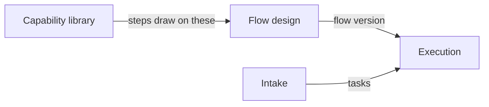

# Capability Library Overview

## Purpose

FlowBoard runs tasks through **flows**: versioned graphs of steps, where each step is one agent doing one job. A step does not carry its own instructions from scratch. It names a reusable building block — a **skill** ("run `/code-review`") or an **agent** ("be the `reviewer`") — and the library is where those building blocks are installed, defined, inspected, updated and removed.

The feature map summarises it as: *"Your reusable building blocks: skills (packaged instructions) and agents (defined roles) that steps draw from."*

## Where it sits

In the functional-components diagram (`flowboard-ideation.drawio`, page *Functional components*) the Capability library is one of the top-level functional groups, with a single outgoing edge:

The library feeds **design time**, not run time directly. Flow design picks capabilities; execution later mounts whatever the pinned flow version names (see [[Capability Runtime Mounting]]).

In the logical-components diagram it appears as *Skills & agents — install, edit, list*, which writes to the *Disk* store (worktrees, artifacts, skills, session logs). The ideation page names its routes `/skills` and `/agents`. In the harness-architecture diagram it is a piece of **durable state on the host filesystem**: `skills/<slug>/SKILL.md` as plugin dirs, plus agent definitions, installed from GitHub by `git clone`.

## What the module does

| Function | Summary | Note |
|---|---|---|
| Install a skill from GitHub | Clone, parse `SKILL.md`, review, confirm | [[Installing A Capability From GitHub]] |
| Define an agent | Prompt, default model, default effort, allowed tools | [[Agent Capabilities]] |
| Bundle a capability pack | Skills + agents + flows as one installable unit | [[Bundle Packs]] |
| Show provider coverage | Which agent CLIs each capability is packaged for | [[Provider Coverage And Portability]] |
| Flag network-capable tools | Mark tools that interact with egress | [[Capability Tools And Egress]] |
| Update | Move to a newer upstream commit | [[Updating And Removing Capabilities]] |
| Remove | Delete, blocked while any step uses it | [[Updating And Removing Capabilities]] |
| Show usage | "Used by" — which flows and steps draw on it | [[Capabilities In Flows]] |

## Design principles

- **Local-first.** Installing clones into a capability store on your machine. Nothing is fetched at run time.
- **Provider-agnostic core, provider-specific packaging.** The step names a logical capability; an adapter mounts the provider's packaging of it.
- **Preview before write.** Install shows the parsed manifest and requested tools before anything is written.
- **Additive by default.** Install, update and define are additive or reversible (re-install from the same commit). Remove is the only destructive action, and the only one the screen refuses outright.
- **Installing grants nothing.** A capability *declares* the tools it wants; the step's sandbox still decides what it gets.

## Related

- [[Capability Library Index]]
- [[Capability Versus Provider Pack]]
- [[Capability Library Screen]]
- [[Capability Library Roadmap]]
