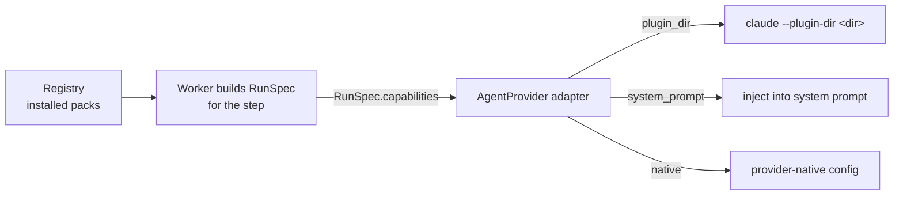

# Capability Runtime Mounting

How a capability gets from the library into a running agent.

## Path

1. The worker picks the step's capability from the pinned flow version.
2. It selects the **pack whose provider matches the step's provider** and places it in `RunSpec.capabilities`.
3. The adapter interprets `mount` in its own terms. *"The registry stores the pack; the adapter knows how to mount it."*

## Claude Code specifics

From PRD §7 and the backlog:

- **Skills** — one `--plugin-dir <install_path>` per installed skill. The PRD originally said `--add-dir`; that **does not register skills** and was fixed to `--plugin-dir` (backlog FIX, must not regress).
- **Agents** — `--append-system-prompt <agent.system_prompt>` for `kind='agent'`.
- **Tools** — `--allowedTools …`, always with `mcp__vibe__*` appended so a restrictive list cannot lock out `ask_user`.
- **Reproducibility** — `--strict-mcp-config` keeps personal MCP config out of runs; the args are snapshotted to `data/runs/<id>/args.json`.

## The prompt

The prompt builder assembles, in order:

1. Task, acceptance criteria, non-goals
2. Input artifacts — "read these first"
3. Output paths
4. **For `kind='skill'`: the slash invocation, e.g. `/grill-me`**
5. The step's `prompt_template`, with placeholders substituted
6. Headless instruction: use the `ask_user` MCP tool for questions
7. *(additive)* Recalled memory — scoped by user, project, **agent/skill**, task

## Inside the sandbox

From the harness-architecture diagram:

- **Mounts:** `rw` task worktree → `/work` · **`ro` `skills/` → `/skills`** · socket `ask.sock`
- **Never mounted:** `~/.ssh`, cloud credentials, `flowboard.db`, `docker.sock`
- Skill installs happen on the host (`git clone` from GitHub); the sandbox only reads them.

## Graceful degradation

| Provider lacks | Effect |
|---|---|
| `plugins` | Pack must use `system_prompt` or `native` mount |
| `allowed_tools` | Tool policy becomes advisory / prompt-level |
| `effort` | Adapter drops it; editor greys the field |

## Testing without GitHub

Seed skills are real local plugin dirs, so the question loop and flow engine are testable without network access. The `ReplayProvider` implements the same port for deterministic tests.

## Related

- [[Capability Versus Provider Pack]]
- [[Capability Storage On Disk]]
- [[Capability Tools And Egress]]
- [[Skill Capabilities]]
- [[Agent Capabilities]]
