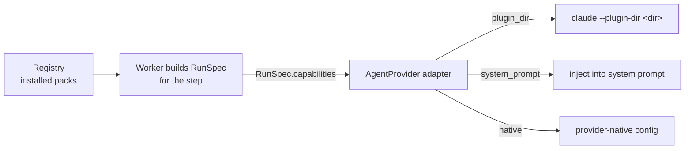

# Capability Runtime Mounting

How a capability gets from the library into a running agent.

## Path

1. The worker picks the step's capability from the pinned flow version.
2. It resolves the version from the task's **`capability_pins`** — the plugin commits and agent rows recorded at task start ([[Capability Library Decisions|D10]]).
3. It selects the **pack whose provider matches the step's provider** and places it in `RunSpec.capabilities`. In v1 that is the Claude plugin dir at the pinned commit: the plugin of the step's skill, plus the step's `extra_plugin_ids`. Agent steps mount only their extras (D14).
4. The adapter interprets `mount` in its own terms. *"The registry stores the pack; the adapter knows how to mount it."*

## Claude Code specifics

From PRD §7 and the backlog:

- **Skills** — one `--plugin-dir <commit dir>` per plugin **the step names** (D14). The PRD and backlog Story 3.2 pass one per *installed* skill to every run; v1 does not, because plugin hooks and MCP servers are mounted as-is (D8) and should only run where a step asked for them. `--add-dir` **does not register skills**; backlog Story 0.1 found this, and the PRD was corrected to match.
- **Agents** — `--append-system-prompt <agent.system_prompt>` for `kind='agent'`.
- **Tools** — `--allowedTools …`, always with `mcp__vibe__*` appended so a restrictive list cannot lock out `ask_user` (PRD §7, backlog Story 3.2).
- **Hooks** — `--settings <generated per-run settings.json with PreToolUse hooks>` (PRD §7): an in-agent gate that blocks writes outside the worktree, non-goal paths and destructive commands. Needs the `tool_hooks` capability flag.
- **Reproducibility** — `--strict-mcp-config` keeps personal MCP config out of runs (PRD §7); the args are snapshotted to `data/runs/<id>/args.json` (PRD §7, backlog Story 3.2).

## The prompt

The prompt builder assembles, in order:

1. Task, acceptance criteria, non-goals
2. Input artifacts — "read these first"
3. Output paths
4. **For `kind='skill'`: the slash invocation, fully qualified — e.g. `/grill-me:grill-me`** (D16; the PRD writes bare `/grill-me`)
5. The step's `prompt_template`, with placeholders substituted
6. Headless instruction: use the `ask_user` MCP tool for questions

With memory on, a **seventh part** — recalled memory, scoped by user, project, **agent/skill** and task — is inserted just before the closing instruction (part 6), capped at `settings.memory.max_recall_chars` (default 6,000). It never grows the other six parts. PRD §7 and `09-memory.md` place it there; the drawio *Prompt builder* label lists it after part 6.

## Inside the sandbox

From the harness-architecture diagram:

- **Mounts:** `rw` task worktree → `/work` · **`ro` `skills/` → `/skills`** · socket `ask.sock`
- **v1:** only the step's pinned plugin commit dirs are mounted read-only, not the whole store (D14).
- **Never mounted:** `~/.ssh`, cloud credentials, `flowboard.db`, `docker.sock`
- Skill installs happen on the host (`git clone` from GitHub); the sandbox only reads them.

`08-sandboxing.md` says *mount only the worktree (and the declared artifact dir)* and lists no skills mount. **Resolved (D14):** `claude` runs inside the task's container (PRD §7 *Sandboxed runs*), so it needs the plugin dirs; `08-sandboxing.md` is the doc to fix.

## Host tier

Without Docker, runs fall back to the host tier (PRD §11.1). A step whose plugins — its skill's or its extras — came from a git URL **does not run** on the host tier: their hooks and MCP servers would execute as you, with no egress wall. Seed plugins still run there (D15).

## Graceful degradation

| Provider lacks | Effect |
|---|---|
| `plugins` | Pack must use `system_prompt` or `native` mount |
| `allowed_tools` | Tool policy becomes advisory / prompt-level |
| `effort` | Adapter drops it; editor greys the field |
| `tool_hooks` | No in-agent gate; the sandbox alone enforces, and the flow editor says so |

## Testing without GitHub

Seed skills are real local plugin dirs, so the question loop and flow engine are testable without network access. The `ReplayProvider` implements the same port for deterministic tests.

## Related

- [[Capability Library Decisions]]
- [[Capability Versus Provider Pack]]
- [[Capability Storage On Disk]]
- [[Capability Tools And Egress]]
- [[Skill Capabilities]]
- [[Agent Capabilities]]
