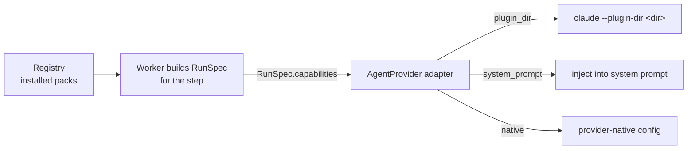

# Capability Runtime Mounting

How a capability gets from the library into a running agent.

## Path

1. The worker picks the step's capability from the pinned flow version.
2. It resolves the version from the task's **`capability_pins`** — the plugin commits and agent rows recorded at task start ([[Capability Library Decisions|D10]]).
3. It selects the **pack whose provider matches the step's provider** and places it in `RunSpec.capabilities`. In v1 that is the Claude plugin dir at the pinned commit: the plugin of the step's skill, plus the step's `extra_plugin_ids`. A step without a skill mounts only its extras (D14).
4. The adapter interprets `mount` in its own terms. *"The registry stores the pack; the adapter knows how to mount it."*

> [!warning] The shipped code differs
> No registry or worker is built; `run-agent` stands in. Its YAML `plugins:` become `plugin_dir` packs, and its `skills:` folders are copied into a temporary plugin named `local`, so `/name` becomes `/local:name` ([[Run Agent CLI Decisions]] R26). Claude Code passes each `plugin_dir` to the Agent SDK's `plugins` option (one `--plugin-dir` each), appends `system_prompt` text and ignores `native`. OpenCode reads only the dir's `skills/` folder (`skills.paths`), puts `system_prompt` text in the prompt's `system` and merges `native` config. Since 2026-10-18; [[Agent Providers Open Questions]] #2.

## Claude Code specifics

From PRD §7 and the backlog:

- **Skills** — one `--plugin-dir <commit dir>` per plugin **the step names** (D14). Earlier drafts of the PRD and backlog Story 3.2 passed one per *installed* skill to every run; v1 does not, because plugin hooks and MCP servers are mounted as-is (D8) and should only run where a step asked for them. `--add-dir` **does not register skills**; backlog Story 0.1 found this, and the PRD was corrected to match.
- **Agents** — `--append-system-prompt <agent.system_prompt>` whenever the step names an agent; a step with both an agent and a skill gets this *and* the slash invocation (D27). As built (2026-10-18) the agent prompt is `RunSpec.systemPrompt`: the Claude Code adapter appends it to Claude Code's own system prompt through the Agent SDK's `systemPrompt` option (the `claude_code` preset), with no `--append-system-prompt` flag, and OpenCode sends it as the prompt's `system`.
- **Tools** — `--allowedTools <agent ∩ skill, narrowed by the step>` (D28), always with `mcp__vibe__*` appended so a restrictive list cannot lock out `ask_user` (PRD §7, backlog Story 3.2). As built, the ask-user server is named `flowboard`, and the adapter, not the runner, pre-approves it with or without an allow list: `mcp__flowboard__*` in the SDK's `allowedTools` on Claude Code, a `flowboard_*` allow rule on OpenCode. An explicit deny still wins (2026-10-22; [[Claude Code Adapter]]).
- **Hooks** — `--settings <generated per-run settings.json with PreToolUse hooks>` (PRD §7): an in-agent gate that blocks writes outside the worktree, non-goal paths and destructive commands. Needs the `tool_hooks` capability flag. Backlog D5 recommends an *"Empty `--settings` file per run"* instead, and the drawio *D5 · Hook isolation* card an *"Empty --settings file per headless run."* ([[Execution Open Questions]] #52). As built (2026-10-18) there is no `--settings` file, hooks or empty: when `RunSpec.guards` is set, the Claude Code adapter registers an in-process `PreToolUse` callback through the Agent SDK's `hooks` option, and `settingSources: []` keeps the user, project and local settings out ([[Claude Code Adapter]]).
- **Reproducibility** — `--strict-mcp-config` keeps personal MCP config out of runs (PRD §7); the args are snapshotted to `data/runs/<id>/args.json` (PRD §7, backlog Story 3.2). `03` §6 and the drawio *Run records* card snapshot the resolved `RunSpec` to `data/runs/<id>/spec.json` instead. As built, the Claude Code adapter sets `strictMcpConfig: true` on every run, and under `--strict-mcp-config` the CLI connects no MCP servers from mounted plugins either (Agent SDK 0.3.302 docs; Claude Code 2.1.302), so a plugin's `.mcp.json` does not start (see D8). Neither snapshot is written: the plan left it to the runner, which is not built, and `run-agent` logs the launched `RunSpec` as the `start` line of `runs/<stamp>-<adapter>.jsonl` ([[Agent Providers Storage]]).

## The prompt

The prompt builder assembles, in order:

1. Task, acceptance criteria, non-goals
2. Input artifacts — "read these first"
3. Output paths
4. **When the step names a skill: the slash invocation, fully qualified — e.g. `/grill-me:grill-me`** (D16; earlier PRD drafts wrote bare `/grill-me`, and the reference `agent-provider.ts` in `docs/old/reference/` still documents part 4 as `Slash invocation for kind='skill', e.g. "/grill-me".`; the shipped port documents it fully qualified, e.g. `"/grill-me:grill-me"`)
5. The step's `prompt_template`, with placeholders substituted
6. Headless instruction: use the `ask_user` MCP tool for questions

As built (2026-10-18), core's `renderPrompt` keeps this order, but the adapters change part 4: Claude Code moves the invocation to the front, because the CLI only treats a leading `/` as a slash command, and OpenCode rewrites it in place as `Use the "grill-me" skill.`. The reference port's *"adapters must not reorder"* was dropped ([[Claude Code Adapter]], [[OpenCode Adapter]]).

With memory on, a **seventh part** is added: recalled memory scoped by *"user + project + agent + task"* (PRD §7; PRD §11.2 says the step's *"agent/skill"*), capped at `settings.memory.max_recall_chars` (default 6,000). *"It never grows the other six parts."*

> [!warning] Before part 6 or after it?
> PRD §7 (*"inserted just before the closing instruction"*) and `09-memory.md` (*"just before the closing headless instruction"*) put part 7 ahead of part 6. PRD §11.2 (*"append them to the prompt as a final part"*), `03` §6 (*"append the hits as a **7th prompt part**"*) and the drawio *Prompt builder* card (*"6 headless: use ask_user · +7 recalled memory"*) put it at the end. `PromptParts` in `agent-provider.ts` has six fields and no slot for it. [[Capability Library Open Questions]] #17; also [[Execution Open Questions]] #51 and [[Memory Open Questions]] #6. See [[Recalled Memory In The Prompt]].

## Inside the sandbox

From the harness-architecture diagram:

- **Mounts:** `rw` task worktree → `/work` · **`ro` `skills/` → `/skills`** · socket `ask.sock`
- **v1:** only the step's pinned plugin commit dirs are mounted read-only, not the whole store (D14). No source gives their mount target inside the container ([[Sandboxing Open Questions]] #22; [[Sandbox Mounts]]).
- **Never mounted:** `~/.ssh`, cloud credentials, `flowboard.db`, `docker.sock`
- Skill installs happen on the host (`git clone` from GitHub); the sandbox only reads them.

`08-sandboxing.md` used to say *mount only the worktree (and the declared artifact dir)*, with no skills mount. **Resolved (D14):** `claude` runs inside the task's container (PRD §7 *Sandboxed runs*), so it needs the plugin dirs. `08` now reads *"Mount only the worktree (and the declared artifact dir), plus the plugin dirs the step names, read-only — the agent CLI runs inside the box and needs them to register skills"*, and PRD §11.1 says *"the only other mounts are the step's plugin dirs, read-only"*.

## Host tier

Without Docker, runs fall back to the host tier (PRD §11.1). A step whose plugins — its skill's or its extras — came from a git URL **does not run** on the host tier: their hooks and MCP servers would execute as you, with no egress wall. Seed plugins still run there (D15).

## Graceful degradation

| Provider lacks | Effect | Source |
|---|---|---|
| `plugins` | Pack must use `system_prompt` or `native` mount | `agent-provider.ts` (`CapabilityPack` comment: *"provider without plugins"*) |
| `allowed_tools` | Tool policy becomes advisory / prompt-level | `01-ports.md`, `agent-provider.ts` |
| `effort` | Adapter drops it; editor greys the field | `01-ports.md`, `agent-provider.ts` |
| `tool_hooks` | No in-agent gate; the sandbox alone enforces, and the flow editor says so | PRD §7 (the flag is in `01-ports.md` and the shipped `core/src/ports/agent-provider.ts`, not in the reference `agent-provider.ts` in `docs/old/reference/`; Claude Code and OpenCode declare it, [[Agent Providers Open Questions]] #1) |

## Testing without GitHub

Seed skills are real local plugin dirs, so the question loop and flow engine are testable without network access. The `ReplayProvider` implements the same port for deterministic tests.

## Related

- [[Capability Library Decisions]]
- [[Capability Versus Provider Pack]]
- [[Capability Storage On Disk]]
- [[Capability Tools And Egress]]
- [[Skill Capabilities]]
- [[Agent Capabilities]]
- [[Recalled Memory In The Prompt]]
- [[Claude Code Adapter]]
- [[Sandbox Mounts]]
