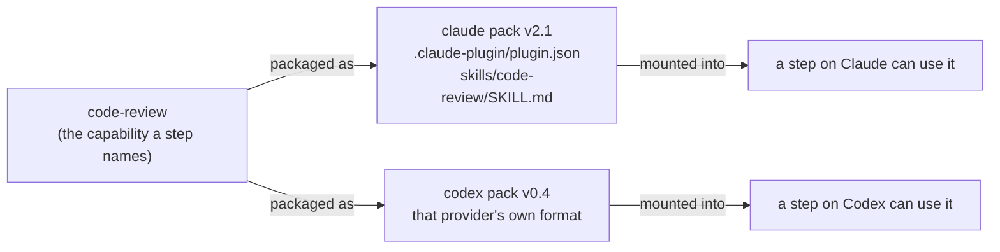

# Capability Versus Provider Pack

> [!check] v1: one provider, seam kept
> v1 is Claude-only ([[Capability Library Decisions|D1]]): every capability has exactly one pack, a Claude plugin dir, and the library shows no per-provider packs. `CapabilityPack` stays in the port as the data union below (D2), so adding a second provider later needs no change to the flow graph. Everything in this note about multiple packs per capability describes that later state.

## The distinction

A step says *"run code-review"*. It does not say how.

- The **capability** is that logical name: `code-review`, `grill-me`, `architect`.
- A **provider pack** is the actual bundle of files one agent CLI knows how to mount. For Claude Code that is a plugin directory; another provider has its own format.

**The registry stores the pack; the adapter knows how to mount it.** The same logical capability can have one pack per provider.



## Why the split exists

The original v1 design (PRD) hard-wired skills to Claude plugin directories mounted with `--plugin-dir` (it first said `--add-dir`, which does not register skills). The architecture review (`old/architecture/05-environment-and-registry.md`, component 13) turned that hard-wired assumption into a port:

> A "skill" is *one packaging* of a general **capability**. A Claude plugin dir (`.claude-plugin/plugin.json` + `skills/<slug>/SKILL.md`, mounted via `--plugin-dir`, invoked as `/slug`) is the Claude adapter's format.

This keeps the flow graph provider-agnostic. A flow references logical capabilities and logical model ids, so it can run on Claude Code, Codex, or the replay adapter unchanged — as long as each capability it names has a pack for the provider its step runs on.

## The type

From `old/reference/core/ports/agent-provider.ts`:

```ts
/**
 * A mountable capability (a "skill"/plugin, generalized). The registry stores
 * it; the adapter interprets `mount` in its own terms.
 */
export interface CapabilityPack {
  id: string;
  provider: ProviderId;
  mount:
    | { kind: 'plugin_dir'; path: string }        // Claude: --plugin-dir
    | { kind: 'system_prompt'; text: string }     // provider without plugins
    | { kind: 'native'; config: Record<string, unknown> };
}
```

`ProviderId` is `'claude-code' | 'codex' | 'replay' | (string & {})` — an open set. `05-environment-and-registry.md` sketches the pack differently, with a `mount(spec: RunSpec): void` method. **Decided: the data union** (D2).

Three mount strategies cover the field:

| `mount.kind` | Used when | Example |
|---|---|---|
| `plugin_dir` | The provider supports plugins (`plugins` capability flag) | Claude Code `--plugin-dir <path>` |
| `system_prompt` | The provider has no plugin system | Inject the skill text into the system prompt |
| `native` | The provider has its own config format | A Codex-native configuration block |

## Consequences that show up in the UI

- Each capability's detail pane lists **packs — one packaging per provider**, with an installed version per provider or *"not packaged for this provider"*.
- The status bar reports **codex packs for N of M** — the share of the library that survives switching a flow to Codex.
- Per the mockup, the flow editor refuses to save a step whose provider has no pack for the capability it names (blocking vs warning returns with the second provider — moot in v1).

See [[Provider Coverage And Portability]].

## Agents are nearly provider-neutral already

An agent is a prompt plus defaults. The only provider-specific part is the default model id. The architecture wants that to be a **logical** id (`reasoning-high`, `fast-cheap`, `default`) resolved through `resolveModel()`; the PRD still stores a native one (`sonnet`). For v1 the Claude aliases (`opus` / `sonnet` / `haiku`) serve as the logical ids ([[Capability Library Decisions|D20]]). See [[Agent Capabilities]].

## Related

- [[Capability Library Decisions]]
- [[Capability Kinds]]
- [[Capability Runtime Mounting]]
- [[Capability Data Model]]
- [[Capability Library Glossary]]
