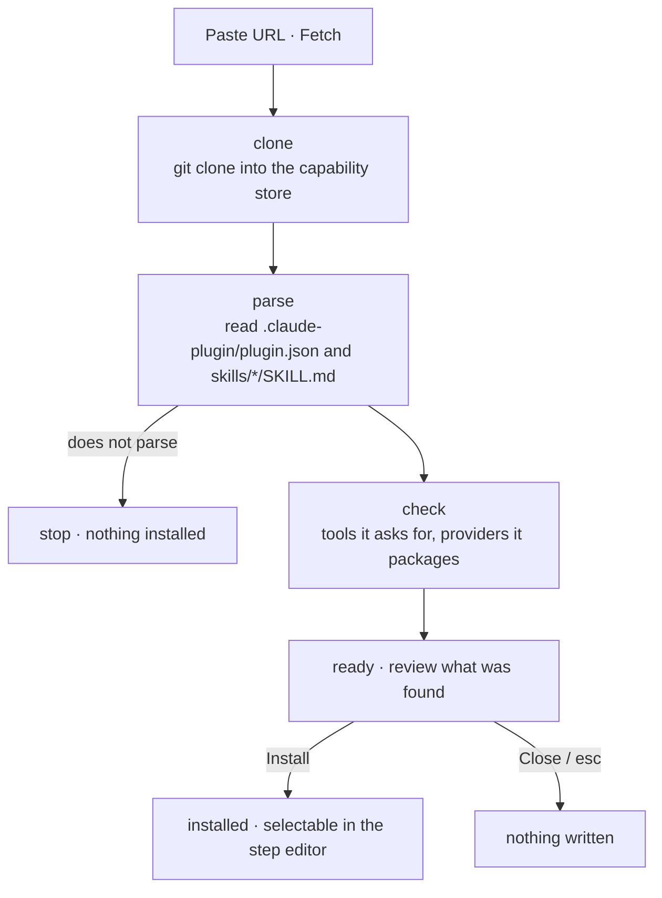

# Installing A Capability From GitHub

**+ Install from GitHub** is one of the two ways anything enters the library (the other is [[Agent Capabilities|+ Define agent]]). It takes a repository URL and nothing else.

## Principles

- **Local-first.** The clone lands in the capability store on your machine. Nothing is fetched at run time.
- **Nothing is written until you confirm.** The clone and the parse are a preview, not the install.
- **No half-installs.** A repository that does not parse stops at the parse stage.
- **Reproducible.** The exact commit is recorded on the capability; it is what the *update available* dot later compares against.
- **Installing grants nothing.** The capability declares what it wants; the step's sandbox decides what it gets.

## Stages

| Stage | Dialog state | Footer |
|---|---|---|
| `url` | URL field editable, **Fetch** enabled | *nothing is written until you confirm* |
| `clone` → `parse` → `check` | URL read-only; three-step checklist with spinner on the running step | *reading the repository…* |
| `ready` | Found block, `SKILL.md`, tools, providers | **Install `<id>`** · *it becomes selectable in the step editor straight away* |

## What the ready stage shows

- **found** — name, version, kind (`skill (Claude plugin dir)`), invoked as (`/dependency-audit`), commit (`b62f10d`), description
- **SKILL.md** — the manifest as read
- **tools it asks for** — network tools amber, with the callout *"It asks for WebFetch. This capability wants to reach the network. Egress stays default-deny — a step using it will still fail closed until you add the host it needs to that step's allowlist."*
- **providers** — `Claude Code — packaged` / `Codex CLI — no pack in this repository`

## After install

The capability joins the library with a **hollow dot** — installed, used by nothing yet. It is immediately selectable in the step editor. Provider coverage drops if it is single-provider (*codex packs for 7 of 18* instead of *7 of 17*).

The library selection jumps to the new capability and resets the kind/provider filters and search.

## Worked example: `acme-sec/fb-dependency-audit`

From the field guide's walkthrough — a flow needs a dependency audit and nothing in the library does it.

1. **Nothing in the library does this.** Search `dependency` → 0 of 17. Search matches name, author and description together, so empty really means nothing covers it.
2. **Paste the repository** `https://github.com/acme-sec/fb-dependency-audit`.
3. **It clones and parses.** Three checks; the manifest parse is the one that matters.
4. **What was found.** `dependency-audit`, 1.0.2, skill, `/dependency-audit`, commit `b62f10d`.
5. **The tools it asks for.** `Read`, `Bash` ⚠, `WebFetch` ⚠ — the screen you should actually read. A dependency auditor needs the network to check advisories; wiring it up is a two-part job.
6. **One provider, not two.** Claude plugin dir only — normal for a new capability.
7. **Installed.** Hollow dot, `claude · 0 uses`; status bar now *codex packs for 7 of 18*.

Then it branches on the provider of the step you add it to:

**Step runs on Claude**

8. **Wired into a Claude step.** The editor saves; used by *Code review @team-sec v2 · step dependency-audit*; dot turns solid. Remaining job: add the advisory host to that step's egress allowlist, or the first run fails closed.
9. **Later — an update lands** (1.1). Dot turns amber; taking it changes behaviour for every flow using it on its next run. See [[Updating And Removing Capabilities]].

**Step runs on Codex**

8. **The flow editor refuses.** No Codex pack; validation blocks the save.
9. **Three ways out.** Switch the step to Claude, package it for Codex, or use something else. See [[Provider Coverage And Portability]].

## Backend notes

- PRD: clone **or sparse-checkout** into `./skills/<slug>`; parse `SKILL.md` frontmatter for name and description.
- Backlog Story 7.1: install into `./skills/<slug>` *as a plugin dir* — add `.claude-plugin/plugin.json` when missing.
- Architecture: installing "from a GitHub URL" becomes a **provider-tagged** operation.
- GitHub is an external service reached by `git clone` on the host (harness-architecture diagram), not from inside the sandbox.

## Related

- [[Skill Capabilities]]
- [[Capability Tools And Egress]]
- [[Capability Storage On Disk]]
- [[Capability Library API And Routes]]
