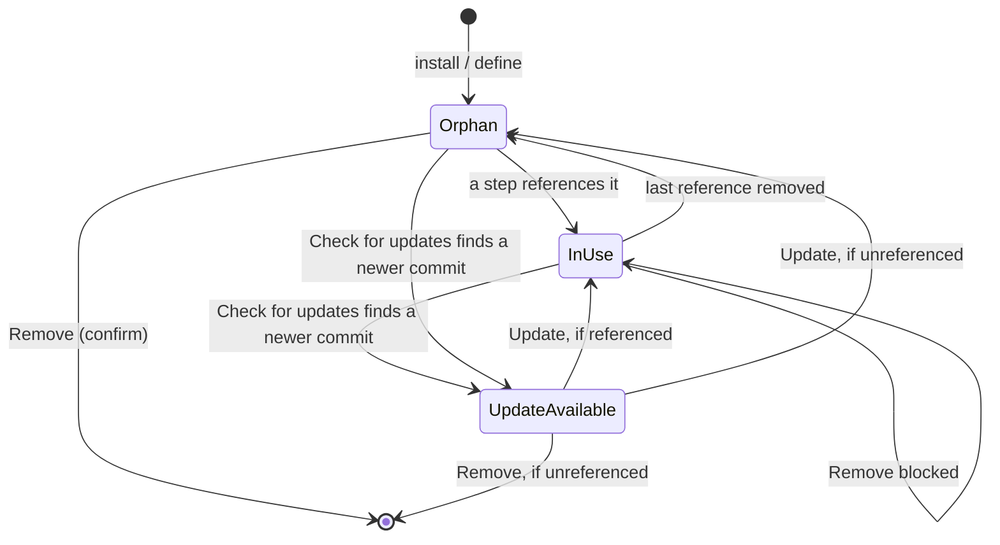

# Updating And Removing Capabilities

In v1 the **plugin** is what gets updated and removed ([[Capability Library Decisions|D4]]). Its skills move together: you cannot update or remove one skill of a plugin on its own. Agents defined in the library are edited in place; seeded agents update like plugins (D12).

## Lifecycle

*Update available* is a display state over *in use* / *used by nothing*: the dot shows the update first, but removal depends only on whether a step references it.

The rail dot carries these states — see [[Capability Library Screen]].

## What is pinned to what

| Thing | Pinned to | So when it changes |
|---|---|---|
| **task** | The flow version it started on, **and** the plugin commits and agent rows recorded in `capability_pins` at start (D10) | Nothing happens to it. Every step of the task runs the versions it started with. |
| **flow** | **Nothing.** It names capabilities, not capability versions. | Every flow drawing on that capability uses the new version on its next **task**. |

Update `secret-scan` from 1.3 to 1.5 and every *new* task uses 1.5. A task already running keeps 1.3 to its last step, because its commit dir stays on disk until no live task pins it (D11).

> [!note] Changed from the sources
> The mockup and field guide pinned nothing below the flow, so an update reached every flow "on its next run" — including the next step of a task already halfway through. With the store keeping one directory per commit (`<plugin>/<commit>/`), task-level pinning costs a JSON column. See [[Capability Library Decisions]] D10.

> [!warning] Read the update note before you take it
> *"Stops flagging example keys in docs"* sounds harmless until you notice it also means a real key in a docs file stops being caught. The library shows you the note; it cannot decide for you.

### Finding updates

- **Manual only** (D13). One **Check for updates** action per project runs `git ls-remote` against each git-sourced plugin. Nothing polls, and opening the screen fetches nothing.
- **Seeds** (D12): upgrading FlowBoard stages the new seed commit into the store and marks the seed *update available*. Nothing changes until you click Update.

### Taking an update

1. **Update to n** opens a preview: the update note, and the **skills added and removed** by the new commit.
2. If a removed skill is **in use**, the update is refused, by the same rule as Remove (D19).
3. Otherwise the new commit is cloned into its own dir, `commit_sha` moves to it, and the amber dot clears.
4. The old commit dir stays while any non-terminal task pins it, then is garbage-collected (D11).

## Removing is blocked while anything uses it

**Used by** counts the steps in each flow's **latest version**, plus any flow version **pinned by a non-terminal task** (D17). A step uses a plugin if its skill belongs to it or its `extra_plugin_ids` list it. Old flow versions nothing is running do not block removal.

- The **Remove** button is disabled, with *"in use by N steps — can't be removed"* beside it.
- A plugin nothing uses shows a **hollow dot** and a callout: *"Nothing uses this. No step in any flow references it, so removing it is safe — and leaving it installed is just clutter in the step editor's picker."*
- **Remove asks for confirmation** (D18; the PRD and backlog asked for it, the mockup deleted on first click).
- A running task is safe either way: it runs from its own pinned commit dir.

> [!note] The only destructive action
> Removing is the only destructive action on the screen, and the only one it refuses outright. Installing, updating and defining an agent are additive, or reversible by re-installing from the same commit.

## Removing a bundle pack

Deferred with bundle packs (D3). The designed rule: removing a [[Bundle Packs|bundle pack]] leaves behind anything a flow still draws on.

## Related

- [[Capability Library Decisions]]
- [[Capabilities In Flows]]
- [[Installing A Capability From GitHub]]
- [[Capability Library Controls]]
