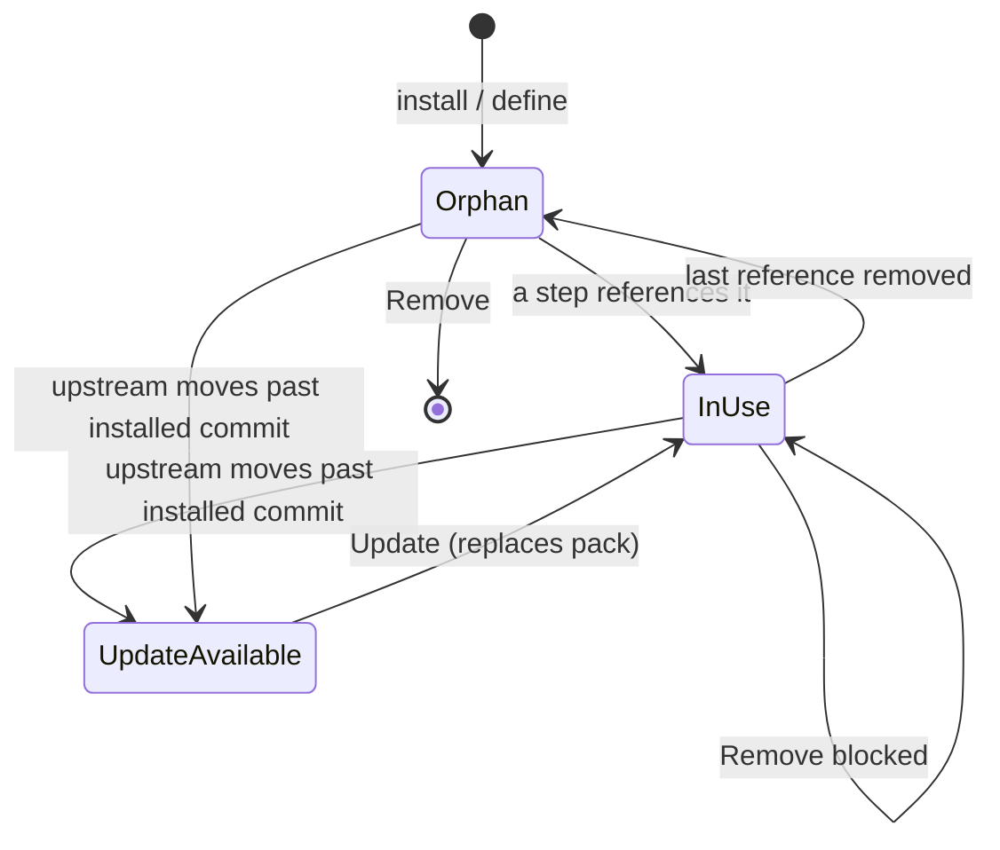

# Updating And Removing Capabilities

## Lifecycle

The rail dot carries these states — see [[Capability Library Screen]].

## Updating changes every flow at once

This is the asymmetry worth knowing:

| Thing | Pinned to | So when it changes |
|---|---|---|
| **task** | The flow version it started on | Nothing happens to it. You can edit the flow freely while it runs. |
| **flow** | **Nothing.** It names capabilities, not capability versions. | Every flow drawing on that capability picks up the new version on its next run. |

Update `secret-scan` from 1.3 to 1.5 and every flow that draws on it uses 1.5 on its next run — immediately, with no version bump of its own.

> [!warning] Read the update note before you take it
> *"Stops flagging example keys in docs"* sounds harmless until you notice it also means a real key in a docs file stops being caught. The library shows you the note; it cannot decide for you.

### Mechanics

- Offered only when the source repository has moved past the installed commit (**update available**, amber dot).
- The detail pane shows **Update to n** (amber button) and a callout: *"n is available. {note} Updating replaces the installed pack for every flow that draws on it — flows are not pinned to a capability version the way tasks are pinned to a flow version."*
- Taking it replaces the installed pack, records the new commit and install time, and clears the amber dot.

## Removing is blocked while anything uses it

- The **used by** list is the check. Anything referenced by a step cannot be removed.
- The **Remove** button is disabled, with *"in use by N steps — can't be removed"* beside it.
- A capability nothing uses shows a **hollow dot** and a callout: *"Nothing uses this. No step in any flow references it, so removing it is safe — and leaving it installed is just clutter in the step editor's picker."*
- The argument for removing orphans: every installed capability is another row in the step editor's picker.
- PRD / backlog: remove **with confirm**.

> [!note] The only destructive action
> Removing is the only destructive action on the screen, and the only one it refuses outright. Installing, updating and defining an agent are additive, or reversible by re-installing from the same commit.

## Removing a bundle pack

Removing a [[Bundle Packs|bundle pack]] leaves behind anything a flow still draws on — the library will not pull the rug out from under a running recipe.

## Related

- [[Capabilities In Flows]]
- [[Installing A Capability From GitHub]]
- [[Capability Library Controls]]
- [[Capability Library Open Questions]]
