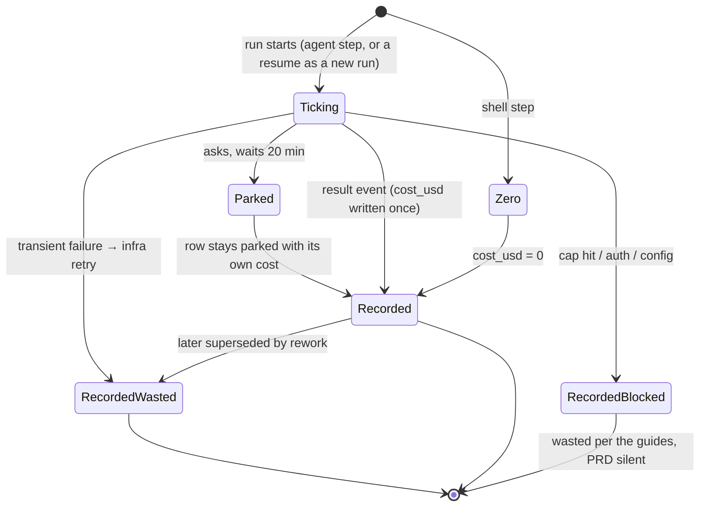

# Cost Accounting Rules

Every rule that decides what a number means, in the sources' own words. The notes for each concept explain the rule. This note lists them in one place.

## Recording a run's cost

| # | Rule | Source |
|---|---|---|
| 1 | *"Take the final result event's total cost as authoritative for `runs.cost_usd`."* | PRD §7 |
| 2 | *"Accumulate per-message token usage as you stream so the live view shows a running number before the run ends."* | PRD §7 |
| 3 | *"`message_delta.usage` is cumulative per message — reset per `message_start`, do not sum across deltas."* | backlog 3.2 |
| 4 | *"persist `num_turns` per assistant turn so the viewer/board show live numbers."* | backlog 3.2 |
| 5 | Absent `costUsd` → *"PricingService fills it from tokens."* | `events.ts` |
| 6 | *"treat `runs` as an **append-only usage journal** — never mutate cost after the result lands; corrections are new rows."* | `02` §1 |
| 7 | *"each run prices against the table in effect at its `started_at`"* (idea) | `06` §12 |
| 8 | *"Shell runs cost nothing and record `cost_usd = 0`."* | PRD §7 |
| 9 | Draft mode: *"override to haiku/low and record actual model/effort on the run."* | backlog 3.2 |
| 10 | *"Tag memory-layer token/API cost separately so it never lands in the per-run cost rollups"* | PRD §11.2 |

> [!warning] The shipped code differs
> Rule 5 quotes the reference `events.ts`. The shipped comment (2026-10-22): `costUsd` is *"USD as the provider reports it"*; Claude reports it only on the result, OpenCode on every event (0 for a model it has no price for), and *"Absent means "price it from tokens""*. No PricingService is built, so nothing fills it yet. Rule 2 is done in the adapters, which emit running totals as `usage` events, and rule 3 in the Claude adapter. See [[Normalized Event Envelope]].

## Marking spend as wasted

| # | Rule | Source |
|---|---|---|
| 11 | Transient failure: *"The failed run is marked `wasted = 1` and does **not** count toward `max_attempts`."* | PRD §7 |
| 12 | Rework: *"Mark the superseded runs `wasted = 1` so the cost view can report discarded spend."* | PRD §8 |
| 13 | *"downstream runs `wasted=1`, downstream `done` → `skipped` so they re‑instantiate."* | backlog 5.2 |
| 14 | Wasted spend = *"sum of `cost_usd` where `wasted = 1`"* | PRD §13 |
| 15 | The bill *"never goes down. Sending a step back moves money from kept to wasted; it does not reduce what you owe."* | task-detail guide |

## Spending again

| # | Rule | Source |
|---|---|---|
| 16 | Transient failures retry *"up to 3 times, with backoff of 30 s, 2 min and 8 min."* Each is a new run with the same `attempt` number | PRD §7 |
| 17 | Cap hit, auth error, bad config: *"put the task into `blocked` … Retrying these would only burn the same money again."* | PRD §7 |
| 18 | *"`max_attempts` counts total runs of the step, first try included (infra retries excluded)."* | PRD §8 |
| 19 | Same fingerprint twice → escalate, *"because the redo changed nothing."* | PRD §8 |
| 20 | **Retry** at an escalated gate *"grants one more attempt … It does not reset the counter."* | PRD §8 |

## What decisions cost

From the monitor and inbox guides. The full table is in [[Monitor Actions And Costs]].

| Decision | Effect on money | Source |
|---|---|---|
| Approve | *"Approving costs nothing and wastes nothing."* | `inbox.html:334` |
| Send back | *"moves everything the last attempt spent into **wasted**."* | `inbox.html:334` |
| Retry a failure | *"The failed attempts are already spent. Retrying spends again."* | inbox guide |
| Answer a question | *"Answering is free."* | task-detail mockup |
| Leave a question waiting | *"a parked run is not billing you … Leaving the inbox full costs calendar time and a worker slot's worth of throughput — not money."* | inbox guide |
| Stop | Spend becomes wasted (guides). The monitor guide records the run *"as failed"*; backlog 3.4 says *"finalise as cancelled"* | monitor guide, backlog |

## The life of a run's cost

A resume does not continue the parked run. PRD §9 *"enqueue[s] a new `start_run`"*, which starts at `[*]` as its own run with its own cost ([[Cost Runtime]], [[Cost And Control Open Questions]] #16).

> [!note] Flipping the flag is not rewriting cost
> Rule 12 sets `wasted = 1` on a run whose cost is already recorded. That is an update to the flag, not to `cost_usd`, so rule 6 still holds for the money. No source says whether the flag change should itself be a journal row.

## Related

- [[Cost Ledger]]
- [[Wasted Spend]]
- [[Failures And Retries]]
- [[Attempts And Send Back]]
