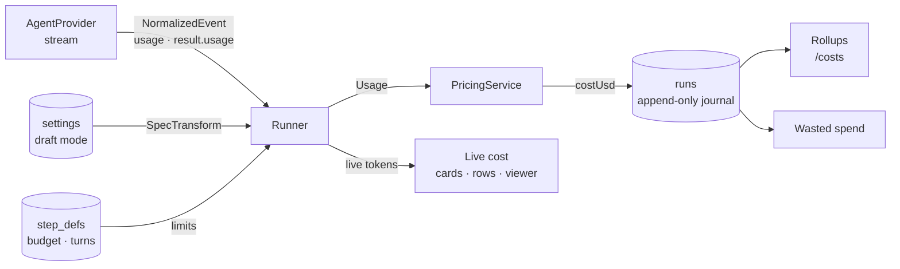

# Cost And Control Overview

> *A clear picture of where the money goes — because running agents costs real money.* (feature map §18)

## Purpose

FlowBoard runs headless agent sessions unattended, often several at once. Each one spends money. Cost And Control answers three questions:

1. **What is this costing right now?** A live figure on each running card, row and run viewer, and a burn rate for everything running. See [[Live Cost]].
2. **Where did the money go?** Spend per project over time, per step definition, per model and effort, and per finished task by flow version. See [[Spend Rollups]].
3. **How much went nowhere?** One number for spend on attempts that were thrown away. See [[Wasted Spend]].

It also holds the controls that bound spend before it happens: [[Draft Mode]] and [[Spend Caps And Limits]].

The design brief frames the screen: *"Not a total. This screen answers 'which parts of my flow are worth their price.'"* (`docs/old/design/brief.md` §5). `06-cost-and-platform.md` calls the money view *"a primary product surface, not an afterthought"*.

## Place in the system

| Drawio page | Node | What it says |
|---|---|---|
| *Functional components* | **Cost & control** group | Five cards: *Ticking run cost* (live, per card and per run), *Spend rollups* (project · step def · model × effort · over time), *Wasted spend* (money burnt by rework loops), *Cost per completed task* (trended by flow version), *Draft mode* (force haiku / low effort while iterating) |
| *Functional components* | edge **Execution → Cost & control** | labelled `usage` |
| *Logical components* | **Costs `/costs`** → **Cost rollup** → **Database** | *"rollups and draft-mode toggle"*; *"per project · step · model; wasted spend"* |
| *Logical components* | **Run orchestrator → Task & run state** | labelled `events, cost` |
| *Harness architecture* | **Cost ledger** (worker) | *"result-event cost is authoritative · wasted = rework + infra retries · memory cost tagged separately"* |
| *Harness architecture* | **Read models** | *"cost rollups incl. wasted spend"* |
| *FlowBoard ideation* | **Costs & settings `/costs`** | *"Not just a total."* Six cards, the five PRD rollups plus the draft mode toggle |

Architecture: component **#12 Cost & usage ledger + PricingService** and component **#15 Settings, draft mode, API**, both in `06-cost-and-platform.md`. The architecture README describes FlowBoard as *"a **durable workflow engine + human-in-the-loop protocol + cost ledger**"*.

## Design principles

| Principle | Source wording |
|---|---|
| The provider's own total wins | *"Take the final result event's total cost as authoritative for `runs.cost_usd`."* (PRD §7) |
| Never rewrite cost | *"treat `runs` as an **append-only usage journal** — never mutate cost after the result lands; corrections are new rows."* (`02` §1) |
| One code path for every provider | *"**One code path costs every provider uniformly**; native cost is just the degenerate case where the table isn't consulted. Every downstream rollup is provider-blind."* (`06` §12) |
| Show it climbing | *"Adds up spending live, so you watch a number climb rather than only seeing a total at the end."* (feature map §7) |
| Waste gets its own number | *"This needs its own treatment; it's the number that changes my behaviour"* (brief §5) |
| Overrides record the truth | Draft mode *"records the *resolved* model/effort on the run so cost stays honest"* (`06` §15) |
| Logical caps, physical backstops | Sandbox limits *"physically backstop the logical `max_turns`/`max_budget_usd` caps"* (PRD §11.1) |
| Memory must pay for itself | *"the honest number is *net*: run spend saved minus memory spend added"* (`06` §12) |

The pitch makes control the selling point: *"Every step has a budget and a turn cap; a global **draft mode** forces the cheapest models while iterating; the sandbox enforces *physical* limits; and the cost views surface **wasted spend** specifically so we can cut it. It is the spend-*control* layer we don't have."* (`docs/pitch.md`)

## What it is not

- Not a billing system. No source covers invoices, payment or provider accounts. See [[Cost And Control Open Questions]] #7 on whether the Claude figure is a real bill.
- Not per-person accounting in v1. Spend by person and team is a feature-map idea. See [[Cost And Control Roadmap]].
- Not a screen with a mockup. `/costs` is specified only in prose. See [[Costs Page]].

## Related

- [[Cost And Control Index]]
- [[Cost Ledger]]
- [[Cost Surfaces]]
- [[Burn Today And Wasted]]
