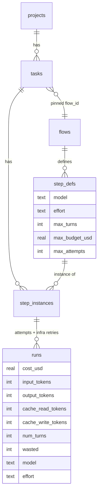

# Cost Data Model

Cost owns no table of its own in the PRD. It reads and writes columns on `runs`, reads limits from `step_defs`, and keeps draft mode in `settings`.

## `runs`: the journal

From PRD §5, with the columns later sources add.

| Column | Type | Meaning | Source |
|---|---|---|---|
| `id`, `step_instance_id`, `attempt` | | One row per run; infra retries reuse `attempt` | PRD §5, §7 |
| `state` | TEXT | `starting \| running \| parked \| succeeded \| failed \| cancelled` | PRD §5 |
| `cost_usd` | REAL DEFAULT 0 | From the result event, or priced from tokens | PRD §5, §7 |
| `input_tokens` | INTEGER DEFAULT 0 | `Usage.input` | PRD §5 |
| `output_tokens` | INTEGER DEFAULT 0 | `Usage.output` | PRD §5 |
| `cache_read_tokens` | INTEGER DEFAULT 0 | `Usage.cacheRead` | PRD §5 |
| `cache_write_tokens` | INTEGER DEFAULT 0 | `Usage.cacheWrite` | PRD §5 |
| `num_turns` | INTEGER DEFAULT 0 | Written per assistant turn, not only at the end | PRD §5, backlog 3.2 |
| `wasted` | INTEGER NOT NULL DEFAULT 0 | *"1 if superseded by a rework loop or an infra retry"* | PRD §5 |
| `error` | TEXT | Stderr on a non-zero exit (PRD §7), *"stderr tail"* (backlog 3.2). A limit or timeout hit *"marks the run failed with reason"* (backlog 3.5). As built, `RunResult.error` is the provider's own report first (a cap hit included), else the stderr tail, and it can be set on exit 0 ([[Agent Run Handle And Result]]) | PRD §7, backlog 3.2, 3.5 |
| `started_at`, `ended_at` | INTEGER | Day bucketing; the price-table version (idea) | PRD §5, `06` §12 |
| `model` | TEXT | **Added.** The model that actually ran, after draft mode | backlog 1.1, `02` §1, PRD §11.1 |
| `effort` | TEXT | **Added.** The effort that actually ran | backlog 1.1, `02` §1, PRD §11.1 |
| `sandbox` | TEXT | **Added.** The tier that ran | PRD §11.1, backlog 1.1 |
| `provider` | TEXT | **Proposed** in `02` §1 (*"add `runs.provider`"*); needed by `PricingService.price(provider, …)` | `02` §1 |

`runs.model`, `runs.effort` and `runs.sandbox` appear in PRD §11.1 prose (*"`runs.sandbox` records the tier that actually ran, alongside `runs.model`/`runs.effort`"*) but not in the §5 `CREATE TABLE`. The drawio *SQLite* card lists `runs (attempt, fingerprint, wasted, cost, tokens, sandbox)`: it has `sandbox`, but not `model` or `effort`.

## `step_defs`: what a step may spend

| Column | Type | Meaning |
|---|---|---|
| `model` | TEXT NOT NULL DEFAULT `'sonnet'` | *"passed to --model"* |
| `effort` | TEXT NOT NULL DEFAULT `'medium'` | `low \| medium \| high \| xhigh \| max` |
| `max_turns` | INTEGER, nullable | `--max-turns` |
| `max_budget_usd` | REAL, nullable | `--max-budget-usd` |
| `max_attempts` | INTEGER NOT NULL DEFAULT 3 | Total runs including the first |

All PRD §5. See [[Step Guardrails]] and [[Models And Effort]].

## `settings`: draft mode

`settings(key TEXT PRIMARY KEY, value TEXT NOT NULL)` (PRD §5). `06` §15 puts *"draft mode, escalation threshold (minutes), theme (light/dark/system), and a **memory** block"* there. No source gives the key name, value format or default, and the drawio *SQLite* card lists only *"settings (memory, sandbox_profile)"*. **Proposal**, shared with [[Settings Data Model]]: one row per top-level setting with a JSON `value`, so key `draft_mode`, value `true` or `false`, default `false` ([[Settings And Plumbing Open Questions]] #5).

## Tables the rollups join through

| Table | Used for |
|---|---|
| `step_instances` | `runs → step_instances` for the step and the task; `attempts` |
| `tasks` | `project_id`; `flow_id` (the pinned version) for cost per finished task; `status = 'done'` |
| `flows` | `version` for the trend |
| `step_defs` | per step definition; `skill_id` and `agent_id` if grouped by skill or agent |
| `projects` | per project |

## Proposed additions

None of these are in a source. Each is listed in [[Cost And Control Open Questions]].

| Proposal | Why | Open question |
|---|---|---|
| `price_rates(provider, model, effective_from, input_per_mtok, output_per_mtok, cache_read_per_mtok, cache_write_per_mtok)` | The PricingService's rate table, *"versioned and dated"* | #6 |
| `memory_usage(at, adapter, op, tokens, cost_usd)` | The separate memory bucket | #15 |
| `runs.provider` | `price()` takes a provider; `02` §1 already proposes it | #14 |

## Related

- [[Cost Ledger]]
- [[Cost Storage]]
- [[Task Data Model]]
- [[Flow Data Model]]
