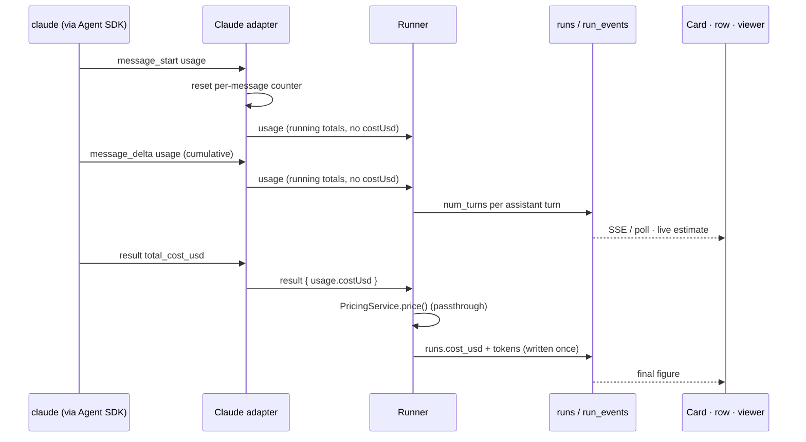

# Cost Runtime

How a run's cost moves from the provider to the screen.

## Before launch: the transform chain

The runner builds a `RunSpec` from the step definition and applies transforms before `launch()`. No source fixes their order; the list follows the **proposal** in [[Settings Overrides And Spec Transforms]] (draft mode, then sandbox resolution, then the permission gate last; [[Settings And Plumbing Open Questions]] #10, and [[Cost And Control Open Questions]] #5).

1. **Draft mode**, if on: `s => ({ ...s, model: 'fast-cheap', effort: 'low' })` (`06` §15).
2. **Sandbox profile**: *"draft mode and the sandbox profile compose as `RunSpec` transformers."* (backlog 3.5)
3. **Permission gate**: last, because it checks the resolved tier (see [[Settings Overrides And Spec Transforms]]).

Limits are not a transform: they ride on the `RunSpec` from `step_defs` as `limits: { maxTurns, maxBudgetUsd }` (`agent-provider.ts`). The runner *"maps the logical `max_turns` / `max_budget_usd` caps to the sandbox's physical `--memory` / `--cpus` / `--pids-limit` / wall-clock backstops"* (`03` §6).

It records what actually ran: *"records model, effort, tier"* (drawio *Runner*). `03` §6 suggests snapshotting *"the resolved `RunSpec` to `data/runs/<id>/spec.json"*. PRD §7 snapshots *"the final args to `data/runs/<id>/args.json`"*. (As built: no runner and no `args.json`; `pnpm run-agent` logs the launched `RunSpec` as the `start` line of its run log, [[Agent Providers Storage]].)

## During the run



- The adapter parses the native stream. *"`message_delta.usage` is cumulative per message → reset per `message_start`, don't sum across deltas."* (`03` §5)
- The runner tees each event *"to `run_events` + the SSE emitter"* (`03` §6). The SSE endpoint tails `run_events` by `seq`, because the worker is a separate process (PRD §7).
- The drawio *Stream parser*: *"stream-json → NormalizedEvent v1 (versioned, OTel GenAI names) → run_events · live token and cost"*. Life-of-a-step beat G: *"stream-json on stdout → parser → run_events + live cost → SSE → run viewer and board."*

> [!warning] The shipped code differs
> No stdout is parsed and no separate stream parser exists (2026-10-18). The Claude adapter normalizes the Agent SDK's typed messages, and the OpenCode adapter its server's SSE events. Events carry no `v`, and there is no `run_events` table or `seq` until the runner is built; `run-agent` appends every event to `runs/<stamp>-<adapter>.jsonl`. See [[Stream Parsing And Normalization]].

The step from tokens to a live dollar figure has a normalized event since 2026-10-18, `usage` with running totals, but on Claude no dollars: its live totals carry no `costUsd`, and there are no Claude rates. OpenCode's carry its own running cost. See [[Live Cost]].

## At the end

`07-ports-in-practice.md` shows the reference loop:

```ts
for await (const ev of run.events) {                     // normalized — provider-blind
  persistEvent(run, ev);                                 //   → run_events + SSE
  if (ev.type === 'result') updateLiveCost(task, ev.usage);
}
const result = await run.result;                         // AgentProvider port
```

As built, the port also emits `usage` events with the running totals, so live cost can follow each of them, not only `result` ([[Normalized Event Envelope]]). The only loop like this today is `run-agent`'s (`cli/src/run.ts`): it prints and logs each event, and ends its log with the `RunResult`, usage included.

Then:

1. `runs.cost_usd` from `usage.costUsd`, or from the [[Pricing Service]] when absent.
2. Classify the exit. Success → advancement (PRD §8). Transient failure → flag `wasted = 1`, queue a retry with the same `attempt`. Anything else → task `blocked` (PRD §7).
3. On rework, flag the superseded and downstream runs `wasted = 1` (PRD §8, backlog 5.2).

## Shell steps

*"No `AgentProvider` is involved, and the run costs nothing."* (`03` §6). `cost_usd = 0` (PRD §7).

## Parked runs

After 20 minutes waiting on a question the run parks: *"After 20 minutes the agent parks and resumes later with --resume"* (drawio life-of-a-step beat H). The resume is a new run: PRD §9 *"enqueue[s] a new `start_run`"*, so the parked row and the resumed row each record their own cost. How the two roll up, and whether the resumed total is cumulative over the forked session, is [[Cost And Control Open Questions]] #16. See [[Ask Park And Resume]].

## Testing at $0

- *"A test stand-in — A fake provider that replays a recorded session, so the whole system can be tested without spending real money."* (feature map §6)
- `ReplayProvider`: *"Every engine, park/resume, and cost test runs deterministic and zero-spend."* (`01-ports.md`). Its test asserts `res.usage.costUsd === 0.012` (`replay-provider.ts`).
- A stopped replay settles with `exitCode: 130, error: 'stopped'`. In the reference its usage was zero unless a `result` event had already arrived, so a stopped run's spend was invisible to the port. As built (2026-10-22), every provider keeps the usage reported so far: Replay from its scripted `usage` events; Claude its last running tokens and turns, without `costUsd`; OpenCode its tokens and cost ([[Agent Run Handle And Result]], [[Replay Provider]]).
- Backlog 0.2: *"an integration lane that spawns the real worker against a fake `claude` binary … so runner/park/resume can be tested without spend."* (**GAP**)

## Related

- [[Cost Ledger]]
- [[Draft Mode]]
- [[Event Stream And SSE]]
- [[Monitor Runtime]]
