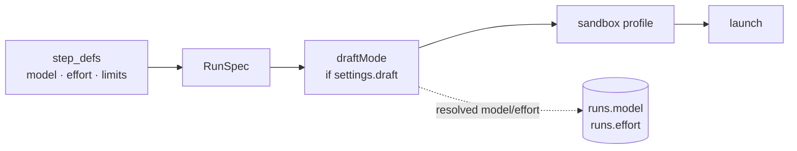

# Draft Mode

> **Draft mode** — A switch that forces every step onto the cheapest, fastest AI while you're tinkering with the recipe rather than the code. (feature map §7)

Feature map §19 lists it again under Settings: *"Force everything onto cheap, fast AI while you iterate on recipes."*

## What it does

| Source | Wording |
|---|---|
| PRD §13 | *"Add a global **draft mode** toggle in settings that overrides every step to `--model haiku --effort low`, for when I am iterating on the flow itself rather than on code."* |
| PRD §16 acceptance | *"Draft mode forces every step to haiku/low"* |
| Drawio ideation card | *"Draft mode toggle — Overrides every step to --model haiku --effort low while iterating on the flow itself."* |
| Drawio functional card | *"Draft mode — force haiku / low effort while iterating"* |
| Backlog 3.2 | *"Draft mode: override to haiku/low and record actual model/effort on the run."* (**PRD/FIX**) |
| Backlog 8.3 | *"Draft mode toggle; theme light/dark/system …; escalation threshold in minutes."* |
| `06` §15 | Settings hold *"draft mode, escalation threshold (minutes), theme (light/dark/system), and a **memory** block"* |

## A transform, not a special case

> **Genericize — draft mode as a `RunSpec` transformer:** don't special-case it in the runner. Model it as a pure function applied before `launch()` (`06` §15)

```ts
type SpecTransform = (spec: RunSpec) => RunSpec;
const draftMode: SpecTransform = s => ({ ...s, model: 'fast-cheap', effort: 'low' });
```

*"Provider-neutral, composable with any future override (force-local-model, cap-budget-globally, pin-a-model for an incident), and it records the *resolved* model/effort on the run so cost stays honest (12)."* The runner applies the chain: *"Draft mode is applied here as a `RunSpec` transformer and the *actual* model/effort recorded on the run"* (`03` §6). Backlog 3.5: *"draft mode and the sandbox profile compose as `RunSpec` transformers."* The drawio *Runner* card: *"builds the RunSpec · draft-mode transform · writes per-run mcp.json + settings.json (hooks) · records model, effort, tier"*.



## Why the run records what actually ran

Backlog 1.1: *"`runs.model`, `runs.effort` (draft mode must not corrupt cost views)"*. `06` §12: draft mode *"overrides model/effort *and records the actual ones used* so `runs.model` / `runs.effort` keep the rollups honest."* Without it, the *model × effort* rollup would book haiku spend to opus. See [[Spend Rollups]].

## In the flow designer

The flow-designer mockup has a **draft mode** toggle in its topbar (`flow-designer.html:234`). Turning it on:

- shows `haiku` on every node's model chip (`flow-designer.html:486`);
- drops the canvas bar's ceiling to `$0.05` per step (`:611`);
- adds *"draft mode — every step forced to haiku"* to the bar (`:612`).

The flow-designer guide: *"**Draft mode isn't a version.** It forces every step onto the cheapest model while you're iterating on the *recipe* rather than the code, and the cost ceiling in the canvas bar drops to match. It's a switch on how runs execute, not an edit to the flow, so it never makes a new version and never shows as unsaved."* Its controls table: *"Not an edit — makes no version"*.

## Where the sources differ

| Point | Sources |
|---|---|
| Global setting or designer toggle | PRD §13 and feature map §19: a global setting. Mockup: a toggle on the flow designer. See Flow Design Open Questions #28 |
| Model id | PRD and drawio: `haiku`. `06` §15: the logical id `fast-cheap`. See Flow Design Open Questions #15 |
| Effort | PRD: `low`. The mockup changes only the model chip; effort chips stay as they were |
| Budget | No source changes `max_budget_usd`. The mockup's `$0.05` per step ceiling has no other source |
| Which runs | `06` §15 applies it *"before `launch()"*. So it reaches each new run, including later steps of tasks already running. No source says whether that is intended |
| Shell steps | Not mentioned. A shell step has no model, so the transform should leave it alone |
| Rollups | The run records the resolved model, but no source says whether draft-mode runs belong in *cost per finished task by flow version* |

All of these are in [[Cost And Control Open Questions]] #5.

## The pitch

*"a global **draft mode** forces the cheapest models while iterating"* (`docs/pitch.md`, objection 4).

## Related

- [[Models And Effort]]
- [[Spend Caps And Limits]]
- [[Cost Runtime]]
- [[Cost Data Model]]
