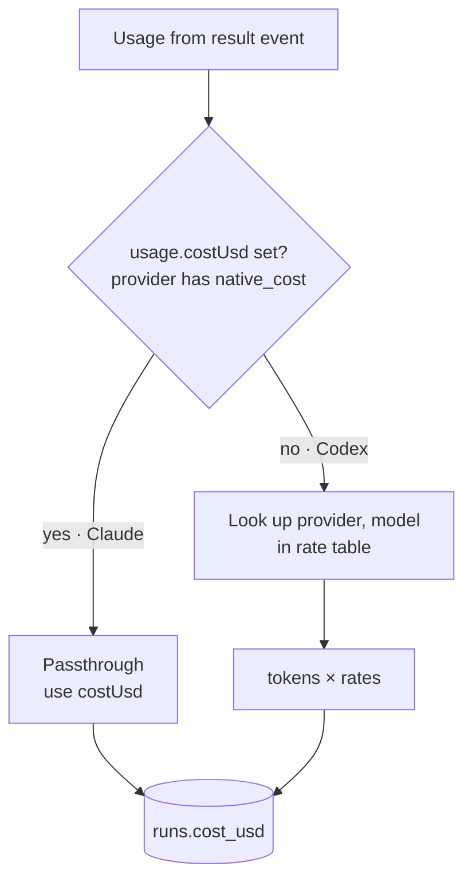

# Pricing Service

The one service that turns any provider's `Usage` into dollars (`06-cost-and-platform.md` §12).

```ts
interface PricingService {
  price(provider: string, model: string, usage: Usage): number;  // -> costUsd
}
```

## The passthrough

> **Genericize — the elegant part:** Claude reports `total_cost_usd`, so its price table is a **passthrough** (`usage.costUsd` already set). Codex reports tokens only, so the same service prices it from a `(provider, model) → rates` table. **One code path costs every provider uniformly**; native cost is just the degenerate case where the table isn't consulted. Every downstream rollup is provider-blind. (`06` §12)



## Adding a provider

`06`, *Where a new provider actually touches the codebase*, step 2: *"A `(codex, model) → rates` row in the price table (12), because `native_cost` is absent."* Step 4: *"Zero changes to: engine, board projection, HITL protocol, notifier, cost rollups, viewer, API."*

## Versioned and dated rates

An idea, not a requirement:

> keep the price table **versioned and dated**. When rates change, historical cost stays reproducible because each run prices against the table in effect at its `started_at`. (`06` §12)

> [!note] This only bites for priced providers
> For Claude the result's `total_cost_usd` is authoritative and stored once, so a rate change never touches history. The versioned table matters for providers priced from tokens.

## The mockups ask the same question

The inbox mockup seeds a pending question on task `provider-codex`, step `research` (`inbox.html:220`):

> *"The Codex CLI reports no per-call cost. Estimate spend from token counts, or record it as unknown and leave the totals honest?"* Options: **Estimate from tokens** · **Record as unknown**.

The inbox guide's walkthrough answers it **Estimate from tokens**. `06` §12 already assumes estimation. The *Record as unknown* option has no design: a `NULL` cost would break every sum. See [[Cost And Control Open Questions]] #6.

A second inbox fixture, already answered: `cost-rollup`, *"Roll up by model, or by step?"* → **Both** (`inbox.html:244`). That matches PRD §13, which asks for both.

## What is not specified

- Where the rate table lives (a table, a JSON file, settings) and who maintains it.
- The rate shape: per million input, output, cache-read and cache-write tokens is the natural reading of `Usage`, but no source says so.
- The provider id. `price()` takes `provider`, but the PRD `runs` table has no provider column; `02` §1 proposes adding `runs.provider`.

All three are in [[Cost And Control Open Questions]] #6.

## Related

- [[Usage And Native Cost]]
- [[Cost Ledger]]
- [[Provider Coverage And Portability]]
- [[Cost Data Model]]
