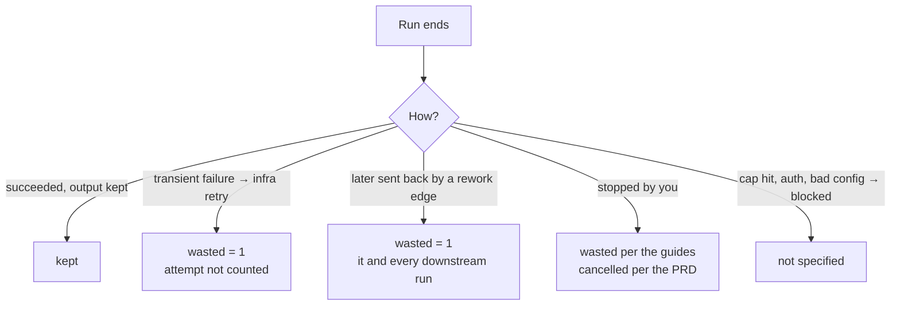

# Wasted Spend

> **Wasted spend, called out** — A specific number for money burned on work that got redone or thrown away, so you can actually go after it. (feature map §18)

The brief puts it first: *"This needs its own treatment; it's the number that changes my behaviour"* (brief §5). The monitor guide: *"It's the one number here you can actually act on."*

## The flag and the figure

- **Flag:** `runs.wasted INTEGER NOT NULL DEFAULT 0 -- 1 if superseded by a rework loop or an infra retry` (PRD §5).
- **Figure:** *"**wasted spend**: sum of `cost_usd` where `wasted = 1`, i.e. money burnt by rework loops"* (PRD §13).

Wasted is never subtracted from anything. The task-detail guide: *"Sending a step back moves money from kept to wasted; it does not reduce what you owe."*

## What earns the flag

| Event | Flagged? | Source |
|---|---|---|
| A run **superseded by a rework loop** | Yes | PRD §5, §8: *"Mark the superseded runs `wasted = 1` so the cost view can report discarded spend."* |
| Runs **downstream** of a rework target | Yes | backlog 5.2: *"Rework: same instance, `attempts++`, new run, downstream runs `wasted=1`, downstream `done` → `skipped` so they re‑instantiate."* |
| A run that failed **transiently** and was retried | Yes | PRD §7: *"The failed run is marked `wasted = 1` and does **not** count toward `max_attempts`."* Feature map §4: *"It doesn't use up a try, but it still shows up in wasted spend."* |
| A run **you stopped** | The guides say yes; the PRD does not | Monitor guide: *"a failed build, a run you stopped, a review you sent back"*. Task-detail guide on cancel: *"Anything in flight becomes wasted."* PRD and backlog: a stop finalises the run as `cancelled`, with no `wasted` rule |
| A run that **failed and blocked** the task (budget or turn cap hit, auth error) | Not specified | PRD §7 blocks the task. Whether the spend becomes wasted if you then retry, or fail the task, is open |
| A **shell** step's failing run | Costs `$0`, so the flag doesn't matter | PRD §7 |
| **Memory**-layer calls | Never in run rollups | PRD §11.2 |

The definitions disagree. PRD §13 and the drawio ideation card say *"money burnt by rework loops"* only. PRD §5, the drawio *Cost ledger* card (*"wasted = rework + infra retries"*) and feature map §4 add infra retries. The guides add stops. Brief §5 is narrowest: *"money burnt on work later discarded by a review sending the task back"*. Monitor Open Questions #17 has the full table. See [[Cost And Control Open Questions]] #1.

## How to read it

- **Healthy share.** *"A healthy board keeps it under roughly a tenth of the bill. If it's climbing, the recipe is usually the culprit, not the code: check the Pipeline view for a thick retry loop."* (`monitor-guide.html:489`). Whether "a tenth" is a rule or a hint is [[Cost And Control Open Questions]] #18.
- **Per task.** A row shows its own wasted under its cost. The task Cost tab draws kept grey and wasted red per step. See [[Task Cost And Wasted Spend]].
- **What decisions do to it.** Approving is free. Sending back moves the last attempt's spend to wasted. Retrying a failure spends again. Answering a question is free. See [[Monitor Actions And Costs]].
- **One-off tolls.** The sample failures are environment, not confusion: *"Three attempts, $1.44 spent and thrown away"* on an egress denial (`inbox.html:204`); *"The $1.44 is already gone. Retrying spends again — but the host is allowlisted now, so the next task down this flow will not pay the same toll."* (inbox guide).

## What drives it down

| Lever | Source |
|---|---|
| Stop early on a stuck loop: the same failure fingerprint twice escalates instead of spending a third try | PRD §8; feature map §4: *"it doesn't spend a third try"* |
| Don't retry non-transient failures: *"Retrying these would only burn the same money again."* | PRD §7 |
| Cheap sensors before expensive reviewers: check steps cost `$0`, and the model *"never gets reviewed on code that doesn't pass"* | PRD §7, §15 |
| Deterministic gates as extra shell steps: *"$0 catches before any model reviews"* | drawio *Harness architecture* |
| Memory warm starts: *"warm-start is a **wasted-spend** lever — fewer rework re-derivations, fewer repeated inbox questions"* | `06` §12, `09-memory.md` |
| Tune the recipe: cost per finished task trended by flow version shows whether a change helped | PRD §13 |

The pitch uses it as the success metric: *"**Wasted spend is a number on a dashboard**, and it trends down as flows are tuned (baseline it in week 1)."*

## Mockup accounting bugs

Three mockups mishandle the move from kept to wasted. Monitor: `reject()` deletes the review run's cost, and `stop()` counts a stopped run twice. Task detail: `sendBack()` zeroes Review's cost, so the bill shrinks. See [[Burn Today And Wasted]], [[Attempts And Send Back]] and Task Detail Open Questions #15.

## Related

- [[Cost Accounting Rules]]
- [[Burn Today And Wasted]]
- [[Task Cost And Wasted Spend]]
- [[Branching Joining And Loops]]
- [[Failures And Retries]]
