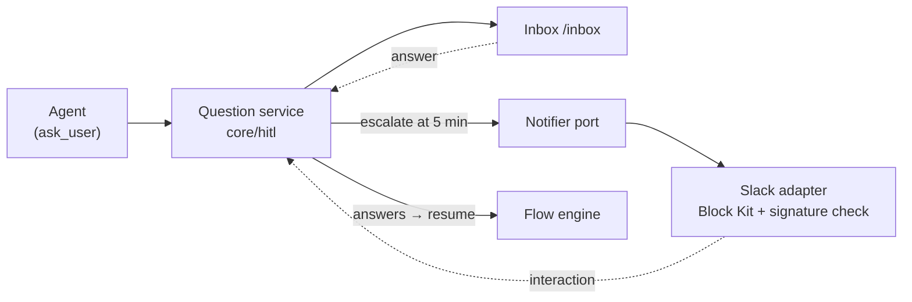

# Escalation And Notifications Overview

> *"When a question sits unanswered, FlowBoard nudges you on another channel so nothing stalls silently."* (feature map §13)

Escalation And Notifications is architecture component **#10, Notification / escalation → Notifier port** (`04-hitl-and-notify.md` §10). Its role, in the architecture's words: *"5-min timer → post the question to a channel → bidirectional reconciliation, first-write-wins."*

It has three jobs, named on the drawio *Functional components* page under **Escalation**:

| Job | Drawio card | Note |
|---|---|---|
| Post a waiting question to chat | *"Escalate after 5 min / Block Kit message to Slack"* | [[Escalation Timer]], [[Rendering Questions In Chat]] |
| Accept answers that come back | *"Verify inbound / signature check on interactions"* | [[Signed Inbound Interactions]] |
| Close the question everywhere | *"Resolve everywhere / answered once, closed in both places"* | [[First Write Wins]], [[Resolve Everywhere]] |

## Place in the system

Drawn from the drawio *Logical components* page: *Question service → Notifier* (*"escalate at 5 min"*), *Notifier → Slack* (*"Block Kit + signature check"*), *Question service → Flow engine* (*"answers → resume"*). On the *Functional components* page the only edge into Escalation is *Human in the loop → Escalation*, labelled *"unanswered too long"*.

Escalation does not own questions. [[Human In The Loop Index|Human In The Loop]] owns the question schema, the inbox and park/resume. Escalation *"subscribes to (9)'s question lifecycle; writes answers back through the *same* idempotent path as the web inbox, so web and channel can't diverge."* (`04` §10).

## Design principles

| Principle | Source wording |
|---|---|
| The channel is optional | *"If the token is absent, log the escalation and carry on — Slack is optional."* (PRD §10) |
| The mechanism is channel-independent | *"the mechanism is channel-independent — only rendering and signature verification differ"* (`04` §10) |
| One schema, many renderers | *"One JSON shape … drives three renderers with zero divergence: the MCP tool return, the `/inbox` controls, and the Slack/Discord blocks"* (`04` §9) |
| First answer wins, wherever it came from | *"Answer from anywhere … and whoever answers first wins."* (feature map §13) |
| Security stays in the adapter | *"Security stays in the adapter: Slack's v0 HMAC on the raw body, 300s replay window, `timingSafeEqual`."* (`04` §10) |
| Say little in the message | *"Never include artifact bodies or file contents in a notification — only task title + question text"* (`04` §10) |
| New channels are cheap | *"New channels cost an adapter, not a bespoke interactive UI each."* (`04` §10) |
| Keep the core free of Slack | *"Slack is named directly (§10)"* is one of the leaks the rebuild fixes (architecture README) |

## Why it matters

The inbox guide states the payoff: *"you can leave. Nothing needs watching, and chat will find you."* The empty state promises the same: *"you'll be nudged in chat if you're not here."*

It also names the warning sign: *"If **from chat** is most of the total, you are not really using this screen — the escalation window is too short, or you are not here when agents ask."* See [[Escalation In The UI]].

## Status

PRD milestone **M6 — Slack escalation**: *"5-minute timer, Block Kit rendering, interaction handler, idempotency and reconciliation both directions."* The first build had unit tests but backlog Story 6.3 records a **GAP**: *"run once against a real workspace — never done."* See [[Escalation And Notifications Roadmap]].

## Related

- [[Escalation And Notifications Index]]
- [[Escalation And Notifications Glossary]]
- [[Notifier Port]]
- [[Escalation Lifecycle]]
- [[Escalation To Chat]]
- [[Human In The Loop Overview]]
