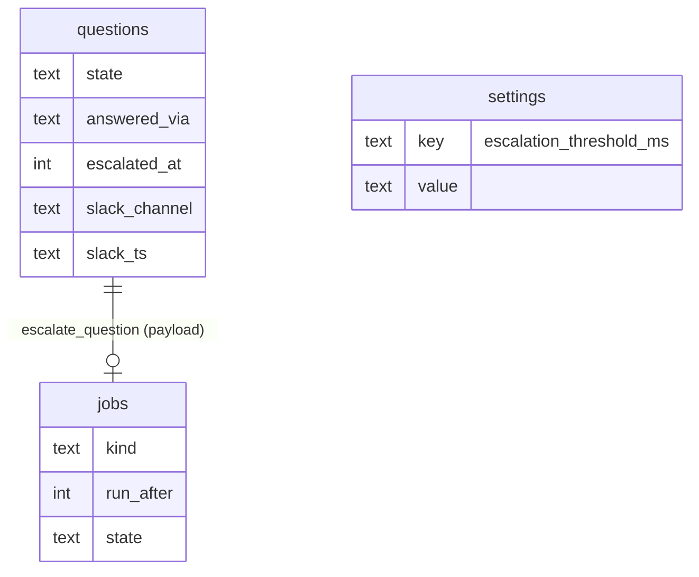

# Escalation Data Model

Escalation has no table of its own. It uses columns on `questions`, a job kind on `jobs`, and one setting.

## In the PRD schema (§5)

```sql
CREATE TABLE questions (
  ...
  state            TEXT NOT NULL,   -- 'pending'|'answered'|'expired'|'cancelled'
  answer           TEXT,            -- JSON
  answered_at      INTEGER,
  answered_via     TEXT,            -- 'web'|'slack'
  escalated_at     INTEGER,
  slack_channel    TEXT,
  slack_ts         TEXT,
  created_at       INTEGER NOT NULL
);
CREATE INDEX questions_pending ON questions(state, created_at);

CREATE TABLE jobs (
  id         TEXT PRIMARY KEY,
  kind       TEXT NOT NULL,   -- 'start_run'|'advance_task'|'escalate_question'|'import_backlog'
  payload    TEXT NOT NULL,
  run_after  INTEGER NOT NULL,
  state      TEXT NOT NULL,   -- 'queued'|'leased'|'done'|'failed'
  attempts   INTEGER NOT NULL DEFAULT 0,
  last_error TEXT,
  leased_at  INTEGER,
  created_at INTEGER NOT NULL
);

CREATE TABLE settings (
  key   TEXT PRIMARY KEY,
  value TEXT NOT NULL
);
```

| Field | Escalation use | Source |
|---|---|---|
| `questions.state` | The job posts only while `pending`; first write wins on `pending → answered` | PRD §10 |
| `questions.escalated_at` | When it was posted. Backlog 6.2: *"store `slack_channel`, `slack_ts`, `escalated_at`"* | PRD §5, backlog 6.2 |
| `questions.slack_channel`, `slack_ts` | The posted ref, for `chat.update`. *"already posted"* means these are set | PRD §10 |
| `questions.answered_via` | Which side answered: `'web' \| 'slack'` | PRD §5 |
| `questions.answered_at` − `created_at` | Wait time; the source of *median reply* (proposal in [[Human In The Loop Open Questions]] #32) | PRD §5 |
| `jobs.kind = 'escalate_question'` | The timer | PRD §5 |
| `jobs.run_after` | `now + threshold` | PRD §10 |
| `jobs.payload` | Not specified for this kind. It has to identify the question. | — |
| `settings` | `escalation_threshold_ms` | `04` §10, backlog 6.1 |

## In code (reference files)

| Type | Fields | File |
|---|---|---|
| `Question` | `id`, `prompt`, `help?`, `kind`, `options?`, `required?` | `core/hitl/question.ts` |
| `QuestionContext` | `taskTitle`, `stepName`, `sessionUrl?` | `core/ports/notifier.ts` |
| `PostedRef` | `channel`, `ref` | `core/ports/notifier.ts` |

`PostedRef` maps onto `slack_channel` / `slack_ts`: *"slack_channel + slack_ts equivalent"* (`07`).



## Proposals

> [!warning] Proposal — not in any source schema
> Each is listed in [[Escalation And Notifications Open Questions]].

| Change | Why | OQ |
|---|---|---|
| Rename `slack_channel` / `slack_ts` to `notify_channel` / `notify_ref`, and widen `answered_via` beyond `'web' \| 'slack'` | The port's `PostedRef { channel, ref }` is channel-neutral; Discord and email would otherwise need new columns. Same proposal as [[Human In The Loop Data Model]]. | #8 |
| `questions.answered_by TEXT` | PRD §10's *"by whom"* and the mockup's *"dana answered"* have nowhere to live | #10 |
| `step_instances.escalated_at`, `notify_channel`, `notify_ref` | Only if gates and failures escalate. Same proposal as [[Human In The Loop Data Model]]. | #3 |

## Related

- [[Escalation Storage]]
- [[Escalation Runtime]]
- [[Human In The Loop Data Model]]
- [[Escalation Threshold]]
