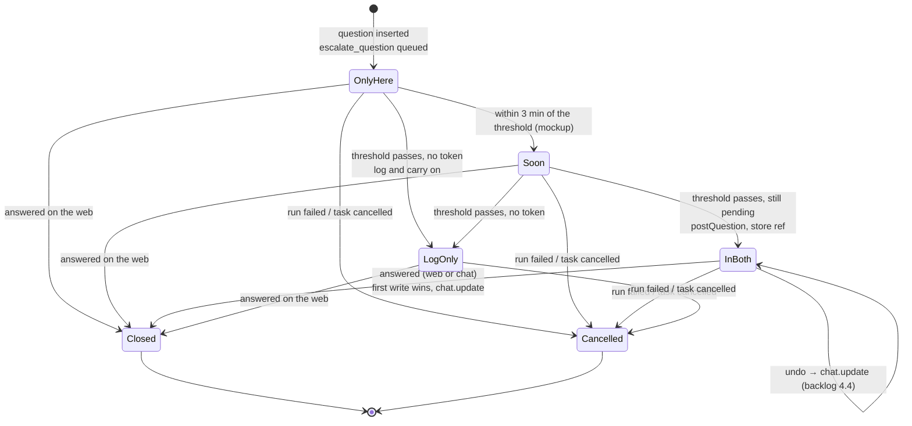

# Escalation Lifecycle

The life of one question, seen from the escalation side. The question's own states (`pending | answered | expired | cancelled`, PRD §5) belong to [[Question Lifecycle]]. Escalation adds no state of its own: an escalated question is still `pending`, with `escalated_at` and a posted ref set.

## States

| State | Stored | Inbox shows | Source |
|---|---|---|---|
| Only here | `questions.state = 'pending'`, no `slack_ts` | `waited 5m 00s`, no chip | PRD §5, inbox mockup |
| Soon | same | `escalates in 2m 14s` — *"still only here"* | inbox guide |
| In both | `escalated_at`, `slack_channel`, `slack_ts` set | `escalated` — *"also in chat now"* | PRD §10, backlog 6.2, inbox guide |
| Log only | same as only here; a log line | not specified | PRD §10 |
| Closed | `state = 'answered'`, `answer`, `answered_at`, `answered_via` | card leaves the queue, joins *recently answered* with a `web` or `slack` tag | PRD §5, inbox guide |
| Cancelled | `state = 'cancelled'` | not shown in any source (see [[Question Lifecycle]]) | `04` §9, backlog 2.1 |

"Soon" is a display state of the mockup only (`soon = !escd && w > ESCALATE - 3 * MIN`).

## The guide's timeline

The inbox guide draws *"A question's life: asked, parked, escalated, answered"*:

| Beat | Label |
|---|---|
| asked | *"a batch, or just one"* |
| parked | *"slot released · $0/min"*, *"billing stops"* |
| escalated | *"posted to chat"* after *"10m, no answer"* |
| answered | *"you, or chat"*, then *"the run resumes"* |

Under it: *"answer it before the timer and it never escalates"*.

> [!warning] Park before escalation, or after?
> The guide draws *parked* before *escalated* and frees the slot at once. In PRD §9 the agent stays blocked for 20 minutes before parking, so with a 5-minute threshold escalation comes first. See [[Waiting And Escalation]], [[Monitor Open Questions]] #8 and [[Escalation And Notifications Open Questions]] #21.

## Ends that are not answers

| End | Escalation behaviour | Gap |
|---|---|---|
| Run fails | *"cancel that step's pending questions so they stop escalating"* (`04` §9) | A message already in chat is not repainted: the port has only `updateResolved(ref, by)`. |
| Task cancelled | *"cancel pending questions"* (backlog 2.1) | Same. |
| `expired` | Never set: *"Either use `questions.state='expired'` or remove it. Today it is never set."* (backlog 1.1, **BUG**) | Same. |

See [[Escalation And Notifications Open Questions]] #11.

## Related

- [[Escalation Timer]]
- [[First Write Wins]]
- [[Resolve Everywhere]]
- [[Question Lifecycle]]
- [[Escalation In The UI]]
