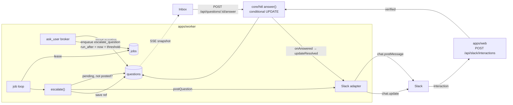

# Escalation Runtime

Where escalation code lives and how a question moves through it.

## Where the code lives

| Piece | Location | Source |
|---|---|---|
| Timer, skip rules, first-write-wins, repaint triggers | `core/hitl` (*"question protocol, park/resume"*) | architecture README module layout; `notifier.ts` |
| `Notifier`, `QuestionContext`, `PostedRef` | `packages/core/ports` (*"AgentProvider, ExecHost, MemoryStore, Notifier, TaskSource interfaces"*) | PRD §3 |
| Slack adapter | `packages/adapters/notify/` (*"slack"*); README layout `notify/slack/  discord/  email/` | PRD §3, architecture README |
| The job loop that runs `escalate_question` | `apps/worker` (*"job loop, runner, ask_user broker, escalation timer"*) | PRD §3 |
| `POST /api/slack/interactions`, `POST /api/questions/:id/answer` | `apps/web` route handlers, thin | PRD §12 |

*"the domain (flow engine, board projection, question protocol, cost ledger) depends only on **ports**; everything provider-specific is an **adapter** behind one."* (architecture README).

> [!note] Who writes `questions`?
> PRD §9: the broker *"is the only writer of the `questions` table"*. Yet an answer from the web or from Slack arrives at `apps/web` route handlers, and escalation stores `slack_ts` from the worker's job. The PRD does not reconcile *"only writer"* with these writes. It matters here because first-write-wins depends on one conditional UPDATE. See [[Escalation And Notifications Open Questions]] #16.

## The path



Drawio *Harness architecture* adds the step letter **H**: *"A question goes shim → ask.sock → broker → questions → Inbox, and to Slack after 5 minutes. After 20 minutes the agent parks and resumes later with --resume."* Its edge *Escalation + Notifier → Slack* is labelled *"H Block Kit after 5 min"*.

## The call sites

From `07-ports-in-practice.md`, *"The escalation job (component 10) depends only on the port — the channel is injected"*:

```ts
async function escalate(notifier: Notifier, q: Question, ctx: QuestionContext) {
  if (await isAnswered(q.id)) return;                 // skip if already answered
  const posted = await notifier.postQuestion(q, ctx); // Slack | Discord | Console | …
  await saveRef(q.id, posted);                        // slack_channel + slack_ts equivalent
}
// on web answer OR channel answer, the SAME idempotent path repaints the other side:
async function onAnswered(notifier: Notifier, q: Question, by: string) {
  const ref = await loadRef(q.id);
  if (ref) await notifier.updateResolved(ref, by);
}
```

## Known defects from the first build

| Item | Tag | Source |
|---|---|---|
| A failed run's pending questions *"keep escalating"* | **PRD/BUG** | backlog 3.2 |
| Three overlapping pollers (`/api/inbox/summary` ×2 + `/api/questions?state=pending`) instead of one stream | **BUG (perf)** | backlog 4.3 |
| Slack never run against a real workspace | **GAP** | backlog 6.3, preamble item 1 |
| The 10 s undo was *"bolted onto the MCP tool"*, delaying every answered batch | preamble item 5 | backlog |

## Related

- [[Escalation Timer]]
- [[Notifier Port]]
- [[Escalation API And Routes]]
- [[Human In The Loop Runtime]]
