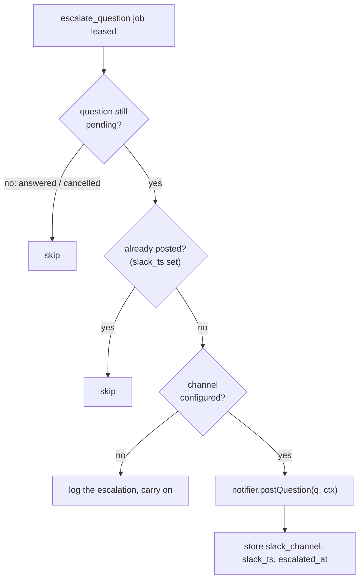

# Escalation Timer

> **Escalate after a wait** — *"If a question isn't answered within a set time, it's posted to your chat tool with buttons to answer right there."* (feature map §13)

## The rules

| Rule | Source |
|---|---|
| *"When a question is inserted, enqueue an `escalate_question` job with `run_after = now + 5 minutes`. If the question is still `pending` when the job runs, post to Slack via `chat.postMessage` using Block Kit"* | PRD §10 |
| *"`escalate_question` at `now + settings.escalation_threshold_ms` (default 5 min); skip if answered or already posted."* | backlog Story 6.1 |
| *"skip if already answered or posted. No token configured → log and continue (channel is optional)."* | `04` §10 |
| *"No token → log and continue."* | backlog Story 6.1 |
| *"On any run failure, **cancel that step's pending questions** so they stop escalating."* | `04` §9 |
| *"cancel that step's pending questions** (today they keep escalating)"* (**PRD/BUG**) | backlog Story 3.2 |

## It is a job, not a timer in memory

The timer is a row in `jobs`: `kind = 'escalate_question'`, `run_after = now + threshold` (PRD §5). The worker leases it like any other job: *"`UPDATE ... SET state='leased' WHERE id = (SELECT ...)` inside a transaction, with a stale-lease reclaim after 10 minutes"* (PRD §7). The worker's role in PRD §3 lists it by name: *"job loop, runner, ask_user broker, escalation timer"*.

So a worker restart does not lose a pending escalation: the row is still there.

## What the job does



The `07` call site:

```ts
async function escalate(notifier: Notifier, q: Question, ctx: QuestionContext) {
  if (await isAnswered(q.id)) return;                 // skip if already answered
  const posted = await notifier.postQuestion(q, ctx); // Slack | Discord | Console | …
  await saveRef(q.id, posted);                        // slack_channel + slack_ts equivalent
}
```

> [!note] The call site checks less than the rules
> `07` only checks `isAnswered`. The rules also skip *"already posted"* (`04`, backlog 6.1) and cancelled questions (`04` §9). The sketch is illustrative.

## Timing against park

The timer and the 20-minute park run on the same question. Escalation comes first.

| From asking | What happens | Source |
|---|---|---|
| 0 | Question inserted, `escalate_question` queued | PRD §10 |
| every 2 s | Broker polls `questions` while the agent's call is held open | PRD §9 |
| 5 min (default) | Posted to chat if still pending | PRD §10 |
| 20 min | Broker returns `no_answer_yet`; the run is `parked` | PRD §9 |
| any time | First answer wins; if the run parked, a `start_run` resumes it | PRD §9, §10 |

So with the default, a question reaches chat while the agent is still blocked waiting, 15 minutes before it parks.

## Edge cases

| Case | What the sources say |
|---|---|
| Answered before the timer | Job skips. Inbox guide: *"answer it before the timer and it never escalates"*. |
| Run fails while the question waits | Cancel the step's pending questions *"so they stop escalating"* (`04` §9). |
| Task cancelled | *"SIGTERM live runs, cancel pending questions, mark instances skipped."* (backlog 2.1) |
| No Slack token | Log and carry on. |
| Posted, then the job crashes before saving the ref | Not covered. A reclaimed job would see no `slack_ts` and post again. See [[Escalation And Notifications Open Questions]] #13. |
| Slack API call fails | Not covered. `jobs` has `attempts` and `last_error` (PRD §5), but no retry rule is given for this job. Open Questions #13. |
| Question in a batch | One job per question, so a batch posts one message per question. Open Questions #4. |

## Related

- [[Escalation Threshold]]
- [[Escalation Lifecycle]]
- [[Escalation Scope]]
- [[Escalation Runtime]]
- [[Question Lifecycle]]
