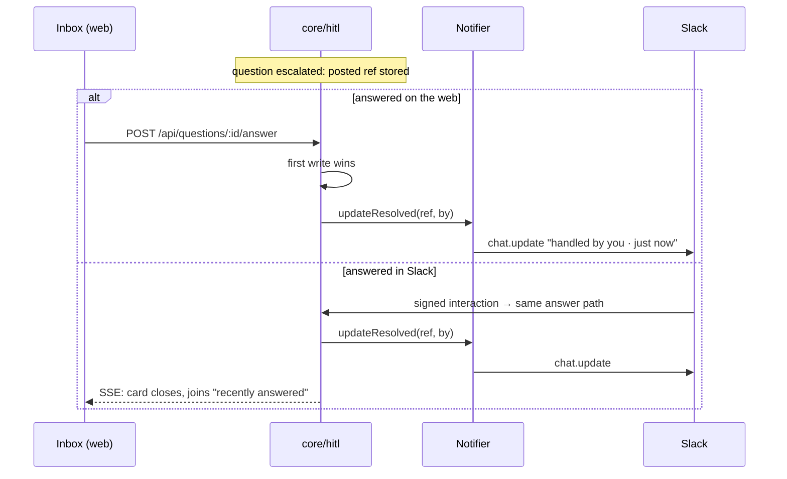

# Resolve Everywhere

> *"Resolve everywhere / answered once, closed in both places"* (drawio *Functional components*)

After the first answer, the other place must stop asking. PRD §10 calls this **reconciliation**.

## The rule

> [!quote] PRD §10
> *"**Reconciliation.** Answering in Slack must update the open web page (the inbox subscribes to an SSE stream). Answering on the web must repaint the Slack message via `chat.update` to show it is resolved and by whom."*

| Trigger | Repaint | Source |
|---|---|---|
| Web answer | `chat.update` on the Slack message | PRD §10, backlog 6.2 |
| Slack answer | SSE push to every open inbox; also `chat.update` on the Slack message itself | PRD §10, backlog 6.2 (*"`chat.update` on web answer, Slack answer, and undo"*) |
| Undo | `chat.update` | backlog 4.4, 6.2; `notifier.ts` (*"repaint on answer/undo"*) |

`04` §10: *"`updateResolved` (`chat.update` for Slack) repaints on web answer, channel answer, and undo."*

## Both directions



The `07` call site:

```ts
// on web answer OR channel answer, the SAME idempotent path repaints the other side:
async function onAnswered(notifier: Notifier, q: Question, by: string) {
  const ref = await loadRef(q.id);
  if (ref) await notifier.updateResolved(ref, by);
}
```

A question that never escalated has no ref, so nothing is repainted.

## The web side

| Rule | Source |
|---|---|
| *"One SSE snapshot stream (pending + recently-answered) so Slack answers repaint the open page"* | `04` §9 |
| *"SSE snapshot stream (pending + answered in last 2 min) so Slack answers repaint"* | backlog 4.3 |
| *"Answered‑elsewhere row swaps in place, collapses after the window."* | backlog 4.3 |
| *"Stays in sync — Answer the same question somewhere else (like chat) and the inbox updates itself instantly."* | feature map §12 |
| *"An answer from someone else does not move your cursor. If a teammate closes a card while you are mid-batch, that card disappears and you carry on where you were — the queue re-orders around you rather than under you."* | inbox guide |
| *"Cards resolve calmly when answered from Slack."* | drawio ideation |
| *"Rule: resolution never moves the row the developer is currently on, and never re-sorts the batch."* | old design handoff 1e |

How the inbox shows it is in [[Escalation In The UI]].

## "By whom"

PRD §10 wants the repaint to show *"by whom"*. `updateResolved(ref, by: string)` carries it. The mockups name people (*"dana answered pdf-import · plan in chat"*; *"handled by you · just now"*). But the schema records only the side, `answered_via` (`'web' | 'slack'`), and PRD §2 says *"No auth, no multi-tenancy, no user table."* Nothing says where `by` comes from. See [[Escalation And Notifications Open Questions]] #10.

## Related

- [[First Write Wins]]
- [[Escalation In The UI]]
- [[Notifier Port]]
- [[Answering Rules]]
- [[Escalation To Chat]]
