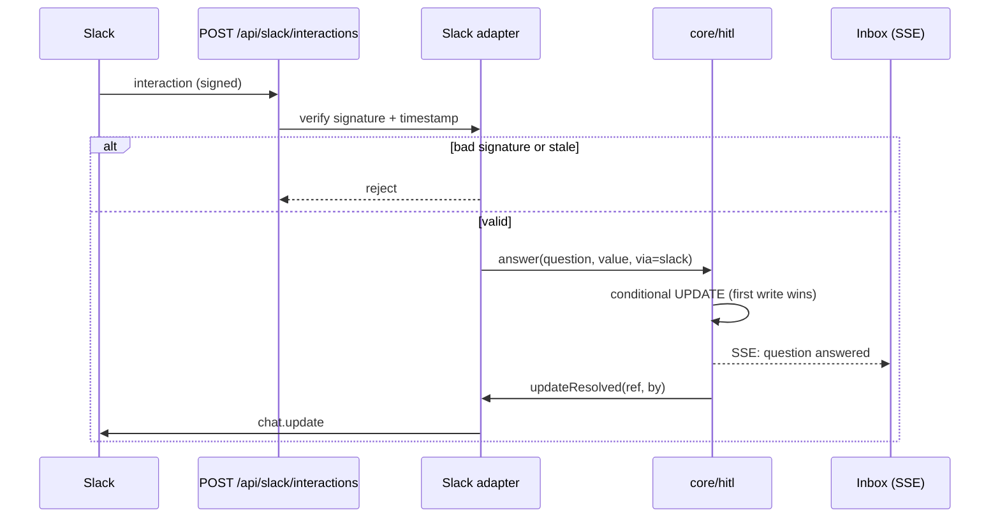

# Signed Inbound Interactions

An answer given in Slack comes back to FlowBoard as an **interaction**. It has to be checked before it is trusted, because it can unblock an agent.

Drawio *Functional components*: *"Verify inbound / signature check on interactions"*. Drawio ideation: *"Verification / Signature check on Slack interactions."*

## The rules

| Rule | Source |
|---|---|
| *"Handle interactions at `POST /api/slack/interactions` (verify the signing secret)."* | PRD §10 |
| *"`POST /api/slack/interactions`: v0 HMAC on the raw body, 300 s replay window, `timingSafeEqual`."* | backlog Story 6.2 |
| *"Security stays in the adapter: Slack's v0 HMAC on the raw body, 300s replay window, `timingSafeEqual`."* | `04` §10 |
| *"the adapter only renders and verifies signatures"* | `notifier.ts` |
| *"Unit tests (signature, shapes, idempotency, modal) exist; run once against a real workspace — never done."* (**GAP**). The signature check has never met a real Slack request. | backlog Story 6.3 |

## What each part means

The sources name these three parts without explaining them. The explanations below describe Slack's standard request signing.

| Part | Purpose |
|---|---|
| **v0 HMAC on the raw body** | Slack's request signing (`v0` scheme), keyed with `SLACK_SIGNING_SECRET`. It must be computed over the raw body, before any parsing. |
| **300 s replay window** | Reject a request whose timestamp is more than 300 seconds off, so a captured request can't be replayed later. |
| **`timingSafeEqual`** | Compare signatures in constant time, so timing doesn't leak the expected value. |

## The path after verification

Illustrative: the sources name the steps, not the calls. PRD §12 says only that a handler *"call[s] a function in `packages/core`"*.

Answers take "the *same* idempotent path as the web inbox" (`04` §10). See [[First Write Wins]].

The route follows the PRD's rule for every handler: *"All handlers are thin: validate with zod, call a function in `packages/core`, return JSON."* (PRD §12). `06` §15 adds *"Every port is called from `src/lib/`, **never from a route**"*, so the diagram's direct route-to-adapter call is itself open: [[Escalation And Notifications Open Questions]] #22.

> [!warning] Socket Mode would replace this, and the drawio disagrees with itself
> The drawio *Harness architecture* uses *"Slack Socket Mode + Block Kit, so no public URL"* and *"Socket Mode WebSocket, outbound only"*. Its other pages keep the check: *Logical components* has *"Slack / Block Kit + signature check"*, *Functional components* has *"Verify inbound"*, and the ideation page has *"Verification"*. The rules above assume HTTP. How signing works over a WebSocket is Slack's business, not the sources'; none of them says. See [[Escalation And Notifications Open Questions]] #6.

> [!question] Who is allowed to answer?
> Signing proves a request came from Slack, not who pressed the button or whether they should. No source restricts who may answer; presumably anyone who can see the message in `SLACK_CHANNEL_ID`. PRD §1: *"no auth"*. See Open Questions #10.

## Related

- [[Slack Adapter]]
- [[First Write Wins]]
- [[Escalation API And Routes]]
- [[Notification Content Limits]]
