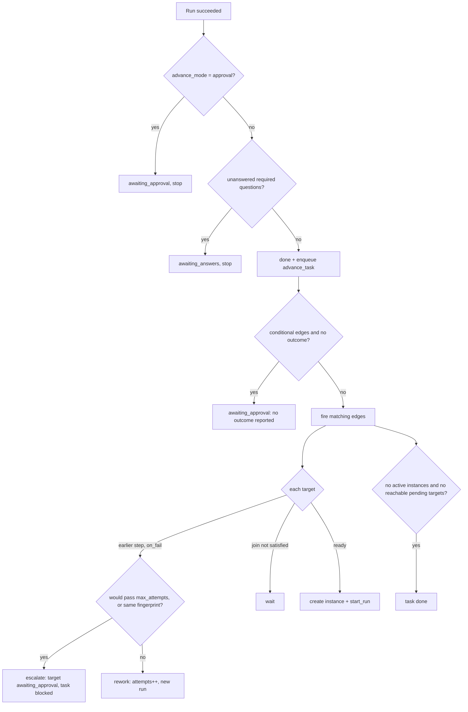

# Advancement Rules

What the engine does after a run finishes. The rules are PRD §8; the code lives in `packages/core/engine/` (PRD §3).

## After a run succeeds

*"After a run succeeds:"* (PRD §8)

1. *"If the step has `advance_mode='approval'`, set the step instance to `awaiting_approval` and stop. It advances only when I click Approve."*
2. *"If the step has unanswered required questions, set `awaiting_answers` and stop."*
3. *"Otherwise mark it `done` and enqueue `advance_task`."*

"Succeeds" means the process exited 0 (*"On exit code 0, set the run to `succeeded`, scan for artifacts, then apply the advancement rules in §8"*, PRD §7). A shell step with a non-zero exit also follows its edges (PRD §7). See [[Run Outcomes]].

## `advance_task`

*"`advance_task` resolves outgoing edges from the completed step definition:"* (PRD §8)

| Edge | Fires when |
|---|---|
| `always` | *"always fire"* |
| `on_pass` / `on_fail` | *"fire based on `step_instances.outcome`"* |
| any conditional, no outcome | nothing fires: *"set the step instance to `awaiting_approval` with the reason "no outcome reported" and stop"* |

Then:

- **Fan-out.** *"If more than one edge fires, create all the target step instances and start them concurrently."*
- **Join.** *"A step definition with multiple incoming edges is a join: it starts only once every upstream step instance for this task is `done`."*
- **Rework.** *"an `on_fail` edge pointing at an earlier step increments that step instance's `attempts` and creates a new run."*

Details: [[Fan-Out And Join]], [[Rework Loop]].

Assembled from PRD §8, with the done rule from `02` §3 (see [[Task Completion]]) and the escalation check from PRD §8 (see [[Loop Guard And Escalation]]). The PRD places the "no outcome" check inside `advance_task`, after the instance is marked `done`.

## Gates and human decisions

- **Approve**: PRD §8 says *"approve means pass"* only for the no-outcome gate, and is silent on approving over an agent's `fail`. `02` §3 adds the override: *"Approve overrides the agent's `fail` outcome (human wins)"* (backlog 5.2, tagged **FIX**). The feature map and the drawio side with `02` §3: *"**Your call wins** — If you approve or reject a step, your decision overrides whatever the agent concluded"* (feature map §4); *"Your call overrides the agent's."* (drawio harness concept 8, *Human escalation*). Backlog 10.2 lists *"approve overrides outcome"* among the README's deviations from the PRD.
- **Reject**: *"reject sets `fail` + reason; reject with no `on_fail` edge fails the task"* (`02` §3).
- **Answers**: when the last required answer arrives, *"enqueue a new `start_run` that resumes"* (PRD §9). See [[Ask Park And Resume]].

The drawio *Flow engine* card in the worker: *"advance_task: always / on_pass / on_fail · fan-out + join · approval and answer gates · no outcome → gate, never pass"*.

## The feature map's version

§4 *The engine*: *"**Decide the next step** — When a step finishes, the engine reads the recipe and starts whatever comes next."*; *"**Follow pass/fail paths** — If a step reports success or failure, the engine takes the matching route (a passed review moves on; a failed one loops back)."*; *"**Silence isn't success** — If an agent finishes without saying whether it passed, the engine doesn't assume it did. The step stops and asks you."*

The monitor guide's *"four handoff rules"* (Advance, Fan out, Join, Loop back) restate this for the screen: *"When a step finishes, the engine reads the flow and applies these. Nothing else moves work."* See [[Hand-Off Rules]].

## Gaps

- **Approval and questions together.** A step with `advance_mode='approval'` that also has unanswered questions hits rule 1 first and never reaches rule 2. Whether that is intended is not stated ([[Execution Open Questions]] #5).
- **Approval on a failed outcome.** On an approval step whose agent set `fail`, the run still "succeeds", so rule 1 parks it for approval. Under `02` §3 Approve then overrides to pass; the PRD does not say, and the backlog calls the override a deviation ([[Execution Open Questions]] #64). The screens should show the agent's verdict at the gate.
- **A silent approval step.** Because rule 1 comes first, a run on an approval step that sets no outcome waits at an ordinary gate, never at *"no outcome reported"*. The `review` step in the seeded flow is such a step ([[Seeded Flow Execution]]).
- **`manual` steps.** PRD §5 allows `kind = 'manual'`; no rule says what the engine does when it reaches one. See [[Execution Open Questions]] #6.

## Related

- [[Execution Index]]
- [[Run Outcomes]]
- [[Fan-Out And Join]]
- [[Rework Loop]]
- [[Approval Gates]]
- [[Connections And Routes]]
