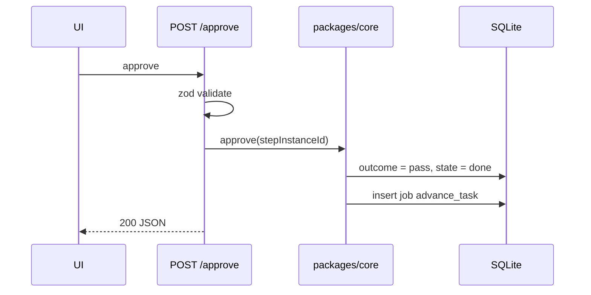

# Execution API And Routes

*"REST route handlers under `apps/web/app/api/`. All handlers are thin: validate with zod, call a function in `packages/core`, return JSON."* (PRD §12) For execution, *thin* means: write rows, enqueue a job, return. The drawio *API routes + server actions* card: *"zod-validated input → write rows → enqueue a job → return"*.

## In the PRD

| Method | Path | Execution effect |
|---|---|---|
| `POST` | `/api/tasks/:id/promote` | *"backlog -> todo, pin flow, create worktree"* |
| `POST` | `/api/tasks/:id/cancel` | stop runs, cancel questions, skip instances (backlog 2.1) |
| `POST` | `/api/step-instances/:id/approve` | outcome pass: *"Approve overrides the agent's `fail` outcome (human wins)"* (`02` §3). PRD §8 says *"approve means pass"* only of the no-outcome gate ([[Execution Open Questions]] #64). Enqueueing `advance_task` is inferred |
| `POST` | `/api/step-instances/:id/reject` | outcome fail + reason; *"reject with no `on_fail` edge fails the task"* (`02` §3, backlog 5.2). Backlog 2.3: the UI must send the reason. |
| `POST` | `/api/step-instances/:id/retry` | one more attempt with a note (PRD §8) |
| `POST` | `/api/questions/:id/answer` | may enqueue a resume `start_run` (PRD §9) |
| `GET` | `/api/runs/:id` | one run |
| `GET` | `/api/runs/:id/stream` | SSE: *"replays existing `run_events` for the run, then streams new ones. Reconnect with `Last-Event-ID`."* |
| `GET` | `/api/projects/:id/board` | *"board projection: columns + cards"* |
| `POST` | `/api/import/backlog` | *"md file -> tasks"*; enqueues an `import_backlog` job for the worker (backlog 7.3). See [[Intake API And Routes]] |

(PRD §12)

## Named elsewhere

| Path | Source |
|---|---|
| `POST /api/tasks/:id/start` | backlog intro: *"the code added `POST /api/tasks/:id/start` with no button"* |
| Stop | `03` §8: *"Stop = SIGTERM by pid from the route"*, path not named |

## Proposed

> [!note] Proposals
> Not in any source, except the `start` path, which the backlog intro records. The task-level paths match [[Task Detail API And Routes]] (and, for demote, [[Workspaces API And Routes]]); the stop path and the retry body follow [[Monitor API And Routes]]. Each is listed in [[Execution Open Questions]] #47.

| Method | Path | For |
|---|---|---|
| `POST` | `/api/tasks/:id/start` | Start, if D1 keeps it separate from promote |
| `POST` | `/api/tasks/:id/demote` | Send to backlog |
| `POST` | `/api/tasks/:id/pause` | Pause (named in feature map §3, defined in the task-detail guide) |
| `POST` | `/api/tasks/:id/fail` | **Fail task** at an escalation gate |
| `POST` | `/api/runs/:id/stop` | Stop a run |
| `POST` | `/api/step-instances/:id/retry` with `{ note?, allowHost? }` | PRD §8's Retry *"carries my note"*; the mockups' **Retry as-is** (no host) and **Allow host & retry** |

Sibling sets propose different shapes for the same actions; pick one ([[Execution Open Questions]] #47):

| Action | [[Task Detail API And Routes]] | [[Monitor API And Routes]] | [[Human In The Loop API And Routes]] | [[Sandboxing API And Routes]] |
|---|---|---|---|---|
| Fail task | `POST /api/tasks/:id/fail` | — | `POST /api/step-instances/:id/fail-task` (or `reject` with `{ failTask: true }`) | — |
| Allow host & retry | — | `retry` with `{ note?, allowHost? }` | `POST /api/step-instances/:id/allow-host` `{ host }` | `POST /api/step-instances/:id/allow-host` `{ host }` |

The proposals agree elsewhere: Stop as `POST /api/runs/:id/stop` (Task Detail, Monitor), demote as `POST /api/tasks/:id/demote` (Task Detail, Workspaces). Clean-up of the workspace, `POST /api/tasks/:id/cleanup`, is proposed by Task Detail and Workspaces; it does not touch execution.

## What a route does, step by step

*Illustrative* for Approve:

## Rules for every execution route

- *"Every port is called from `src/lib/`, **never from a route**"* (`06` §15). `06` uses the first build's layout (`src/app/api/`, `src/lib/`); in the PRD's layout that is `apps/web/app/api/` calling `packages/core` (PRD §3, §12).
- *"If a route ever needs to know whether it's Claude or Codex, something leaked upward."* (`06` §15)
- Stop is the one route that touches a process (by pid): *"SIGTERM by pid from the route (same machine)"* (backlog 3.4; `03` §8). As built, a signal from outside is reported as a failed run (exit 1), not as a stop, and OpenCode's pid is its server's ([[Agent Run Handle And Result]]). As built in run-flow (2026-10-23), each run's log records its pid as a `pid` line: the agent CLI's, or for a shell step its process group's, which a stop has to signal as a group. The line also holds the process's start time, and run-flow, stopping what a dead host left running, signals a pid only while that still matches, since the pid may be another process's by now (Claude's call, 2026-10-23, open to Alex's review).

## Related

- [[Execution Index]]
- [[Execution Controls]]
- [[Job Queue]]
- [[Task Detail API And Routes]]
- [[Monitor API And Routes]]
- [[Workspaces API And Routes]]
- [[Sandboxing API And Routes]]
- [[Thin Route Handlers]]
