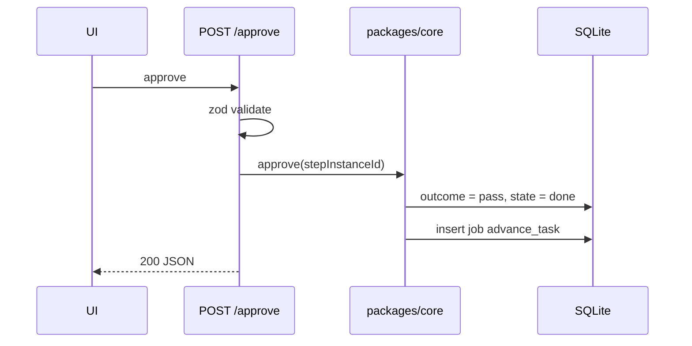

# Execution API And Routes

*"REST route handlers under `apps/web/app/api/`. All handlers are thin: validate with zod, call a function in `packages/core`, return JSON."* (PRD §12) For execution, *thin* means: write rows, enqueue a job, return. The drawio *API routes + server actions* card: *"zod-validated input → write rows → enqueue a job → return"*.

## In the PRD

| Method | Path | Execution effect |
|---|---|---|
| `POST` | `/api/tasks/:id/promote` | *"backlog -> todo, pin flow, create worktree"* |
| `POST` | `/api/tasks/:id/cancel` | stop runs, cancel questions, skip instances (backlog 2.1) |
| `POST` | `/api/step-instances/:id/approve` | outcome pass; enqueue `advance_task` |
| `POST` | `/api/step-instances/:id/reject` | outcome fail + reason (backlog 2.3) |
| `POST` | `/api/step-instances/:id/retry` | one more attempt with a note (PRD §8) |
| `POST` | `/api/questions/:id/answer` | may enqueue a resume `start_run` (PRD §9) |
| `GET` | `/api/runs/:id` | one run |
| `GET` | `/api/runs/:id/stream` | SSE: *"replays existing `run_events` for the run, then streams new ones. Reconnect with `Last-Event-ID`."* |
| `GET` | `/api/projects/:id/board` | *"board projection: columns + cards"* |

(PRD §12)

## Named elsewhere

| Path | Source |
|---|---|
| `POST /api/tasks/:id/start` | backlog intro: *"the code added `POST /api/tasks/:id/start` with no button"* |
| Stop | `03` §8: *"Stop = SIGTERM by pid from the route"*, path not named |

## Proposed

> [!note] Proposals
> Not in any source. They match the paths proposed in [[Task Detail API And Routes]] so the vault stays consistent. Each is listed in [[Execution Open Questions]].

| Method | Path | For |
|---|---|---|
| `POST` | `/api/tasks/:id/start` | Start, if D1 keeps it separate from promote |
| `POST` | `/api/tasks/:id/demote` | Send to backlog |
| `POST` | `/api/tasks/:id/pause` | Pause (mockup only) |
| `POST` | `/api/tasks/:id/fail` | **Fail task** at an escalation gate |
| `POST` | `/api/runs/:id/stop` | Stop a run |
| `POST` | `/api/step-instances/:id/retry` with `{ mode: 'as_is' \| 'allow_host', host? }` | the mockups' **Retry as-is** and **Allow host & retry** |

[[Human In The Loop API And Routes]] proposes `POST /api/step-instances/:id/fail-task` and `POST /api/step-instances/:id/allow-host` for the same two actions. The two proposals disagree on shape; pick one.

## What a route does, step by step

*Illustrative* for Approve:

## Rules for every execution route

- *"Every port is called from `src/lib/`, **never from a route**"* (`06` §15).
- *"If a route ever needs to know whether it's Claude or Codex, something leaked upward."* (`06` §15)
- Stop is the one route that touches a process (by pid).

## Related

- [[Execution Index]]
- [[Execution Controls]]
- [[Job Queue]]
- [[Task Detail API And Routes]]
- [[Monitor API And Routes]]
