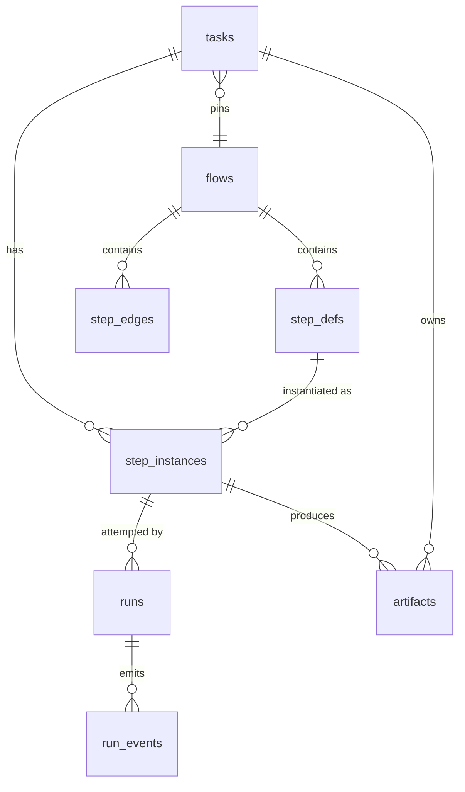

# Execution Data Model

The tables and columns execution reads and writes. Schema is PRD §5 (*"Write this as Drizzle schema"*) unless noted. Columns added by other sources are marked.

## Read: the pinned flow

| Table | Columns execution uses |
|---|---|
| `step_defs` | `kind` (*"'ai' \| 'shell' \| 'manual'"*), `command` (*"null = the project's check_command"*), `skill_id`, `agent_id`, `extra_plugin_ids`, `prompt_template`, `model` (default `'sonnet'`), `effort` (default `'medium'`), `permission_mode` (default `'bypassPermissions'`), `allowed_tools`, `max_turns`, `max_budget_usd`, `max_attempts` (default 3), `advance_mode` (`auto` \| `approval`), `requires`, `produces`, `is_entry` |
| `step_edges` | `from_step`, `to_step`, `condition` (`always` \| `on_pass` \| `on_fail`) |
| `projects` | `repo_path`, `check_command`; `default_flow_id`, which is presumably the version a task pins (*inference*: no source says which flow promotion pins; see [[Project Default Flow]]) |
| `tasks` | `title`, `body`, `acceptance_criteria`, `non_goals` (prompt preamble, template placeholders, and the non-goal path hooks, PRD §7); `worktree_path` (`cwd`); `capability_pins` (*"Each plugin dir is the commit recorded in the task's `capability_pins`"*, PRD §7) |
| `agents` | `system_prompt` (`--append-system-prompt`), `allowed_tools` (the tool intersection), `default_model` (*"a Claude alias, used as the logical model id"*, PRD §5), `default_effort`; *"agent rows are pinned the same way"* as plugin dirs (PRD §7) |
| `skills` | `slug` (the `/<plugin>:<slug>` invocation), `allowed_tools` (PRD §7) |
| `plugins` | `name`, `commit_sha` (the plugin dir), `source` (a git-installed plugin does not run on the host tier, PRD §11.1) |
| `settings` | A key/value table (`key`, `value`, PRD §5). Keys: draft mode (PRD §13), escalation threshold (minutes in `06` §15 and backlog 8.3; `settings.escalation_threshold_ms`, default 5 min, in `04` §10 and backlog 6.1; sets the `escalate_question` `run_after`), `sandbox_profile` (PRD §11.1), `memory` block (PRD §11.2). See [[Settings Data Model]]. |

Backlog 1.1 (**NEW**) adds an optional `step_defs.sandbox_profile` override, not in PRD §5's SQL ([[Sandboxing Data Model]]).

## Written: task and instance state

| Table | Column | Values / meaning |
|---|---|---|
| `tasks` | `status` | `backlog`, `todo`, `running`, `blocked`, `done`, `failed`, `cancelled` |
| | `flow_id` | *"null while in backlog, pinned on promotion"* |
| | `branch_name`, `worktree_path` | set on promotion |
| | `capability_pins` | *"set when the task starts"* |
| `step_instances` | `state` | `pending`, `running`, `awaiting_answers`, `awaiting_approval`, `done`, `failed`, `skipped` |
| | `attempts` | counted runs; the rework budget |
| | `outcome` | `pass`, `fail`, null |
| | `reason` | *"rejection/failure text shown on the card"* (backlog 1.1, `02` §1; not in PRD §5) |

## Written: questions

The worker's broker is *"the only writer of the `questions` table"* (PRD §9); see [[Human In The Loop Data Model]]. Execution touches it in one place: on a run failure, *"cancel that step's pending questions"* (backlog 3.2, `04` §9).

## Written: runs and events

| Table | Column | Meaning |
|---|---|---|
| `runs` | `attempt` | the attempt this run belongs to |
| | `claude_session_id` | `--session-id`, and `--resume` on a resume (PRD §7, §9). `02` §1 proposes renaming it `agent_session_id`; PRD §5 keeps the old name |
| | `pid` | for Stop and restart re-attach |
| | `state` | `starting`, `running`, `parked`, `succeeded`, `failed`, `cancelled` |
| | `exit_code`, `error` | process result; `error` holds stderr (PRD §7), *"stderr tail"* (backlog 3.2) |
| | `cost_usd`, `input_tokens`, `output_tokens`, `cache_read_tokens`, `cache_write_tokens`, `num_turns` | usage |
| | `wasted` | *"1 if superseded by a rework loop or an infra retry"* |
| | `fingerprint` | *"shell steps: normalized hash of a failing check_output"* |
| | `started_at`, `ended_at` | timing |
| | `model`, `effort` | actual values after draft mode (backlog 1.1, `02` §1; named in PRD §11.1's prose, not in PRD §5's SQL) |
| | `provider` | proposed by `02` §1; not in PRD §5 ([[Agent Providers Data Model]]) |
| | `sandbox` | *"tier that ran, for audit"* (backlog 1.1); *"records the tier that actually ran"* (PRD §11.1's prose, not PRD §5's SQL) |
| `run_events` | `run_id`, `seq`, `v`, `type`, `raw`, `summary`, `created_at` | index `run_events_run_seq` |
| `artifacts` | `task_id`, `step_instance_id`, `type`, `path`, `bytes` | registered after a run |
| `run_memories` | `run_id`, `memory_id`, `scope` | optional, audit of recall (PRD §11.2; not in PRD §5). See [[Memory Data Model]] |

## Written: the queue

`jobs`: `kind`, `payload`, `run_after`, `state`, `attempts`, `last_error`, `leased_at`, `created_at`. See [[Job Queue]].

## Entity relationships

`jobs` has no foreign keys. Its `payload` is unspecified `TEXT`; that it carries the ids is an *inference* ([[Execution Open Questions]] #34).

## `runs` as a journal

`02` §1: *"treat `runs` as an **append-only usage journal** — never mutate cost after the result lands; corrections are new rows."* The `wasted` flag is set after the fact on superseded runs, which is a mutation; whether it counts as a correction is not stated ([[Execution Open Questions]] #46).

## Missing columns

| Need | Why | Status |
|---|---|---|
| Task paused | Task-detail **Pause** | *proposal*: a status or a flag ([[Task Data Model]] proposes a `paused` status; [[Execution Open Questions]] #29) |
| Run stop reason | Monitor: *"stopped by you"* | *proposal*: reuse `runs.error` (the replay adapter's `stop()` already sets `error: 'stopped'`) |
| Escalation kind on a gate | spent, stuck, no outcome, approval | *proposal*: reuse `step_instances.reason` |
| Retry note | PRD §8 *"carries my note into it"* | not stated where it is stored ([[Execution Open Questions]] #21) |

## Related

- [[Execution Index]]
- [[Execution Entities]]
- [[Execution State Machines]]
- [[Task Data Model]]
- [[Flow Data Model]]
- [[Agent Providers Data Model]]
- [[Sandboxing Data Model]]
- [[Domain Schema]]
