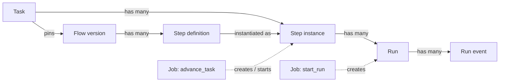

# Execution Entities

PRD §4 defines four concepts (flow, step definition, step instance, run) and warns: *"Get these three distinctions right; everything else follows."* The flow is covered in [[Flow Design Index]]. Execution works with the other three, and adds the job.

## The three, plus the job

| Entity | What it is | Lives | Key fields |
|---|---|---|---|
| Step definition | *"Code review, Sonnet, high effort, waits for my approval."* Belongs to a flow version. *"An AI step names an **agent** … a **skill** … or both"*. | `step_defs` | `kind`, `skill_id`, `agent_id`, `command`, `model`, `effort`, `advance_mode`, `max_attempts`, `requires`, `produces`, `is_entry` |
| Step instance | *"one task's occupancy of one step definition. Has state and artifacts."* | `step_instances` | `state`, `attempts`, `outcome` (+ `reason`, backlog 1.1) |
| Run | *"one attempt at a step instance. Rework loops create attempt 2, 3, 4 against the same step instance."* | `runs` | `attempt`, `pid`, `state`, `exit_code`, cost and tokens, `wasted`, `fingerprint`, `error` |
| Job | A unit of background work the worker leases (not a PRD §4 concept) | `jobs` | `kind`, `payload`, `run_after`, `state`, `attempts`, `last_error`, `leased_at` |

Quotes from PRD §4; columns from PRD §5. The drawio *FlowBoard ideation* card says the same: *"Step def → step instance → run / Rework loops create attempt 2, 3, 4 against the same instance."*

## How they multiply

- **One instance per step per task, reused on rework.** *"Rework: same instance, `attempts++`, new run"* (`02` §3). The instance is not recreated when work loops back to it.
- **Downstream instances are re-created.** On rework, *"downstream `done` → `skipped` so they re-instantiate"* (`02` §3). So a step downstream of a loop target can have more than one instance per task. See [[Rework Loop]].
- **Many runs per attempt.** An infra retry is *"a new run with the same `attempt` number"* (PRD §7). A resume after parking is a new run too (PRD §9 *"enqueue a new `start_run`"*).
- **One job, one run.** A `start_run` job builds one command (PRD §7), so it launches one run. An `advance_task` job resolves edges and may create several instances (fan-out).

## Pins

A task pins two things, at moments the sources do not agree on ([[Starting A Task]], [[Execution Open Questions]] #2):

- `tasks.flow_id`: *"null while in backlog, pinned on promotion"* (PRD §5). See [[Version Pinning]].
- `tasks.capability_pins`: *"JSON {plugins:{id:commit_sha}, agents:{id:<agent row>}}, set when the task starts"* (PRD §5). *"Each plugin dir is the commit recorded in the task's `capability_pins`, not the currently installed one, so an update never reaches a running task"* (PRD §7).

## What the engine reads, and what it never reads

- Reads: the pinned flow (`step_defs`, `step_edges`), `step_instances`, and the run's normalised result.
- Never reads: provider JSON. *"The viewer, cost ledger, and engine never see provider JSON."* (`01-ports.md`)

## Related

- [[Execution Index]]
- [[Execution State Machines]]
- [[Execution Data Model]]
- [[Step Instances And Runs]]
- [[Pinned Flow On A Task]]
