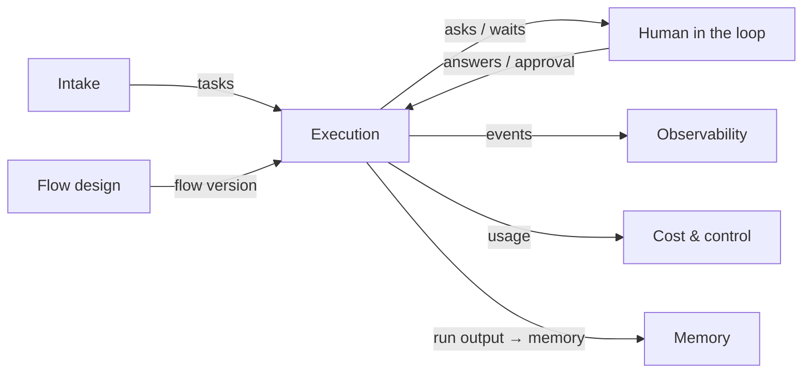

# Execution Overview

## Purpose

FlowBoard is *"a local-first Kanban board where each column is an agent or skill invocation rather than a human workflow stage"* (PRD §1). Execution is the machinery that makes that true. A task *"flows through a graph of automated steps — research, planning, implementation, review — each one a headless Claude Code session with its own model and effort setting. Some steps advance automatically when they finish; others park and wait for me to approve or answer questions."* (PRD §1)

The architecture README names the whole system *"a **durable workflow engine** + human-in-the-loop protocol + cost ledger, specialized to orchestrate headless coding-agent CLIs, wearing a Kanban board as its read model."* Execution is the durable workflow engine part.

## What it covers

The drawio *Functional components* page lists the Execution box (*"dashed = not in v1"*) with seven functions:

| Function | drawio wording | Notes |
|---|---|---|
| Start task | *"pin flow version"* | [[Starting A Task]] |
| Run a step | *"spawn headless session in its worktree"* | [[Runner Pipeline]] |
| Advance | *"auto · on approval · on answers"* | [[Advancement Rules]] |
| Rework loop | *"attempt 2, 3… guarded by max_attempts"* | [[Rework Loop]], [[Loop Guard And Escalation]] |
| Split & join | *"parallel branches from one card"* | [[Fan-Out And Join]] |
| Stop | *"kill the process"* | [[Stopping And Cancelling]] |
| Isolate the workspace (dashed) | *"worktree per task today; devcontainer / Docker sandbox / remote host later"* | Covered by [[Workspaces Index]] and [[Task Workspace]]; the container side by [[Sandboxing Index]] |

The tracker scopes the component as *"Start, run a step, advance, rework loop, split and join, stop, cancel, infra retries, loop guard"*, mapping to feature map §4 *The engine*, §7 *The runner*, §8 *The work queue*, and architecture components *"#3 Flow execution engine, #6 Runner / execution host, #7 Job queue & worker lifecycle (also #5, `08-sandboxing.md`)"*.

## Place in the system

Edges as drawn on the drawio *Functional components* page. Inside, three architecture components split the work:

| # | Component | Role (source wording) |
|---|---|---|
| 3 | Flow execution engine (write model) | *"the state machine — advancement, fan-out, join, conditional edges, rework loops, approval/answer gates, `max_attempts`"* (`02` §3) |
| 6 | Runner / execution host | *"the generic execution loop — build `RunSpec`, `launch()` via the port, tee events to `run_events` + the SSE emitter, scan artifacts on completion, apply the engine's advancement rules"* (`03` §6) |
| 7 | Job queue & worker lifecycle | *"SQLite-as-queue with leasing; restart recovery; concurrency cap `VIBE_MAX_RUNS`"* (`03` §7) |

On the drawio *Logical components* page these appear as **Flow engine**, **Job queue** (*"enqueue / claim"*) and **Run orchestrator** (*"spawns run, parses stream-json, emits events"*), wired: engine → queue (*"enqueue step"*), queue → orchestrator (*"claim"*), orchestrator → engine (*"step done → advance"*), orchestrator → **Task & run state** (*"events, cost"*). The orchestrator also has unlabelled edges to the AgentProvider, Workspace and ArtifactStore ports, and one to the MemoryStore port labelled *"recall / commit (host-side)"*.

## Design principles

| Principle | Source wording |
|---|---|
| Routes never spawn | *"Next.js route handlers must never spawn a long-lived child process; they enqueue jobs and the worker picks them up"* (PRD §2) |
| The core is framework-free | *"**`packages/core` imports no framework, no database driver and no CLI.** The engine, loop guard, advancement rules, prompt builder, fingerprinting and the port interfaces live there."* (PRD §3) |
| Provider-blind engine | *"**Depends only on the AgentProvider port's `RunResult`, never on how the run happened.**"* (`02` §3) |
| No provider strings in the substrate | *"Components 6–8 contain **zero provider strings** once 5 is extracted — that is the test of the abstraction."* (`03` intro) |
| Silence isn't success | *"If an agent finishes without saying whether it passed, the engine doesn't assume it did. The step stops and asks you."* (feature map §4) |
| Work, not weather | *"The engine only ever sees work outcomes, so `max_attempts` counts work, not weather."* (`03` §6) |
| Your call wins | *"If you approve or reject a step, your decision overrides whatever the agent concluded"* (feature map §4) |
| Escalate, don't fail | *"Escalate, don't fail, when a loop is spent or stuck."* (PRD §8) |
| The board is a projection | *"The board is a projection, not the model."* (PRD §4) |
| Sensors before autonomy | *"Check steps run real commands. The exit code is the verdict, and the raw output feeds the next attempt."* (drawio *Harness architecture*, concept 4) |

The drawio *Harness architecture* page names the execution rules as three harness concepts:

- **Loop layer** (6): *"Rework edges share one attempt budget, a repeated fingerprint escalates early, infra retries stay out of the count, and a missing outcome is never a pass."*
- **Graph layer** (7): *"A versioned DAG: one agent per step with a fresh context, parallel branches in the task's own worktree, and an adversarial review only after the check passes."*
- **Human escalation** (8): *"Every stop (gate, question, spent or stuck loop) lands in one inbox, then Slack. Your call overrides the agent's."*

## What it is not

- Not the recipe: designing steps and edges is [[Flow Design Index]].
- Not the question protocol: asking and answering is [[Human In The Loop Index]]. Execution only parks and resumes.
- Not the screens: execution has no screen of its own. See [[Execution Surfaces]].
- Not the provider: turning a `RunSpec` into a CLI command and its stream into `NormalizedEvent`s is the adapter's job (`03` §5). See [[Agent Providers Index]].
- Not the sandbox or the workspace: where a process runs and what it may reach is [[Sandboxing Index]]; creating and cleaning up the worktree is [[Workspaces Index]].
- Not memory: what is recalled and committed is [[Memory Index]]. The runner only brackets the launch with the two calls (`03` §6).

## Related

- [[Execution Index]]
- [[Execution Glossary]]
- [[Life Of One Step]]
- [[Execution Runtime]]
- [[Agent Providers Overview]]
- [[Sandboxing Overview]]
- [[Workspaces Overview]]
- [[Memory Overview]]
