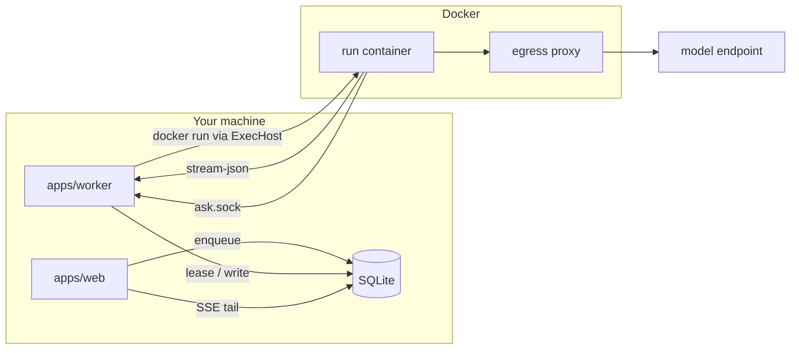

# Execution Runtime

Where execution's code and processes live.

## Processes

The drawio *Harness architecture* title: *"One laptop · two Node processes · one SQLite file · one throwaway Docker container per run."*

| Process | Role in execution | Source |
|---|---|---|
| `apps/web` (Next.js) | *"thin: validates, calls core, enqueues; never spawns agents"* | drawio |
| `apps/worker` (Node) | job loop, runner, `ask_user` broker, escalation timer (PRD §3); *"the harness proper; its rules come from packages/core"* (drawio) | PRD §3, drawio |
| `apps/mcp-shim` | *"tiny stdio MCP server; forwards to the broker over a unix socket"*; *"the CLI launches"* it, one per run (PRD §9) | PRD §3, §9 |
| Agent CLI | `claude -p …`, spawned through the ExecHost: a host child process, or inside the run's container | PRD §7, §11.1 |
| Sandbox container | non-host tiers only: *"one container per run, destroyed on exit"* | drawio *Docker Desktop* box; PRD §11.1 (*"one per run, destroyed on completion"*) |
| Egress proxy | the only way out of the sandbox network | PRD §11.1 |



## Code layout

*"**`packages/core` imports no framework, no database driver and no CLI.** The engine, loop guard, advancement rules, prompt builder, fingerprinting and the port interfaces live there."* (PRD §3)

```
packages/
  core/
    engine/     # DAG traversal, advancement rules, loop guard (§8)
    prompt/     # the prompt parts (§7)
    ports/      # AgentProvider, ExecHost, MemoryStore, Notifier, TaskSource
    events.ts   # NormalizedEvent, versioned (§7 "Events")
  db/           # Drizzle schema, migrations
  adapters/
    agent/      # claude-cli, codex-cli (later), replay
    exec/       # host, docker
apps/
  web/  worker/  mcp-shim/
```

(PRD §3, trimmed to the execution parts.) The architecture README's layout puts the runner and worker at top level: *"`runner/` # generic execution loop — imports ports, not adapters (03)"*, *"`worker/` # queue + lifecycle"*. Its rule: *"`core/` and `runner/` must never import from `adapters/` — only from `core/ports/`. Enforce with a lint rule."*

## Ports execution touches

| Port | Used for | Source |
|---|---|---|
| AgentProvider | launch a run | `01-ports.md`; [[Agent Launch Contract]] |
| Workspace | `cwd`, `execHost(task)` | `workspace.ts` |
| ExecHost | where the process runs | `exec-host.ts` |
| ArtifactStore | scan and register outputs | `07` |
| MemoryStore | recall and commit (additive) | `01-ports.md`, `09` |

```ts
export interface ExecHost {
  readonly id: IsolationTier;          // 'host' | 'container' | 'gvisor' | 'microvm'
  readonly profile?: SandboxProfile;   // absent for the host tier
  spawn(command: string, args: string[], opts: { cwd: string; env?: Record<string, string> }): ChildHandle;
}
```

(`exec-host.ts`; the trailing comments are shortened from its doc comments.) *"This keeps sandboxing orthogonal to the provider: **any provider × any tier, for free** (2×N, not N×M)."* (`01-ports.md`)

## The test of the abstraction

*"Adding **Codex** should require only: … Zero changes to: engine, board projection, HITL protocol, notifier, cost rollups, viewer, API. If step 4 isn't true, the abstraction leaked"* (`06`, *Where a new provider actually touches the codebase*).

## A wider engine

`02` §3 and the architecture README's open decision 1: generalise `kind` into a `StepExecutor` interface.

```ts
interface StepExecutor {
  kind: 'agent' | 'skill' | 'shell' | 'http' | 'transform' | 'manual';
  run(step: StepDef, ctx: RunContext): Promise<RunResult>;  // RunResult identical across executors
}
```

*"Nearly free given the DAG already exists; widens the engine's core interface, so decide before hardening."* (`02` §3) The drawio *FlowBoard ideation* card: *"StepExecutor generalization / A step could be shell, HTTP, pure transform or a human task, not only an agent."*

## Related

- [[Execution Index]]
- [[Life Of One Step]]
- [[Runner Pipeline]]
- [[Worker Lifecycle]]
- [[Execution Storage]]
- [[Process Topology]]
- [[Code Layout And Dependency Rule]]
- [[Agent Providers Runtime]]
- [[Sandboxing Runtime]]
- [[ExecHost Port]]
