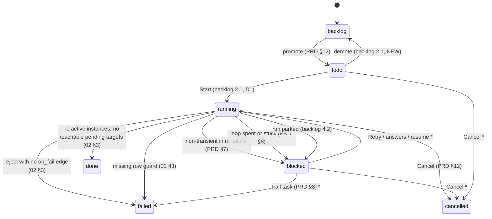
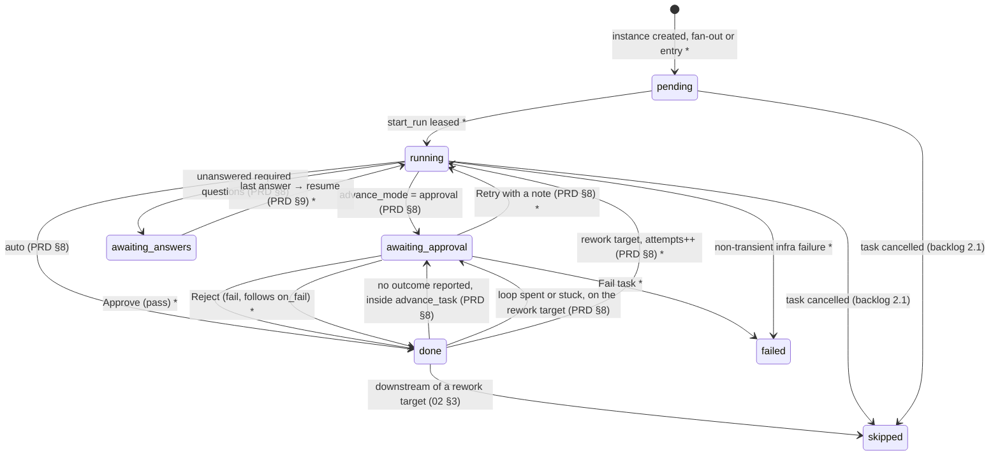
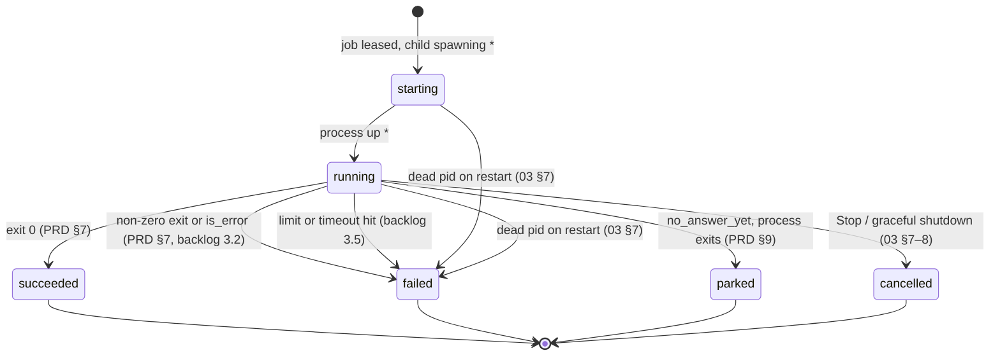
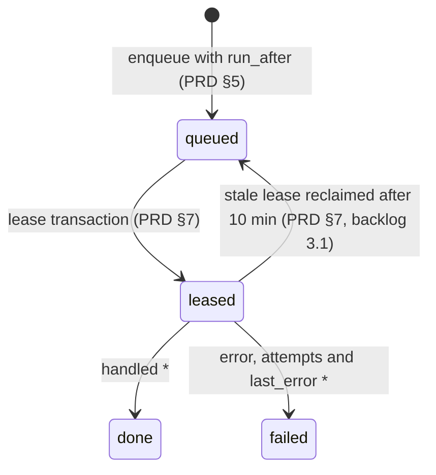

# Execution State Machines

Four state columns move during execution. The value sets come from PRD §5, which draws no transitions. The monitor guide's *"The life of a single step"* does draw a step lifecycle, but in the mockup's own states (pending, queued, running, asking, gate, failed, done); see [[Execution Surfaces]]. The diagrams below are **assembled** in PRD states from the rules in PRD §7–§9, `02` §3, `03` §6–§8 and the backlog. Each edge names its source. Edges marked `*` are *proposals*: no source states them, or a source gives the trigger but not the state that results.

## Task status

`tasks.status`: *"'backlog'|'todo'|'running'|'blocked'|'done'|'failed'|'cancelled'"* (PRD §5).

- `blocked → running` is a proposal: the PRD says what blocks a task but not what status it returns to.
- `failed` after **Fail task** is inferred. PRD §8 says only *"**Fail task** ends it."*
- Cancel from `todo` or `blocked` is inferred from `POST /api/tasks/:id/cancel` (PRD §12), which names no starting status.
- The missing-row guard: *"Guard `getInstance()!` / `defs.find()!` so a missing row fails the task cleanly instead of throwing."* (`02` §3)
- Whether a plain approval gate (not an escalation) sets the task to `blocked` is not stated. The task-detail status bar calls it *"blocked on you"*; its header pill says *"waiting on you"*. See [[Execution Open Questions]] #11.
- **Three failed attempts.** PRD §16 and backlog 10.1 have the task fail after three failed attempts; PRD §8 escalates instead (`blocked`). The diagram follows PRD §8 ([[Execution Open Questions]] #14).
- **Pause** has no status to hold it. Feature map §3 names it (*"**Pause, send back, or cancel**"*); the task-detail guide defines it: *"Stops after the current run rather than mid-flight."*

As built in run-flow (2026-10-23), the flow's own status, `FlowState.status` in `state.json`, is only `running`, `done` or `failed`; there is no `blocked`. Every gate lives on its step, and the flow stays `running` while it waits. The host reports two more states as it exits, without storing them: `paused` (exit 3), a step at a gate with nothing live and no terminal to answer it, and `stopped` (exit 130), a step `running` with no live run after Ctrl+C. Both can be read from `state.json` (Claude's call, 2026-10-23, open to Alex's review; see [[Run Flow Reference#Rules this command settles]]). A flow whose budget is spent is also reported `paused`, with exit 3, but its runs are cut off as by Ctrl+C, so in `state.json` it can look stopped; its spend, against `flow.json`'s `config.budgetUsd`, tells the two apart. The flow ends `failed` only on a person's *Fail the flow*. `backlog`, `todo` and `cancelled` have no counterpart: there is no task, and cancel is on the run-flow plan's Left out list. Whether the worker stores `blocked`, or derives "waiting on you" from the steps at a gate and their gate kinds, is still open.

Full task-level treatment: [[Task Lifecycle]].

## Step instance state

`step_instances.state`: *"'pending'|'running'|'awaiting_answers'|'awaiting_approval'|'done'|'failed'|'skipped'"* (PRD §5).

Notes on the edges:

- **The no-outcome gate fires from `done`.** PRD §8: *"Otherwise mark it `done` and enqueue `advance_task`."* Then, inside `advance_task`: *"If the step has an `on_pass` or `on_fail` edge and the run ended without setting an outcome, set the step instance to `awaiting_approval`"*. Only `advance_mode = approval` goes straight from `running`.
- **Approve and Reject.** The sources give the outcome (*"approve means pass, reject means fail"*, PRD §8) but not the instance state that follows.
- **Fail task and non-transient infra failures.** The sources give the task status (PRD §7 *"put the task into `blocked`"*; PRD §8 *"**Fail task** ends it"*) but not the instance state.
- **Creation, resume, Retry and rework.** PRD §8 says *"create all the target step instances and start them"*, and no source names the state a new instance starts in. A resume, a Retry and a rework each start a new run (PRD §8, §9), but no source says the instance moves to `running`. PRD §9 says only that a parked run *"leaves the step instance in `awaiting_answers`"*.
- **Cancel.** Backlog 2.1: *"Cancel: SIGTERM live runs, cancel pending questions, mark instances skipped."* That covers running instances as well as pending ones.

> [!note] Escalation lands on the target
> *"Set the target step instance to `awaiting_approval` and the task to `blocked`, and show the failing step's last artifact (the error log or review) on the gate."* (PRD §8) The gate sits on the **rework target** (for example `implement`), while the evidence comes from the **failing step** (for example `check`).

- **`failed`** on an instance has no stated trigger. *Proposal:* set when the task fails ([[Execution Open Questions]] #12). As built in run-flow (2026-10-23), only *Fail the flow* sets it; an infra failure leaves its step at a *run failed* gate instead (the run-flow plan).
- **`queued`** is not a PRD state. The monitor and task-detail mockups draw **queued** (*"ready, no free worker"*) as distinct from **pending** (*"not started yet"*). See [[Execution Open Questions]] #13. As built in run-flow (2026-10-23), it is not a step state either: a run waiting for a slot under `--max-runs` is `queued: true` on its run record until the host launches it, while its step is already `running` (Claude's call, 2026-10-23, open to Alex's review).

As built in run-flow (2026-10-23), `InstanceState` is `pending | running | awaiting_approval | done | failed` (`core/src/flow/engine.ts`). There is no `awaiting_answers`, since questions are answered while the run waits and parking is on the run-flow plan's Left out list; the worker's design keeps it. There is no `skipped` either. A step at a gate carries a `gate` of one of three kinds: `verdict` (approval needed, no outcome reported, a fail no route handles, did not write), `escalation` (a spent or stuck loop) or `run_failed` (the run itself failed). The transitions differ from the diagram above:

- The entry step starts `running` at once. A step that a route reaches is created `pending`, and starts `running` once nothing live can still feed it.
- Every gate opens from `running`, the no-outcome gate included, except an escalation, which opens on the rework target from `done`.
- Approve and Reject take a gated step to `done`, with outcome `pass` or `fail`, and fire its routes.
- Retry takes a gated step back to `running`: at the same attempt from a `run_failed` gate, at the next from a verdict or escalation gate.
- A rework takes its target from `done` to `running`, at its next attempt.
- A rework or an escalation deletes every step below its target, in whatever state, and stops their live runs. A step that a route from outside the reset already fed is put back as `pending` (Claude's call, 2026-10-23, open to Alex's review).
- *Fail the flow* marks every `pending`, `running` or `awaiting_approval` step `failed`; nothing else does. An infra failure leaves its step `awaiting_approval` at a `run_failed` gate.
- Ctrl+C, a crash or a spent budget leaves a step `running`; its cut-off run is recorded `interrupted`, and `--resume` starts it again at the same attempt.

## Run state

`runs.state`: *"'starting'|'running'|'parked'|'succeeded'|'failed'|'cancelled'"* (PRD §5).

- **Restart.** *"A `starting`/`running` row whose pid is alive → keep tailing; dead → fail with a Retry hint."* (`03` §7; backlog 3.3 *"reclaim `starting` **and** `running`"*). PRD §7 instead treats *"lost on restart"* as transient and retries it. See [[Execution Open Questions]] #30, #31.
- **Stop.** `03` §8 and backlog 3.4 finalise a stopped run as `cancelled`; the monitor guide records it as failed (*"stopped by you"*). See [[Execution Open Questions]] #27.
- **Shell steps.** PRD §7's completion rule sends any non-zero exit to `failed`, but its shell paragraph says a non-zero exit there *"is a result, not a run failure"*. Which `runs.state` a failing check records is not stated ([[Execution Open Questions]] #57).

A run never restarts. A retry, rework or resume is a **new run** (PRD §7, §8, §9). A superseded run gets `wasted = 1`: *"1 if superseded by a rework loop or an infra retry"* (PRD §5).

As built in run-flow (2026-10-23), a run record (`RunRecord` in `state.json`) has no `state` field, and a retry, rework or `--resume` adds a new record. Its fields map onto `runs.state` this way:

| `runs.state` | run-flow's run record |
|---|---|
| `starting` | `queued: true`, from the run command until the host reports the launch, a wait behind `--max-runs` included (Claude's call, 2026-10-23, open to Alex's review) |
| `running` | `live: true`, no `queued` |
| `succeeded` | `live: false`, no `error`; `outcome` is `pass`, `fail` or absent |
| `failed` | `error` from the run itself: the provider's error, `exit code <n>`, `timed out after <n> minutes`, or a shell setup failure such as `exit code 127: command not found`. Always wasted |
| `cancelled` | `error` set by the engine: `interrupted` (Ctrl+C, a crash or a spent budget; wasted), `superseded` (a rework or escalation; wasted), `stopped` (*Fail the flow*; not wasted), or `not launched` (cut off while still queued; not wasted) |
| `parked` | none: parking is on the run-flow plan's Left out list |

A failing check ends with `outcome: 'fail'` and no `error`: a result, not a run failure, which settles #57 for run-flow. With no worker, a restart is `--resume`, which first stops what the dead host left running (Alex's call, 2026-10-23), then records each run still marked live as `interrupted` and reruns its step at the same attempt. No single run can be stopped by hand.

## Job state

`jobs.state`: *"'queued'|'leased'|'done'|'failed'"* (PRD §5).

The reclaim edge is from PRD §7 (*"with a stale-lease reclaim after 10 minutes"*) and backlog 3.1 (*"stale‑lease reclaim at 10 min"*). What makes a job `failed` rather than re-queued is not stated ([[Execution Open Questions]] #35). See [[Job Queue]].

## Related

- [[Execution Index]]
- [[Execution Entities]]
- [[Task Lifecycle]]
- [[Step Instances And Runs]]
- [[Flow Bar And Step States]]
- [[Execution Open Questions]]
