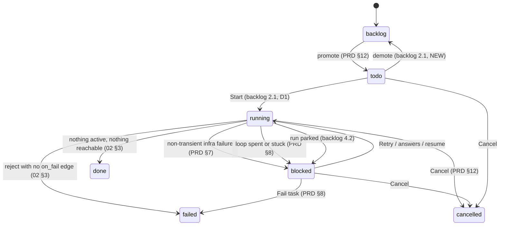
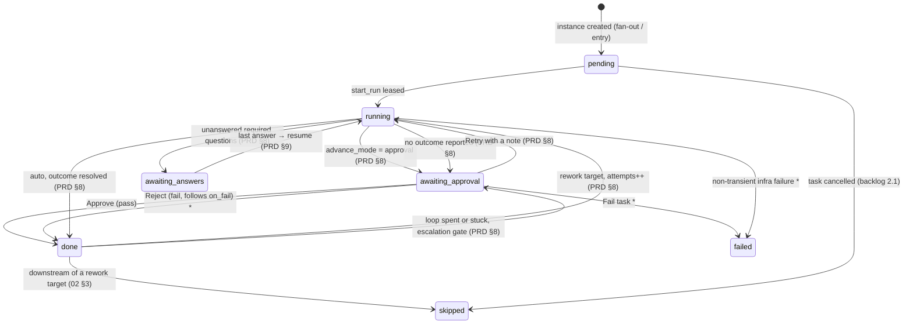
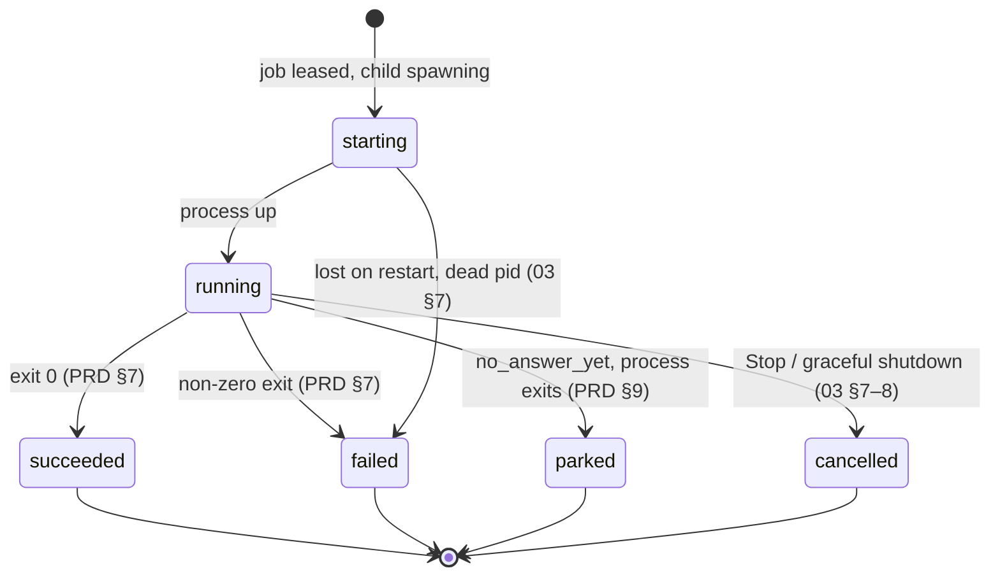
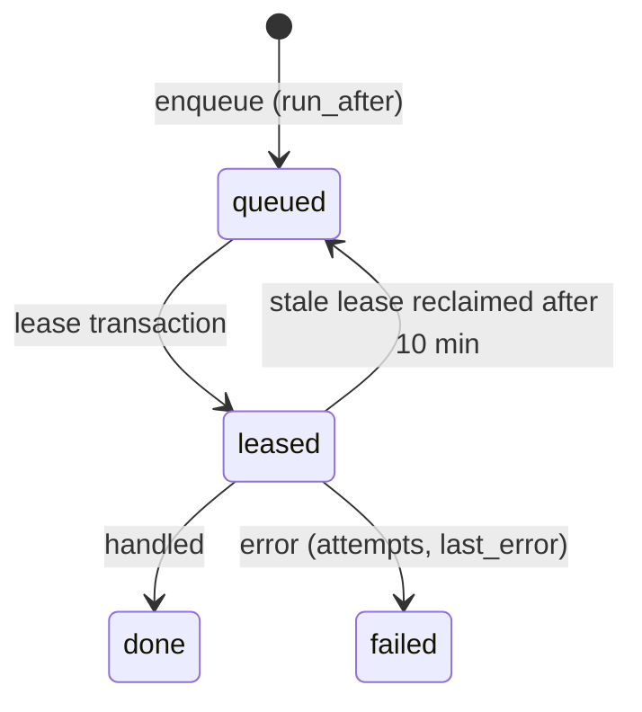

# Execution State Machines

Four state columns move during execution. The value sets come from PRD §5. No source draws the transitions as diagrams; the diagrams below are **assembled** from the rules in PRD §7–§9, `02` §3, `03` §6–§8 and the backlog. Each transition names its source. Transitions no source states are marked *proposal*.

## Task status

`tasks.status`: *"'backlog'|'todo'|'running'|'blocked'|'done'|'failed'|'cancelled'"* (PRD §5).

- `blocked → running` is *proposal*: the PRD says what blocks a task but not what status it returns to.
- Whether a plain approval gate (not an escalation) sets the task to `blocked` is not stated. The task-detail mockup calls it *"blocked on you"*. See [[Execution Open Questions]].
- The task-detail mockup adds **Pause** (*"Stops after the current run rather than mid-flight"*) with no status to hold it.

Full task-level treatment: [[Task Lifecycle]].

## Step instance state

`step_instances.state`: *"'pending'|'running'|'awaiting_answers'|'awaiting_approval'|'done'|'failed'|'skipped'"* (PRD §5).

Transitions marked `*` are *proposals*: the sources give the trigger but not the state the instance lands in. After a Reject, PRD §8 says only that reject *"means fail"*; after Fail task and a non-transient infra failure, it names the task status (`failed`, `blocked`) but not the instance state.

> [!note] Escalation lands on the target
> *"Set the target step instance to `awaiting_approval` and the task to `blocked`, and show the failing step's last artifact (the error log or review) on the gate."* (PRD §8) The gate sits on the **rework target** (for example `implement`), while the evidence comes from the **failing step** (for example `check`).

- **`failed`** on an instance has no stated trigger. *Proposal:* set when the task fails. Listed in open questions.
- **`queued`** is not a PRD state. The monitor and task-detail mockups draw **queued** (*"ready, no free worker"*) as distinct from **pending** (*"not started yet"*). See [[Execution Open Questions]].

## Run state

`runs.state`: *"'starting'|'running'|'parked'|'succeeded'|'failed'|'cancelled'"* (PRD §5).

A run never restarts. A retry, rework or resume is a **new run** (PRD §7, §8, §9). A superseded run gets `wasted = 1`: *"1 if superseded by a rework loop or an infra retry"* (PRD §5).

## Job state

`jobs.state`: *"'queued'|'leased'|'done'|'failed'"* (PRD §5).

The reclaim edge is from *"stale‑lease reclaim at 10 min"* (backlog 3.1). What makes a job `failed` rather than re-queued is not stated. See [[Job Queue]].

## Related

- [[Execution Index]]
- [[Execution Entities]]
- [[Task Lifecycle]]
- [[Step Instances And Runs]]
- [[Flow Bar And Step States]]
- [[Execution Open Questions]]
