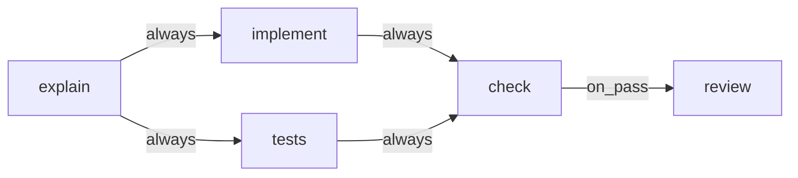

# Fan-Out And Join

How the engine runs branches in parallel and waits for them. Designing these shapes is covered in [[Branching Joining And Loops]].

## The rules

| Rule | Source wording |
|---|---|
| Fan-out | *"If more than one edge fires, create all the target step instances and start them concurrently. This is the fan-out."* (PRD §8) |
| Join (PRD) | *"A step definition with multiple incoming edges is a join: it starts only once every upstream step instance for this task is `done`."* (PRD §8) |
| Join (backlog) | *"Fan‑out creates and starts all targets; join waits for every non‑`on_fail` upstream instance."* (backlog 5.2) |
| Feature map | *"**Run branches in parallel and wait for them** — It starts several branches at once when the recipe fans out, and holds a later step until every branch it depends on is done."* (§4) |

> [!warning] The PRD's join wording is ambiguous
> In the seed flow, `implement` has three incoming edges: `explain → implement` (always), `check → implement` (on_fail) and `review → implement` (on_fail). By PRD §8's definition (*"multiple incoming edges"*) it is a join. In practice the literal rule still works, because it waits on upstream step **instances**, and instances exist only once an edge fires (*"create all the target step instances"*). When `explain` first reaches `implement`, no `check` or `review` instance exists to wait for. Rework then reuses the same `implement` instance (*"increments that step instance's `attempts` and creates a new run"*, PRD §8) rather than going back through the join.
>
> PRD §15 names only `check` as *"the join"*. Backlog 5.2's wording (*"every non‑`on_fail` upstream instance"*) states the intent outright; `02` §2 likewise ignores `on_fail` edges for board layout. See [[Execution Open Questions]] #4.

## In the seeded flow

*"Then `explain → implement` and `explain → tests` (the fan-out). Then `implement → check` and `tests → check` (the join)."* (PRD §15) The edge conditions are assumed `always` (the PRD default) where §15 names none.

Acceptance: *"`implement` and `tests` start at the same time and `review` waits for both"* (PRD §16). Note the PRD's join is `check`; the acceptance list says `review`, which waits on both through `check`.

## Concurrency and the worktree

- Each running branch takes a worker slot. Flow designer guide: *"A fan-out — one step feeding several — means those steps run at the same time, each taking its own worker. It buys wall-clock time at the cost of parallel spend."*
- Branches share one worktree. *"Parallel steps within one task share the task's worktree. If two concurrent steps both write code they will conflict — so the seeded default flow puts the test-writing agent on the same worktree but scoped to `tests/` via its prompt and `allowedTools`. Note this limitation in the README as a known constraint."* (PRD §11)
- The container workspace *"also removes the shared-worktree collision"* (backlog 3.5).

## On the screens

- Board: the card *"sits in the column of the split point and shows a split badge listing the active branches"* (PRD §4).
- Monitor: the flow bar splits a cell (`b∥t`) and the row grows a `⑂2` badge. *"Two lit cells means it fanned out."* (monitor guide). See [[Flow Bar And Step States]].
- Backlog 2.2 asks for a *"split badge with per‑branch cost"*.

## After a rework

When one branch loops back, its sibling's result stands. Monitor guide: *"Tests are not re-run — they already passed, and that result still stands."* The join step downstream of the loop target is reset (*"downstream `done` → `skipped` so they re-instantiate"*, `02` §3) and waits again for both branches. With the backlog rule, a sibling that is still `done` satisfies it immediately.

## Gaps

- **Fan-out mid-flight cancel.** Backlog 5.3 asks for a test of *"cancel mid‑fan‑out"*; no rule says what happens to the other branch when one branch's task is cancelled or fails beyond what Cancel does to all instances.
- **One branch escalates.** If one branch is blocked at an escalation gate, the other keeps running; the task status is `blocked` while a branch is still `running`. Not addressed.
- **A conditional edge into a join that never fires.** The task-done rule must not strand the task. See [[Task Completion]].

## Related

- [[Execution Index]]
- [[Advancement Rules]]
- [[Branching Joining And Loops]]
- [[Worker Slots]]
- [[Seeded Flow Execution]]
