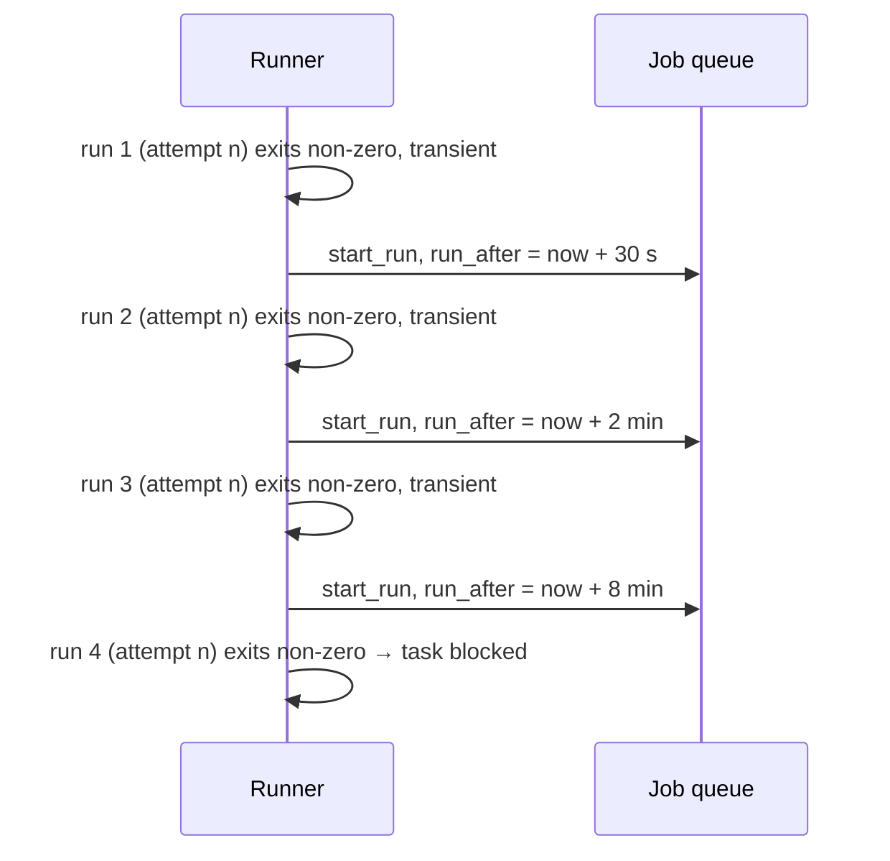

# Infra Retries

What the runner does when an agent process exits non-zero. The engine never sees these: *"Infra failures never reach the engine as attempts (runner retries them)."* (`02` §3)

As built in run-flow (2026-10-23), nothing classifies or retries a failed run: automatic infra retry backoff is on the run-flow plan's Left out list. Every run that ends with an error reaches the engine, which marks it wasted and opens a *run failed* gate on its step, `run failed: <error>`; the gate's `See:` line names the run's log. The gate offers **Retry this step**, the same attempt again, so it uses no attempt, and **Fail the flow** (the run-flow plan). A rate limit therefore holds its step until a person answers, or, with no terminal, pauses the flow with exit 3 once nothing else can run. A worker that retries transient failures by itself would sit in front of that gate. A run stopped at its budget cap waits at the same gate, and once the flow's own budget (`budget_usd`, Alex's call, 2026-10-23) is spent, run-flow also stops the other live runs and pauses the flow, with exit 3, until `--resume` is given a larger budget, or `0` for none.

## The classification

> *"A non-zero exit from an agent run is an **infrastructure failure**, never a verdict on the work, because work verdicts arrive as outcomes. Classify it:*
> - ***Transient** (rate limited, overloaded, network error, process killed by a signal or lost on restart): retry the same attempt automatically, up to 3 times, with backoff of 30 s, 2 min and 8 min. It is a new run with the same `attempt` number. The failed run is marked `wasted = 1` and does **not** count toward `max_attempts`.*
> - ***Anything else**, or a 4th transient failure (budget or turn cap hit, auth error, bad config, unknown): put the task into `blocked`, as before. Retrying these would only burn the same money again."* (PRD §7)

| Class | Examples (PRD §7) | Action | Counts? | Wasted? |
|---|---|---|---|---|
| Transient | rate limited, overloaded, network error, killed by a signal, lost on restart | same attempt again after 30 s / 2 min / 8 min | no | yes |
| Transient, 4th time | — | task `blocked` | — | not stated |
| Anything else | budget or turn cap hit, auth error, bad config, unknown | task `blocked` | — | not stated |

`03` §6 says the same and names the owner: *"**Infra retries are the runner's, not the engine's.** … The engine only ever sees work outcomes, so `max_attempts` counts work, not weather."*

The drawio *Infra-retry classifier* card: *"non-zero agent exit: transient → same attempt again after 30 s / 2 m / 8 m, wasted = 1, not counted · anything else → task blocked"*. Its *Loop layer* concept: *"infra retries stay out of the count"*; its *Cost ledger* card: *"wasted = rework + infra retries"*. Feature map §4: *"**Hiccups don't count** — A rate limit, network blip or crash is retried automatically after a short wait. It doesn't use up a try, but it still shows up in wasted spend."*

As built in run-flow (2026-10-23), the failed run counts as wasted with whatever it cost. An agent run that dies or is stopped before its result keeps its running totals: OpenCode's carry dollars, but a Claude run has tokens and no price yet, so its cost is recorded as unknown (`costUsd: null`, printed `cost unknown`). A stream that dies keeps the last `usage` event's totals.

## The timeline

The `run_after` mechanism is a *proposal*: the PRD gives the backoff but not how it is scheduled. `jobs.run_after` (PRD §5) is the obvious carrier, and PRD §10 already uses it for a delayed job.

## On completion

Backlog 3.2 (**PRD/BUG**): *"Completion: exit 0 → succeeded → §8; non‑zero or `is_error` → failed, stderr tail in `runs.error`, task blocked; **cancel that step's pending questions** (today they keep escalating)."* `04` §9: *"On any run failure, **cancel that step's pending questions** so they stop escalating."*

Backlog 3.2's *"non‑zero … task blocked"* ignores PRD §7's transient class: under PRD §7 a transient non-zero exit is retried, and only *"Anything else, or a 4th transient failure"* blocks the task.

As built in run-flow (2026-10-23), an agent run's questions still open are withdrawn when the run ends, however it ends.

> [!question] Restart: transient or failed?
> PRD §7 lists *"lost on restart"* as transient, so it is retried automatically. `03` §7 and backlog 3.3 say a dead pid on restart → *"fail with a Retry hint"*. See [[Execution Open Questions]] #30 and [[Worker Lifecycle]].

As built in run-flow (2026-10-23), there is no worker to restart. After the host crashes or is stopped, `--resume <run folder>` first stops any agent or check a crashed host left running (Alex's call, 2026-10-23; see [[Worker Lifecycle]]), then records each run still marked live as `interrupted` (wasted) and reruns its step at the same attempt, without a gate; a run the host had not launched yet is `not launched` and not wasted. The worker, which restarts by itself, may still choose otherwise.

## Where the mockups disagree

> [!warning] Failures the mockups count as attempts
> - **Egress denials.** Task-detail guide: Build attempt 1 *"died on an egress denial"* and counts (`↺2`, *"retries 1"*). Inbox (`inbox.html`): *"Attempt 3 of 3 failed — egress denied to api.stripe.com"*. *Inference:* under PRD §7 an egress denial is not a work verdict, so it is never an attempt. Whether it is transient is a judgement call. The list includes *"network error"*, which a refused connection could count as, and then it is retried automatically. Otherwise it is "anything else" and blocks the task. Whether a denial ends the run at all, or only fails one tool call, is not stated either ([[Egress Denials]], [[Sandboxing Open Questions]] #14).
> - **Retry as-is for transients.** The monitor guide's **Retry as-is** is *"For failures that aren't about the network — a flaky test, a rate limit, a transient error."* By PRD §7 a rate limit is retried automatically and never reaches you.
>
> See [[Execution Open Questions]] #22, #23, [[Failures And Retries]] and [[Monitor Open Questions]] #11, #37.

As built in run-flow (2026-10-23), a rate limit does reach you, at a *run failed* gate, whose **Retry this step** works like the mockups' **Retry as-is**.

## Gaps

- **How the runner tells transient from not.** No source lists the exit codes, stderr patterns or stream events it reads ([[Execution Open Questions]] #25). As built in run-flow (2026-10-23), nothing tells them apart: every failed run waits at the same gate.
- **A failure on exit 0.** Backlog 3.2 fails a run on *"non‑zero or `is_error`"*. The classification above is written for a non-zero exit; whether an `is_error` result on exit 0 is classified the same way is not stated ([[Agent Providers Open Questions]] #33). The adapter side is decided: an `is_error` result sets `RunResult.error`, and a set `error` means failed, even at exit 0. run-flow sends such a run to a *run failed* gate like any other.
- **Physical limits.** Backlog 3.5: *"a limit/timeout hit marks the run failed with reason."* PRD §7's lists name *"budget or turn cap hit"* (non-transient) but not a memory, CPU, pid or wall-clock kill. *Inference:* a wall-clock or out-of-memory kill is also a *"process killed by a signal"*, which would make it transient and retried. See [[Execution Open Questions]] #68, [[Resource Limits]] and [[Sandboxing Open Questions]] #15. As built in run-flow (2026-10-23), `timeout_minutes` bounds a run's own time: 30 minutes for a shell step by default, none for an agent step, which its `limits` bound. Its clock stops while one of the run's questions waits for a person (Claude's call, 2026-10-23, open to Alex's review; see [[Run Flow Reference#Rules this command settles]]). A timeout stops the run and opens a *run failed* gate, `run failed: timed out after <n> minutes`. A run killed by a signal from outside lands at the same gate, for example `run failed: killed by SIGKILL` for a check. Neither is retried by itself.
- **Stops.** A Stop or a graceful shutdown is a SIGTERM, so it too reads as *"killed by a signal"* ([[Execution Open Questions]] #55, [[Stopping And Cancelling]]). As built, every provider settles a stop before the result as `{ exitCode: 130, error: 'stopped' }`, which a runner can tell apart from a kill from outside (exit 1); whether a stop is retried is still open ([[Agent Providers Open Questions]] #22). As built in run-flow (2026-10-23), nothing is retried by itself: a run cut off by Ctrl+C, or by a spent flow budget, reruns only on `--resume`, at the same attempt, and a timed-out run waits at a *run failed* gate.
- **Unblocking.** Partly answered. Backlog 3.3 fails a dead run *"with a Retry hint"*, backlog 2.3 puts *"Retry"* in the task sheet, and backlog 5.3 asks for a *"retry after failure"* test. What Retry does on a blocked task (same attempt or the next, counted or not) is not stated. `POST /api/step-instances/:id/retry` (PRD §12) is described only for escalation gates (PRD §8). See [[Execution Open Questions]] #26. As built in run-flow (2026-10-23), Retry at a *run failed* gate reruns the same attempt with the same inputs, and with the note typed there, else the note the attempt started with. It uses no attempt, and the failed run counts as wasted.
- **Shell steps.** The rule is for *"an agent run"*. A shell step's non-zero exit is an outcome. A shell step whose container fails to start is not addressed ([[Execution Open Questions]] #41). As built in run-flow (2026-10-23), a shell step that cannot run its command (exit 126 or 127) or dies by a signal is a setup failure, at a *run failed* gate, not a `fail` (Claude's call, 2026-10-23, open to Alex's review). There is no container to fail to start.

## Related

- [[Execution Index]]
- [[Runner Pipeline]]
- [[Loop Guard And Escalation]]
- [[Worker Lifecycle]]
- [[Failures And Retries]]
- [[Egress Denials]]
- [[Resource Limits]]
