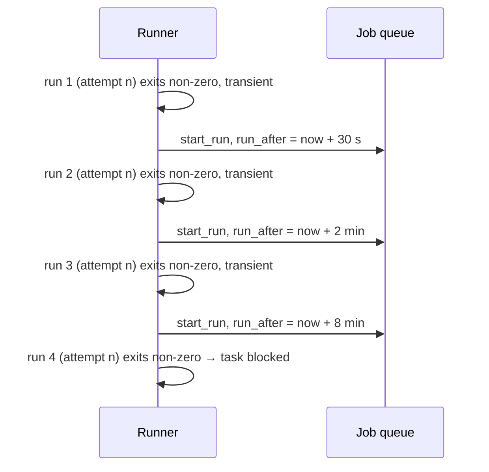

# Infra Retries

What the runner does when an agent process exits non-zero. The engine never sees these: *"Infra failures never reach the engine as attempts (runner retries them)."* (`02` §3)

## The classification

> *"A non-zero exit from an agent run is an **infrastructure failure**, never a verdict on the work, because work verdicts arrive as outcomes. Classify it:*
> - ***Transient** (rate limited, overloaded, network error, process killed by a signal or lost on restart): retry the same attempt automatically, up to 3 times, with backoff of 30 s, 2 min and 8 min. It is a new run with the same `attempt` number. The failed run is marked `wasted = 1` and does **not** count toward `max_attempts`.*
> - ***Anything else**, or a 4th transient failure (budget or turn cap hit, auth error, bad config, unknown): put the task into `blocked`, as before. Retrying these would only burn the same money again."* (PRD §7)

| Class | Examples (PRD §7) | Action | Counts? | Wasted? |
|---|---|---|---|---|
| Transient | rate limited, overloaded, network error, killed by a signal, lost on restart | same attempt again after 30 s / 2 min / 8 min | no | yes |
| Transient, 4th time | — | task `blocked` | — | yes |
| Anything else | budget or turn cap hit, auth error, bad config, unknown | task `blocked` | — | not stated |

The drawio *Infra-retry classifier* card: *"non-zero agent exit: transient → same attempt again after 30 s / 2 m / 8 m, wasted = 1, not counted · anything else → task blocked"*. Feature map §4: *"**Hiccups don't count** — A rate limit, network blip or crash is retried automatically after a short wait. It doesn't use up a try, but it still shows up in wasted spend."*

## The timeline

The `run_after` mechanism is a *proposal*: the PRD gives the backoff but not how it is scheduled. `jobs.run_after` (PRD §5) is the obvious carrier, and PRD §10 already uses it for a delayed job.

## On completion

Backlog 3.2 (**PRD/BUG**): *"Completion: exit 0 → succeeded → §8; non‑zero or `is_error` → failed, stderr tail in `runs.error`, task blocked; **cancel that step's pending questions** (today they keep escalating)."* `04` §9: *"On any run failure, **cancel that step's pending questions** so they stop escalating."*

## Where the mockups disagree

> [!warning] Failures the mockups count as attempts
> - **Egress denials.** Task-detail: Build attempt 1 *"died on an egress denial"* and counts (`↺2`, *"retries 1"*). Inbox: *"Attempt 3 of 3 failed — egress denied to api.stripe.com"*. By PRD §7 an egress denial is neither a work verdict nor in the transient list, so it is "anything else": task `blocked`, not an attempt.
> - **Retry as-is for transients.** The monitor guide's **Retry as-is** is *"For failures that aren't about the network — a flaky test, a rate limit, a transient error."* By PRD §7 a rate limit is retried automatically and never reaches you.
>
> See [[Execution Open Questions]], [[Failures And Retries]] and [[Monitor Open Questions]] #11, #37.

## Gaps

- **How the runner tells transient from not.** No source lists the exit codes, stderr patterns or stream events it reads.
- **Unblocking.** A `blocked` task from a non-transient failure has no stated way back. `POST /api/step-instances/:id/retry` (PRD §12) is described only for escalation gates.
- **Shell steps.** The rule is for *"an agent run"*. A shell step's non-zero exit is an outcome. A shell step whose container fails to start is not addressed.

## Related

- [[Execution Index]]
- [[Runner Pipeline]]
- [[Loop Guard And Escalation]]
- [[Worker Lifecycle]]
- [[Failures And Retries]]
