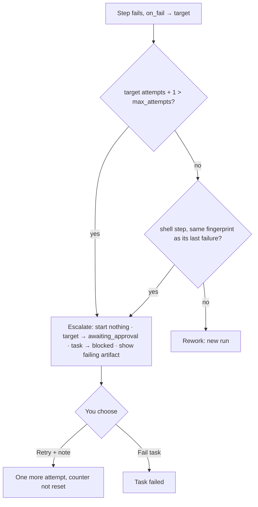

# Loop Guard And Escalation

The cap on rework, and what happens when a loop is spent or stuck. PRD §4: *"**Loops are guarded.** Any step instance that reaches `max_attempts` (default 3) stops looping and hands the task to me with the last error, rather than retrying again or failing silently (§8)."*

## What counts

> *"**`max_attempts` counts total runs of the step, first try included** (infra retries excluded). The default of 3 means one try and two automatic redos."* (PRD §8)

| Rule | Source |
|---|---|
| Default 3 | `step_defs.max_attempts INTEGER NOT NULL DEFAULT 3` (PRD §5) |
| First try counts | *"The first attempt plus two redos."* (feature map §4) |
| One shared budget | *"Every loop that sends work back to the same step draws from the same three, whether the tests failed or the review did."* (feature map §4) |
| Counter on the target | *"counter on the rework *target*, shared by all loops into it"* (`02` §3) |
| Infra retries excluded | *"It doesn't use up a try, but it still shows up in wasted spend."* (feature map §4) |

Backlog decision D3: *"`max_attempts` = total runs incl. the first (default 3); escalate to a gate, never auto-fail"*, with the recommendation column reading *"Decided 2026-10-15; see PRD §8"*.

As built in run-flow (2026-10-23), the counter sits on the rework target and every loop into it shares it (the run-flow plan). Retry at a *run failed* gate reruns the same attempt, with the note typed there, else the note the attempt started with; so an infra failure uses no attempt, though its run counts as wasted. Retry at a verdict gate starts the next attempt, with the note typed there, else the one the attempt started with, so it counts. `max_attempts` on a step that no rework route leads back to is an error, since nothing reads it there: `steps.review.max_attempts: no rework route leads back to review, so nothing reads it`.

> [!question] When does `attempts` count the first run?
> `step_instances.attempts` is `INTEGER NOT NULL DEFAULT 0` (PRD §5), and PRD §8 increments it only on rework (*"increments that step instance's `attempts` and creates a new run"*). For it to count *"total runs of the step, first try included"*, the first run must set it to 1. No source says so. The mockups start every step at `attempts: 1` (`monitor.html`, `task-detail.html`). The check in the diagram below assumes `attempts` already counts the first run. See [[Execution Open Questions]] #66.

> [!check] Answered by run-flow, 2026-10-23
> The first run sets `attempts` to 1, and a rework escalates when `attempts + 1 > max_attempts`, so the default of 3 allows the first run and two reworks (the run-flow plan, Execution #66). See [[Run Flow Reference]].

## When it escalates

> *"**Escalate, don't fail, when a loop is spent or stuck.** Escalate in either of two cases. First, when a rework edge would start a run past `max_attempts`. Second, when a shell step fails with the **same fingerprint** as its previous failed run, because the redo changed nothing. Either way, start nothing. Set the target step instance to `awaiting_approval` and the task to `blocked`, and show the failing step's last artifact (the error log or review) on the gate. I choose: **Retry** grants one more attempt and carries my note into it, like a rejection reason. It does not reset the counter. **Fail task** ends it."* (PRD §8)

The drawio *Loop guard* card: *"attempts counted on the rework target, shared by every loop into it · max_attempts 3 = total runs · same check fingerprint twice → escalate · gate: Retry + note / Fail task"*. Harness concept 6, *Loop layer*: *"Rework edges share one attempt budget, a repeated fingerprint escalates early, infra retries stay out of the count, and a missing outcome is never a pass."*

Feature map §4: *"After a set number, it stops and hands the task to you with the last error, instead of looping forever. You either give it one more try with a note, or fail the task."*

As built in run-flow (2026-10-23), the budget is checked first, then the stuck check. The target waits at an escalation gate, `<target> has used <n> of <max> attempts` or `<step> failed the same way twice`. Its evidence is the failing step's `produces`, less any its failing run did not write, and the gate's `See:` line lists those that exist; a failing step that produces nothing leaves it nothing to show, which `--check` warns about ([[Rework Loop]]).

"Start nothing" goes further in run-flow: the escalation stops and discards everything below the target. Live runs there are stopped and wasted (`error: 'superseded'`) and their steps dropped, since Retry and Fail would both discard them, so no second failure can reach the gate (Claude's call, 2026-10-23, open to Alex's review; see [[Run Flow Reference#Rules this command settles]]).

The choices read **Retry this step** and **Fail the flow**, since run-flow has no task, followed by *Note for the next run (optional)*. Retry reruns the target as its next attempt, past the budget for a spent loop, with its `requires` plus the gate's evidence. It passes the note typed there, else the note of the Reject that escalated, which the gate keeps; a shell step gets the note as `FLOWBOARD_NOTE`.

## Where the escalation lands

- **In the inbox.** The drawio harness concept 8: *"Every stop (gate, question, spent or stuck loop) lands in one inbox, then Slack."* The inbox guide draws a spent loop as a **failure** card: *"A step ran out of attempts. Nothing is running; nothing is being spent."* That card offers no Retry with a note and no Fail task. See [[Failures And Escalated Loops]] and [[Human In The Loop Open Questions]] #24. As built in run-flow (2026-10-23), the escalation lands in the terminal: `-- impl needs a decision`, then the gate's prompt; with no terminal, the flow pauses with exit 3 once nothing else can run. The card's *"Nothing is running"* holds below the target, whose runs the escalation stopped; other branches keep running (the run-flow plan, Execution #49, #50).
- **On the task.** The target instance holds the gate; the evidence is the failing step's last artifact.
- **API.** Retry is `POST /api/step-instances/:id/retry` (PRD §12). Fail task has no endpoint in the PRD. See [[Execution API And Routes]].

## Escalate or fail: the sources disagree

> [!warning] Many sources still say the task fails
> PRD §8, `02` §3, the drawio *Loop guard* card and backlog D3 (decided 2026-10-15) all say **escalate**. These still say **fail**:
>
> | Source | Wording |
> |---|---|
> | PRD §16 acceptance | *"Rejecting a review sends the task back to `implement` as attempt 2, and three failed attempts fail the task"* |
> | Backlog 10.1 | *"Reject → attempt 2; three failures fail the task."* |
> | drawio *FlowBoard ideation* | Card *D3 · max_attempts = attempts allowed*: *"Fail on the 4th (default 3). Loops are guarded."* |
> | Flow designer guide | *Retries*: *"How many attempts before the step gives up and fails the task."* |
> | Monitor guide | *"Retries are capped, then the task fails."*; *"The loop can run a few times before the engine gives up and fails the task outright"* |
> | Task-detail guide | *"After the limit the engine gives up and fails the task rather than looping on your money forever."* |
>
> On the count, the drawio card agrees with PRD §8: *"max_attempts = attempts allowed"*, *"Fail on the 4th (default 3)"* allows three runs and refuses a fourth, as PRD §8 escalates *"when a rework edge would start a run past `max_attempts`"*. The conflict is only fail versus escalate. See [[Execution Open Questions]] #14.
>
> The flow designer's *Retries* field is not `max_attempts` one-to-one: the mockup defaults it to 2 against the PRD's 3. See [[Execution Open Questions]] #15.

As built in run-flow (2026-10-23), a spent loop escalates and never fails by itself; only a person's *Fail the flow* fails a flow (the run-flow plan, Execution #14, #16).

## Retry semantics

- Retry *"does not reset the counter"* (PRD §8). So after a Retry the target is at `max_attempts + 1`; its next failure escalates again at once. *Inferred* from the rule; not stated ([[Execution Open Questions]] #16). As built in run-flow (2026-10-23), that is what happens (the run-flow plan, Execution #14, #16). At a stuck check with attempts left, the Retry's attempt is within the budget, and a later failure escalates again only if it fails the same way or spends the budget.
- PRD §4 and the drawio card *Step def → step instance → run* say rework loops *"create attempt 2, 3, 4"*. With the default of 3, a fourth run comes only from a Retry at the gate or a raised `max_attempts` (inference).
- The monitor and inbox mockups add **Retry as-is** and **Allow host & retry** on a failure card. Allow host & retry *"Adds the blocked host to this step's egress allowlist, then re-queues the run as the next attempt"* (monitor guide). Neither is in the PRD.

## Related

- [[Execution Index]]
- [[Rework Loop]]
- [[Stuck Detection And Fingerprints]]
- [[Failures And Escalated Loops]]
- [[Failures And Retries]]
- [[Attempts And Send Back]]
